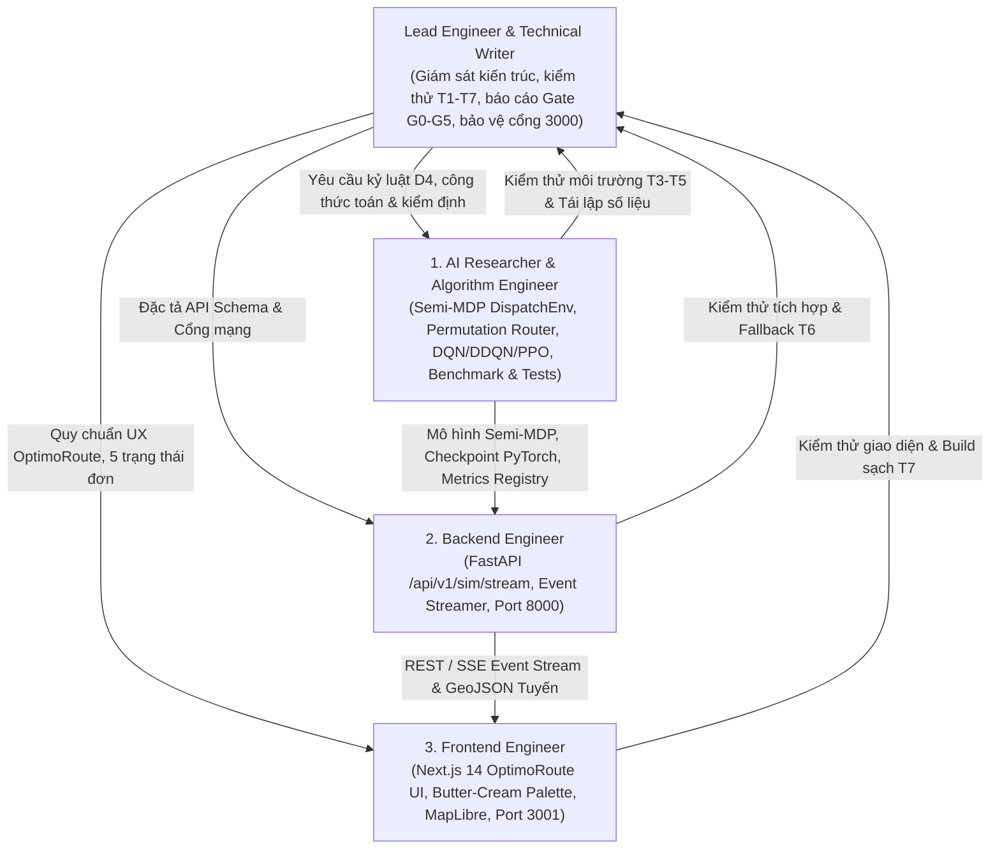

# Cơ Chế Đa Tác Tử (AGENTS.MD) — HotWAY

> **Tài liệu:** Phân công trách nhiệm 4 vai trò chuyên biệt & hợp đồng chuyển giao kỹ thuật  
> **Phiên bản:** v6.1.0 (Real-Time RL Restaurant Dispatch Edition)  
> **Ngày cập nhật:** 24/10/2026  
> **Tài liệu liên quan:** [ARCHITECTURE.md](file:///c:/Users/Asus/Documents/AI/HotWAY/ARCHITECTURE.md) | [TESTING.md](file:///c:/Users/Asus/Documents/AI/HotWAY/TESTING.md)

---

## 1. Cơ Cấu 4 Vai Trò Chuyên Biệt

Để duy trì chất lượng hệ thống và bảo đảm kỷ luật kỹ thuật, dự án phân chia thành 4 vai trò chuyên trách:



---

## 2. Phạm Vi Thư Mục & Trách Nhiệm Từng Vai Trò

| Tên vai trò | Mã định danh | Trách nhiệm cốt lõi | Thư mục sở hữu độc quyền |
|---|---|---|---|
| **AI Researcher & Algorithm Engineer** | `algorithm_engineer` | Xây dựng đồ thị con 12 nút SCC, sinh 401 địa chỉ chuẩn và 151 địa chỉ OOD, triển khai môi trường Gymnasium `RoutingEnv` (GĐ1) và `DispatchEnv` (GĐ2), bộ gom đơn đường vòng và hoán vị vét cạn, huấn luyện DQN, Double DQN, PPO trên PyTorch, tính toán kiểm định Wilcoxon và Holm, đảm bảo đẳng thức Bellman và độ trung thực số liệu T3. | `src/envs/`, `src/routing/`, `src/graph/`, `src/agents/`, `src/baselines/`, `scripts/`, `results/`, `tests/` |
| **Backend Engineer** | `backend_engineer` | Xây dựng REST & Event-Stream API chuẩn `/api/v1/sim/stream`, tích hợp trực tiếp môi trường `DispatchEnv` để phát viễn trắc theo bước thời gian, đóng gói Docker container backend cổng 8000. | `backend/`, `src/services/`, `docker-compose.yml`, `config/site.yaml` |
| **Frontend Engineer** | `frontend_engineer` | Xây dựng giao diện WebGIS 3 cột OptimoRoute với bảng màu butter-cream; hiển thị máy trạng thái đơn hàng 5 pha, lý do quyết định của tác tử, nút bơm đột biến tải và mưa bão, chạy song song 2 kịch bản cùng seed; bảo đảm build TypeScript không lỗi trên cổng 3001. | `frontend/src/app/`, `frontend/src/components/`, `frontend/public/` |
| **Lead Engineer & QA** | `lead_engineer_writer` | Biên soạn và bảo trì chuỗi tài liệu nghiên cứu chuẩn mực (`docs/research/`), giám sát kiểm thử 4 tầng (25 ca kiểm thử T1-T7), bảo đảm tính trung thực khoa học (báo cáo đầy đủ kết quả âm tính), và bảo vệ nguyên vẹn cổng mạng 3000. | `README.md`, `PRD.md`, `ARCHITECTURE.md`, `ALGORITHM.md`, `DESIGN_SYSTEM.md`, `PLAN.md`, `AGENTS.md`, `TESTING.md`, `docs/DECISIONS.md`, `docs/research/` |

---

## 3. Hợp Đồng Chuyển Giao Giữa Các Vai Trò

### 3.1. Hợp đồng giữa Algorithm Engineer và Backend Engineer
- **Giao diện môi trường mô phỏng điều phối:**
```python
from src.envs.dispatch_env import DispatchEnv

env = DispatchEnv(
    matrix_path="data/matrix_standard.npz",
    address_pool_path="data/address_pool_standard.json",
    enable_event_logging=True,
    rain_factor=1.0,
    kitchen_mean_min=12.0,
)
obs, info = env.reset(seed=2026)
next_obs, reward, terminated, truncated, info = env.step(action)
metrics = env.get_metrics()
```
- **Hợp đồng sự kiện truyền phát (Event Payload):**
Mỗi bước nhảy của môi trường sinh ra sự kiện chứa thông tin:
`{event_type: "ORDER_PLACED" | "COOK_START" | "ORDER_READY" | "DISPATCH" | "DELIVERY", timestamp: float, order_id: int, driver_id: int, coordinates: [lat, lon]}`.

### 3.2. Hợp đồng giữa Backend Engineer và Frontend Engineer
- Tất cả API endpoint đều sử dụng tiền tố `/api/v1/`.
- Cổng mạng: Backend hoạt động tại cổng **8000**, Frontend hoạt động tại cổng **3001**. Tuyệt đối cấm sử dụng cổng **3000**.
- Frontend không được phép can thiệp trước khi Gate G5 được Lead Engineer và User nghiệm thu chính thức.
