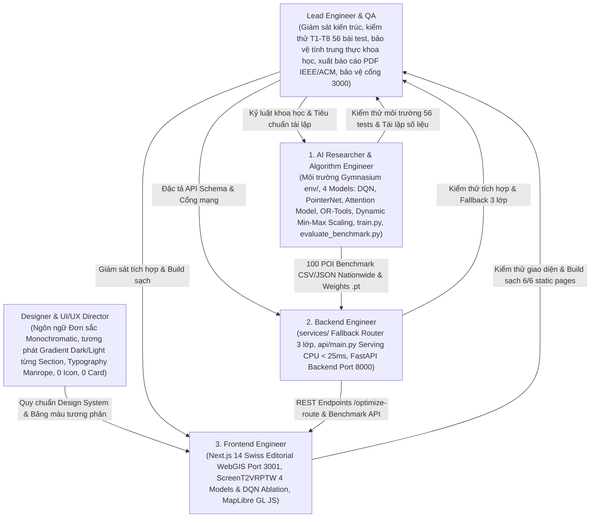

# Cơ Chế Đa Tác Tử (AGENTS.MD) — HotWAY

> **Tài liệu:** Phân công trách nhiệm 5 vai trò chuyên biệt, hợp đồng chuyển giao kỹ thuật & Kỷ luật Sprint 7 ngày nước rút  
> **Phiên bản:** v7.3.1 (Eliminate Hardcoded Regional Biases & Dynamic Min-Max Scaling Edition)  
> **Ngày cập nhật:** 29/10/2026  
> **Tài liệu liên quan:** [ARCHITECTURE.md](file:///c:/Users/Asus/Documents/AI/HotWAY/ARCHITECTURE.md) | [PRD.md](file:///c:/Users/Asus/Documents/AI/HotWAY/PRD.md) | [PLAN.md](file:///c:/Users/Asus/Documents/AI/HotWAY/PLAN.md) | [DESIGN_SYSTEM.md](file:///c:/Users/Asus/Documents/AI/HotWAY/DESIGN_SYSTEM.md)

---

## 1. Cơ Cấu 5 Vai Trò Chuyên Biệt

Để duy trì chất lượng hệ thống, tính trung thực khoa học và ngôn ngữ thẩm mỹ chuyên nghiệp chuẩn trình bày cấp quản lý, dự án thiết lập cơ cấu 5 vai trò chuyên trách:

---

## 2. Phạm Vi Thư Mục & Trách Nhiệm Từng Vai Trò (v7.3.1)

| Tên vai trò | Mã định danh | Trách nhiệm cốt lõi | Thư mục & Tệp sở hữu độc quyền |
|---|---|---|---|
| **Designer & UI/UX Director** | `designer_agent` | Xây dựng ngôn ngữ thẩm mỹ Đơn sắc (Monochromatic) chuẩn Executive, thiết lập nhịp điệu tương phản Gradient giữa các Section (Dark/Light alternating), loại bỏ hoàn toàn board card rườm rà và icon AI, tinh chỉnh typography Manrope chuyên nghiệp, tối giản thanh điều hướng với Menu Dropdown. | `DESIGN_SYSTEM.md`, `frontend/src/app/globals.css`, các token giao diện |
| **AI Researcher & Algorithm Engineer** | `algorithm_engineer` | Xây dựng và duy trì: môi trường `env/traffic_tsp_env.py` (Gymnasium với C(t) và Action Masking); 4 mô hình đối đầu (`models/dqn_agent.py`, `models/pointer_net.py`, `models/attention_model.py`, `models/ortools_solver.py`); triệt tiêu 100% hardcode tọa độ cục bộ bằng **Dynamic Min-Max Scaling per-instance**; công cụ huấn luyện `train.py` (Multi-Scale Curriculum, Cost Perturbation); công cụ đánh giá `evaluate_benchmark.py` trên 100 POI Toàn quốc (Hà Nội 40, Đà Nẵng 20, TP.HCM 40); bóc tách 4 điểm nghẽn tử huyệt của DQN. | `env/`, `models/`, `train.py`, `evaluate_benchmark.py`, `notebooks/`, `results/`, `tests/` |
| **Backend Engineer** | `backend_engineer` | Xây dựng tầng dịch vụ `services/` (TomTom API, HERE, OSRM client, Fallback Router 3 lớp), dịch vụ phục vụ suy luận `api/main.py` trên CPU < 25ms, và backend FastAPI chính tại `backend/app/` trên cổng **8000**. | `services/`, `api/`, `backend/`, `docker-compose.yml`, `config/site.yaml` |
| **Frontend Engineer** | `frontend_engineer` | Hiện thực hóa mã nguồn giao diện Next.js 14 theo sát thiết kế của Designer Agent; hỗ trợ hiển thị màn hình T1/T2/T3, bảng đối soát 4 mô hình và hộp chẩn đoán DQN ablation (`ScreenT2VRPTW.tsx`), bản đồ MapLibre GL JS, thanh menu thu gọn, đảm bảo build TypeScript sạch 100% trên cổng **3001**. | `frontend/src/app/`, `frontend/src/components/`, `frontend/public/` |
| **Lead Engineer & QA** | `lead_engineer_writer` | Biên soạn và bảo trì chuỗi tài liệu nghiên cứu chuẩn mực (`docs/research/`, `PLAN.md`, `PRD.md`, `ARCHITECTURE.md`), giám sát kiểm thử 56 ca kiểm thử tự động, bảo đảm tính trung thực khoa học (bảo đảm số liệu tái lập 100%, không bịa đặt, ghi nhận sự sụt giảm Optimality Gap nhờ Dynamic Min-Max Scaling), xuất bản báo cáo học thuật PDF chuẩn IEEE/ACM và bảo vệ an toàn cổng mạng 3000. | `README.md`, `PRD.md`, `ARCHITECTURE.md`, `ALGORITHM.md`, `PLAN.md`, `AGENTS.md`, `TESTING.md`, `docs/DECISIONS.md`, `docs/research/`, `docs/FINAL_RESEARCH_REPORT.md` |

---

## 3. Hợp Đồng Chuyển Giao Giữa Designer Agent và Frontend Engineer
1. **Bộ quy tắc Không Thẻ Board Card & Không Icon:** Toàn bộ component không sử dụng icon trang trí (`lucide-react`) hay thẻ bo góc lồng nhau dạng AI template. Phân cách bằng nhịp màu Section, đường hairline `border-b` và typography phân cấp.
2. **Nhịp điệu tương phản giữa các Section:** Từng section của Landing Page phải có nền độc lập, luân phiên tương phản giữa Dark (Obsidian / Deep Charcoal với gradient tinh tế) và Light (Pure White / Off-white / Silver).
3. **Thanh Menu Thu Gọn:** Toàn bộ danh sách 6 mục báo cáo (`01 Bối Cảnh` đến `06 Tái Lập`) được gom vào menu xổ xuống (`[Mục Lục ▾]`), giữ cho thanh đỉnh gọn gàng tối đa.
4. **Cổng mạng bắt buộc:** Frontend chạy cổng **3001**, Backend chạy cổng **8000**, Cổng **3000** tuyệt đối cấm dùng.

---

## 4. Kỷ Luật Sprint 7 Ngày Nước Rút (1-Week Sprint to Final Defense)

Để bảo đảm tiến độ báo cáo Hội đồng nghiệm thu trong 7 ngày còn lại, toàn bộ 5 tác tử tuân thủ nghiêm ngặt 5 nguyên tắc:
1. **Bảo toàn 100% Dữ Liệu Thực Nghiệm (Scientific Integrity):** Mọi số liệu trong báo cáo và slide thuyết trình phải đồng bộ tuyệt đối với `results/benchmark_summary_table.csv` và `results/benchmark_multi_model_results.json`. Nghiêm cấm bịa đặt hoặc làm tròn sai lệch số liệu. Bộ dữ liệu thử nghiệm 100 POI phân bố đa vùng trọng điểm: Hà Nội (40), Đà Nẵng (20), TP.HCM (40).
2. **Kỷ Luật Triệt Tiêu Hardcode (Zero-Hardcode Rule):** Tuyệt đối cấm hardcode tọa độ địa lý, bounding box khu vực cụ thể hay giả định mạng lưới địa phương vào mô hình học tăng cường. Mọi không gian đặc trưng phải đi qua Dynamic Min-Max Scaling per-instance về $[0, 1]^2$.
3. **Chế Độ Kiểm Tra Liên Tục (Continuous Verification):** Mọi thay đổi mã nguồn phải vượt qua toàn bộ 56 tests (`python -m pytest tests/`) và biên dịch Next.js 14 sạch (`npm --prefix frontend run build`) trước khi chuyển giao.
4. **Cơ Chế Phục Vụ CPU Tức Thì:** Mô hình Attention Model và OR-Tools phục vụ cục bộ trên CPU máy tính với độ trễ < 25ms; không bắt buộc người chấm phải có GPU chuyên dụng.
5. **Đóng Băng Giao Diện Trước 24 Giờ:** Toàn bộ giao diện WebGIS Demo và Landing Page Report phải được nghiệm thu và đóng băng ít nhất 24 giờ trước thời điểm báo cáo chính thức để tập trung hoàn thiện Slide và Báo cáo PDF.
