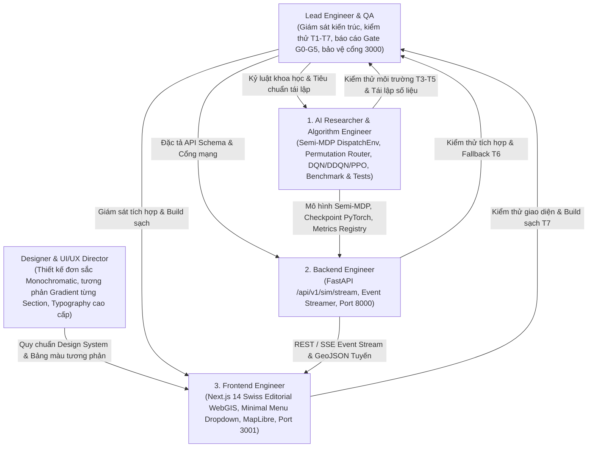

# Cơ Chế Đa Tác Tử (AGENTS.MD) — HotWAY

> **Tài liệu:** Phân công trách nhiệm 5 vai trò chuyên biệt & hợp đồng chuyển giao kỹ thuật  
> **Phiên bản:** v7.0.0 (Executive Monochromatic Routing & WebGIS Edition)  
> **Ngày cập nhật:** 27/10/2026  
> **Tài liệu liên quan:** [ARCHITECTURE.md](file:///c:/Users/Asus/Documents/AI/HotWAY/ARCHITECTURE.md) | [TESTING.md](file:///c:/Users/Asus/Documents/AI/HotWAY/TESTING.md) | [DESIGN_SYSTEM.md](file:///c:/Users/Asus/Documents/AI/HotWAY/DESIGN_SYSTEM.md)

---

## 1. Cơ Cấu 5 Vai Trò Chuyên Biệt

Để duy trì chất lượng hệ thống, tính trung thực khoa học và ngôn ngữ thẩm mỹ chuyên nghiệp chuẩn trình bày cấp quản lý, dự án thiết lập cơ cấu 5 vai trò chuyên trách:

---

## 2. Phạm Vi Thư Mục & Trách Nhiệm Từng Vai Trò

| Tên vai trò | Mã định danh | Trách nhiệm cốt lõi | Thư mục sở hữu độc quyền |
|---|---|---|---|
| **Designer & UI/UX Director** | `designer_agent` | Xây dựng ngôn ngữ thẩm mỹ Đơn sắc (Monochromatic) chuẩn Executive, thiết lập nhịp điệu tương phản Gradient giữa các Section (Dark/Light alternating), loại bỏ hoàn toàn board card rườm rà và icon AI, tinh chỉnh typography chuyên nghiệp, tối giản thanh điều hướng với Menu Dropdown. | `DESIGN_SYSTEM.md`, `frontend/src/app/globals.css`, các token giao diện |
| **AI Researcher & Algorithm Engineer** | `algorithm_engineer` | Xây dựng đồ thị con 12 nút SCC, sinh 401 địa chỉ chuẩn và 151 địa chỉ OOD, triển khai môi trường Gymnasium `RoutingEnv` (GĐ1) và `DispatchEnv` (GĐ2), bộ gom đơn đường vòng và hoán vị vét cạn, huấn luyện DQN, Double DQN, PPO trên PyTorch, tính toán kiểm định Wilcoxon và Holm, đảm bảo đẳng thức Bellman và độ trung thực số liệu T3. | `src/envs/`, `src/routing/`, `src/graph/`, `src/agents/`, `src/baselines/`, `scripts/`, `results/`, `tests/` |
| **Backend Engineer** | `backend_engineer` | Xây dựng REST & Event-Stream API chuẩn `/api/v1/sim/stream`, tích hợp trực tiếp môi trường `DispatchEnv` để phát viễn trắc theo bước thời gian, đóng gói Docker container backend cổng 8000. | `backend/`, `src/services/`, `docker-compose.yml`, `config/site.yaml` |
| **Frontend Engineer** | `frontend_engineer` | Hiện thực hóa mã nguồn giao diện Next.js 14 theo sát thiết kế của Designer Agent; hỗ trợ hiển thị 3 màn hình T1/T2/T3, bản đồ MapLibre GL JS, thanh menu thu gọn, đảm bảo build TypeScript sạch 100% trên cổng 3001. | `frontend/src/app/`, `frontend/src/components/`, `frontend/public/` |
| **Lead Engineer & QA** | `lead_engineer_writer` | Biên soạn và bảo trì chuỗi tài liệu nghiên cứu chuẩn mực (`docs/research/`), giám sát kiểm thử 4 tầng (43 ca kiểm thử tự động), bảo đảm tính trung thực khoa học (báo cáo đầy đủ kết quả âm tính), và bảo vệ nguyên vẹn cổng mạng 3000. | `README.md`, `PRD.md`, `ARCHITECTURE.md`, `ALGORITHM.md`, `PLAN.md`, `AGENTS.md`, `TESTING.md`, `docs/DECISIONS.md`, `docs/research/` |

---

## 3. Hợp Đồng Chuyển Giao Giữa Designer Agent và Frontend Engineer
1. **Bộ quy tắc Không Thẻ Board Card & Không Icon:** Toàn bộ component không sử dụng icon trang trí (`lucide-react`) hay thẻ bo góc lồng nhau dạng AI template. Phân cách bằng nhịp màu Section, đường hairline `border-b` và typography phân cấp.
2. **Nhịp điệu tương phản giữa các Section:** Từng section của Landing Page phải có nền độc lập, luân phiên tương phản giữa Dark (Obsidian / Deep Charcoal với gradient tinh tế) và Light (Pure White / Off-white / Silver).
3. **Thanh Menu Thu Gọn:** Toàn bộ danh sách 6 mục báo cáo (`01 Bối Cảnh` đến `06 Tái Lập`) được gom vào menu xổ xuống (`[Mục Lục ▾]`), giữ cho thanh đỉnh gọn gàng tối đa.
4. **Cổng mạng bắt buộc:** Frontend chạy cổng **3001**, Backend chạy cổng **8000**, Cổng **3000** tuyệt đối cấm dùng.
