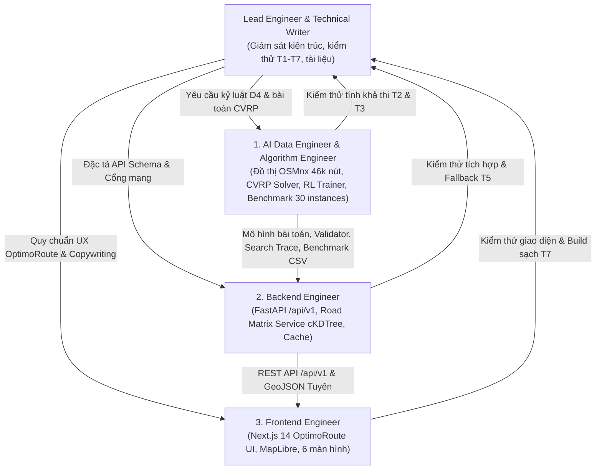

# Cơ Chế Đa Tác Tử (AGENTS.MD) — HotWAY

> **Tài liệu:** Phân công trách nhiệm 4 vai trò chuyên biệt & hợp đồng chuyển giao  
> **Phiên bản:** v5.0.0 (Production Multi-Region & Live Benchmark Edition)  
> **Ngày cập nhật:** 21/10/2026  
> **Tài liệu liên quan:** [ARCHITECTURE.md](file:///c:/Users/TanPhat/Documents/AI_E\HotWAY/ARCHITECTURE.md) | [TESTING.md](file:///c:/Users/TanPhat/Documents/AI_E\HotWAY/TESTING.md)

---

## 1. Cơ Cấu 4 Vai Trò Chuyên Biệt

Để duy trì chất lượng hệ thống và bảo đảm kỷ luật kỹ thuật, dự án phân chia thành 4 vai trò chuyên trách:



---

## 2. Phạm Vi Thư Mục & Trách Nhiệm Từng Vai Trò

| Tên vai trò | Mã định danh | Trách nhiệm cốt lõi | Thư mục sở hữu độc quyền |
|---|---|---|---|
| **AI Data & Algorithm Engineer** | `algorithm_engineer` | Xây dựng đồ thị có hướng SCC TP.HCM (46k nút), tính toán ma trận chi phí bất đối xứng cKDTree, triển khai 4 toán tử Local Search, sinh 30 benchmark instances, huấn luyện DQN/Double DQN PyTorch, và chạy 750 benchmark runs. | `src/data/`, `src/cvrp_solver/`, `src/benchmark/`, `src/rl/`, `notebooks/`, `rel_result/`, `tests/` |
| **Backend Engineer** | `backend_engineer` | Xây dựng REST API chuẩn `/api/v1`, quản lý bộ nhớ đệm ma trận đường bộ theo hash, triển khai cơ chế tự động fallback khi DQN quá hạn, và đóng gói Docker container backend cổng 8000. | `backend/`, `src/services/`, `docker-compose.yml`, `config/site.yaml` |
| **Frontend Engineer** | `frontend_engineer` | Xây dựng giao diện WebGIS 3 cột kiểu OptimoRoute với 6 màn hình chuyên biệt (Đơn hàng, Lập kế hoạch, Chi tiết tuyến, Strategy Lab, Search Replay, Điều phối Live); tích hợp bản đồ MapLibre và bảo đảm build TypeScript không lỗi trên cổng 3001. | `frontend/src/app/`, `frontend/src/components/`, `frontend/public/` |
| **Lead Engineer & QA** | `lead_engineer_writer` | Biên soạn và bảo trì 8 tài liệu kỹ thuật chuẩn mực, giám sát kiểm thử 4 tầng (T1-T7), bảo đảm tính trung thực khoa học, và bảo vệ nguyên vẹn cổng mạng 3000. | `README.md`, `PRD.md`, `ARCHITECTURE.md`, `ALGORITHM.md`, `DESIGN_SYSTEM.md`, `PLAN.md`, `AGENTS.md`, `TESTING.md`, `docs/DECISIONS.md` |

---

## 3. Hợp Đồng Chuyển Giao Giữa Các Vai Trò

### 3.1. Hợp đồng giữa Algorithm Engineer và Backend Engineer
- **Giao diện giải bài toán:**
```python
def solve_cvrp_strategy(
    strategy: str,
    instance: CVRPInstance,
    max_steps: int = 100,
    max_candidates: int = 128,
    leg_geometries: Optional[List[List[List[List[float]]]]] = None,
    t0_c: float = 85.0,
    tenv_c: float = 30.0,
    k_rate: float = 0.020,
    min_temp: float = 60.0,
) -> CVRPSolution: ...
```
- **Hợp đồng kiểm tra tính khả thi:**
```python
def validate_cvrp_solution(
    routes: List[List[int]],
    instance: CVRPInstance,
) -> Tuple[bool, float, str]: ...
```

### 3.2. Hợp đồng giữa Backend Engineer và Frontend Engineer
- Tất cả API endpoint đều sử dụng tiền tố `/api/v1/`.
- Mọi chặng đường trong response `POST /api/v1/plans` phải cung cấp mảng toạ độ `leg_geometries: [[[lat, lon], ...], ...]` để Frontend vẽ trực tiếp lên bản đồ mà không tự ý nội suy.
- Mọi response từ `/api/v1/sim/{plan_id}` bắt buộc gắn nhãn `label: "MÔ PHỎNG"` để hiển thị rõ ràng trên giao diện.
- Bảng nghiệm thu tại Strategy Lab đọc trực tiếp từ `rel_result/summary_by_algorithm.csv` và `rel_result/paired_comparisons.csv`.
