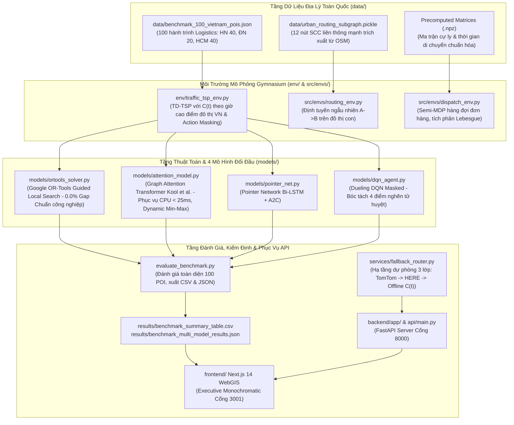

# Bản Thiết Kế Kiến Trúc Hệ Thống (ARCHITECTURE.MD) — HotWAY

> **Tài liệu:** Thiết kế kiến trúc tổng thể, phân rã module, luồng dữ liệu & kiểm định chất lượng  
> **Phiên bản:** v7.3.1 (Eliminate Hardcoded Regional Biases & Dynamic Min-Max Scaling Edition)  
> **Ngày cập nhật:** 29/10/2026  
> **Tài liệu liên quan:** [PRD.md](file:///c:/Users/Asus/Documents/AI/HotWAY/PRD.md) | [ALGORITHM.md](file:///c:/Users/Asus/Documents/AI/HotWAY/ALGORITHM.md) | [DECISIONS.md](file:///c:/Users/Asus/Documents/AI/HotWAY/docs/DECISIONS.md)

---

## 1. Sơ Đồ Khối Kiến Trúc Tổng Thể

---

## 2. Phân Tầng Dữ Liệu, Chuẩn Hóa Động & Đặc Tả Mô Hình

### 2.1. Spatial input normalization
Geographic coordinates are locally projected to a metric plane (equirectangular projection at mean latitude), then scaled by one shared factor for both axes. This preserves shape within the local projection. It does not eliminate distribution shift in road topology, POI density, or unseen regions.

### 2.2. Attention Model and dynamic time state
The Kaggle target configuration is a 128-dimensional, 8-head, 3-layer encoder (741,760 parameters). The decoder context includes graph/depot/current-node embeddings plus cyclic features for the current hour and C(t). Current time advances using the base duration of the traversed edge and traffic at that edge's entry time.

The 64-d/2-layer checkpoint (202,752 parameters) is a historical checkpoint using the old decoder schema. It is not the Gold model and is incompatible with the new time-context projection. New weights count as loaded only after strict schema validation and evaluator confirmation.

### 2.3. Historical benchmark artifact
The values below are retained for traceability. They predate the v2 dynamic-time decoder and PointerNet schema fixes and must not be cited as post-remediation results. The dataset is synthetic, sampled from regional POI pools. OR-Tools is a reference heuristic, not a certified global optimum for dynamic duration.

| Model | Mean duration (min) | Mean distance (km) | Relative gap vs OR-Tools (%) | Mean latency (ms) | Failure (%) | Parameters |
|---|---:|---:|---:|---:|---:|---:|
| Google OR-Tools | 217.72 | 72.71 | 0.00 | 1001.46 | 0.0 | C++ |
| Attention Model | 409.29 | 142.17 | 81.62 | 14.59 | 0.0 | 202,752 (64-d/2L) |
| Pointer Network | 455.60 | 160.71 | 99.49 | 8.85 | 0.0 | 281,601; weights absent |
| Dueling DQN | 342.85 | 116.99 | 107.19 | 2.55 | 50.0 | 310,934; weights absent |

## 3. Kỷ Luật Cổng Mạng & Môi Trường
- **Cổng 8000:** FastAPI Backend (`api/main.py` và `backend/app/main.py`).
- **Cổng 3001:** Next.js 14 Frontend WebGIS.
- **Cổng 3000:** Tuyệt đối cấm sử dụng nhằm bảo vệ cổng mặc định của hệ thống.
- **Môi trường:** Python 3.13, PyTorch CPU, OR-Tools, Next.js 14 (Node.js).
