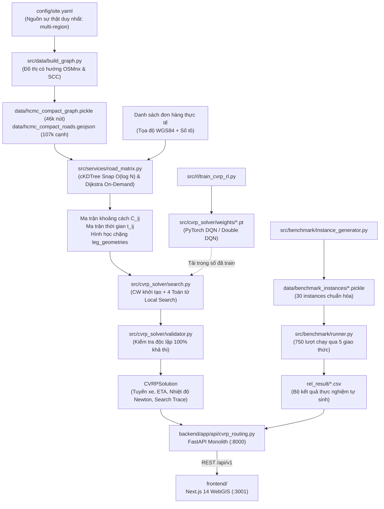

# Bản Thiết Kế Kiến Trúc Hệ Thống (ARCHITECTURE.MD) — HotWAY

> **Tài liệu:** Thiết kế kiến trúc tổng thể, luồng dữ liệu & hợp đồng API  
> **Phiên bản:** v5.0.0 (Production Multi-Region & Live Benchmark Edition)  
> **Ngày cập nhật:** 21/10/2026  
> **Tài liệu liên quan:** [PRD.md](file:///c:/Users/TanPhat/Documents/AI_E/HotWAY/PRD.md) | [ALGORITHM.md](file:///c:/Users/TanPhat/Documents/AI_E/HotWAY/ALGORITHM.md) | [DECISIONS.md](file:///c:/Users/TanPhat/Documents/AI_E/HotWAY/docs/DECISIONS.md)

---

## 1. Sơ Đồ Khối Kiến Trúc Tổng Thể



---

## 2. Luồng Dữ Liệu Xử Lý Đầu Cuối (End-to-End Pipeline)

1. **Khởi tạo đồ thị (`src/data/build_graph.py`):**
   - Đọc cấu hình vùng từ `config/site.yaml`. Hỗ trợ chế độ `hcmc_compact` (bán kính 10km quanh Bếp Trung Tâm) và `binhthanh` (legacy).
   - Tải mạng lưới đường cơ giới `drive` từ OpenStreetMap qua OSMnx, chuẩn hóa hình học cạnh thành toạ độ `[lat, lon]`, bổ sung tốc độ quy chuẩn theo phân cấp đường (motorway: 80km/h $\dots$ residential: 25km/h).
   - Trích xuất thành phần liên thông mạnh lớn nhất (**SCC**) bảo đảm đồ thị liên thông 100% (**46,055 nút**, **107,224 cạnh**, **8,551 km đường**).
2. **Xử lý không gian & Ma trận đường (`src/services/road_matrix.py`):**
   - Xây dựng chỉ mục không gian **cKDTree** chiếu theo hệ tọa độ phẳng cực bộ, cho phép snap bất kỳ tọa độ GPS nào vào nút đường gần nhất trong thời gian $< 0.1\text{ ms}$ (độ phức tạp $O(\log N)$ thay vì quét tuyến tính).
   - Tính toán ma trận chi phí bất đối xứng $C_{ij}$ và $t_{ij}$ bằng thuật toán Dijkstra đơn nguồn (`nx.single_source_dijkstra`) chỉ $n$ lần cho $n$ điểm dừng thay vì $n^2$ lần.
   - Trích xuất mảng hình học chi tiết từng chặng `leg_geometries: [[[lat, lon], ...], ...]` bám sát 100% tim đường thực.
3. **Giải bài toán CVRP & Local Search (`src/cvrp_solver/`):**
   - Khởi tạo nghiệm ban đầu bằng Clarke-Wright Savings trên ma trận bất đối xứng.
   - Vòng lặp cải tiến với 4 toán tử Local Search (`two_opt`, `intra_relocate`, `inter_relocate`, `inter_swap`).
   - Tác tử RL (DQN và Double DQN) sử dụng mạng MLP ($28 \to 128 \to 128 \to 4$) tải trọng số thực tế đã huấn luyện từ `src/cvrp_solver/weights/` để đưa ra quyết định dựa trên vector trạng thái $F28$.
   - Tính toán suy giảm nhiệt độ Newton dọc theo tuyến đường: $T(t) = T_{\text{env}} + (T_0 - T_{\text{env}}) e^{-kt}$.
   - Ghi lại vết tìm kiếm (`search_trace`) phục vụ màn hình Search Replay.
4. **Phục vụ API & Hiển thị (`backend/` & `frontend/`):**
   - FastAPI cung cấp các endpoint chuẩn `/api/v1/scenarios`, `/api/v1/plans`, `/api/v1/strategies/benchmark`, `/api/v1/sim/{plan_id}`.
   - Frontend Next.js hiển thị giao diện 3 cột OptimoRoute, cập nhật tuyến đường và trực quan hoá viễn trắc.

---

## 3. Hợp Đồng API Chuẩn (JSON Schema)

### 3.1. `POST /api/v1/plans`
**Request:**
```json
{
  "scenario_id": "scen_01ca60a1",
  "strategy": "best",
  "max_steps": 100,
  "max_candidates": 128,
  "thermal": {
    "t0_c": 85.0,
    "tenv_c": 30.0,
    "k_rate": 0.020,
    "min_temp": 60.0
  }
}
```

**Response mẫu (trích xuất từ hệ thống đang chạy):**
```json
{
  "plan_id": "plan_cee82463",
  "scenario_id": "scen_01ca60a1",
  "strategy_requested": "best",
  "strategy_used": "double_dqn",
  "fallback": false,
  "fallback_reason": null,
  "runtime_sec": 0.145,
  "metrics": {
    "total_distance_km": 103.73,
    "total_duration_min": 207.5,
    "cw_initial_distance_km": 105.92,
    "improvement_pct": 2.07,
    "vehicles_used": 5,
    "thermal_violations_count": 0,
    "is_feasible": true
  },
  "routes": [
    {
      "vehicle_id": 1,
      "distance_km": 21.48,
      "duration_min": 42.8,
      "total_load": 38,
      "thermal_violations_count": 0,
      "customer_indices": [1, 7, 8, 9],
      "leg_geometries": [[[10.8012, 106.7145], [10.801, 106.715]]]
    }
  ]
}
```

---

## 4. Tiêu Chuẩn Hiệu Năng & Khả Năng Mở Rộng

| Hạng mục | Quy chuẩn v4.0 (Bình Thạnh) | Nâng cấp v5.0 (TP.HCM Production) |
|---|---|---|
| **Quy mô đồ thị** | 38 nút, 84 cạnh | **46,055 nút, 107,224 cạnh** (8,551 km đường) |
| **Snap tọa độ GPS** | Quét tuyến tính $O(N)$ (~5ms) | **cKDTree** $O(\log N)$ ($< 0.1\text{ms}$) |
| **Tính ma trận chi phí** | Dijkstra $N^2$ lần (~2.4s) | **Single-source Dijkstra** $N$ lần (~0.2s) |
| **Số lượng instance** | 1 instance demo tĩnh | **30 instances chuẩn hóa** lưu trữ pickle |
| **Dữ liệu thực nghiệm** | Copy từ PDF có sẵn | **Pipeline tự sinh, 750 runs, tự train weights** |
| **Trọng số mạng Q** | Khởi tạo ngẫu nhiên `randn` | **Trọng số huấn luyện PyTorch** (`.pt` checkpoints) |
| **Kiểm thử tự động** | 6 test case | **15 test cases toàn diện 4 tầng** |
