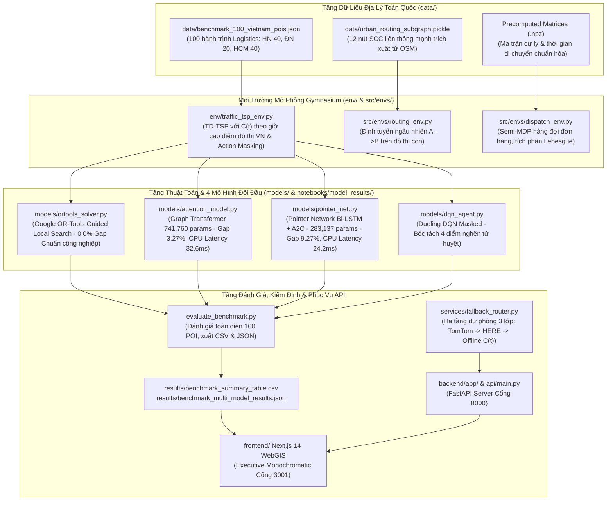

# Bản Thiết Kế Kiến Trúc Hệ Thống (ARCHITECTURE.MD) — HotWAY

> **Tài liệu:** Thiết kế kiến trúc tổng thể, phân rã module, luồng dữ liệu & kiểm định chất lượng  
> **Phiên bản:** v7.3.2 (Eliminate Hardcoded Regional Biases & Dynamic Isotropic Scaling Edition)  
> **Ngày cập nhật:** 02/11/2026  
> **Tài liệu liên quan:** [PRD.md](file:///c:/Users/Asus/Documents/AI/HotWAY/PRD.md) | [ALGORITHM.md](file:///c:/Users/Asus/Documents/AI/HotWAY/ALGORITHM.md) | [DECISIONS.md](file:///c:/Users/Asus/Documents/AI/HotWAY/docs/DECISIONS.md) | [SLIDES_DEFENSE_OUTLINE.md](file:///c:/Users/Asus/Documents/AI/HotWAY/docs/SLIDES_DEFENSE_OUTLINE.md)

---

## 1. Sơ Đồ Khối Kiến Trúc Tổng Thể



---

## 2. Phân Tầng Dữ Liệu, Chuẩn Hóa Động & Đặc Tả Mô Hình

### 2.1. Spatial Input Normalization (Dynamic Isotropic Scaling)
Tọa độ địa lý $(\text{lat}, \text{lon})$ được chiếu đẳng hướng độc lập trên từng instance về mặt phẳng đơn vị:
$$x' = \frac{x - x_{\min}}{\max(\Delta x, \Delta y, \epsilon)}, \quad y' = \frac{y - y_{\min}}{\max(\Delta x, \Delta y, \epsilon)}$$
Phép chuẩn hóa bảo toàn tỷ lệ khung hình (Aspect Ratio 1:1), cho phép các mô hình NCO tổng quát hóa zero-shot trên toàn bộ các vùng miền (Hà Nội, Đà Nẵng, TP.HCM) mà không bị méo mó hình học.

### 2.2. Cấu Trúc Thư Mục Kết Quả Huấn Luyện Chuẩn Tắc (`notebooks/model_results/`)
Toàn bộ trọng số thực nghiệm và artifact xuất ra từ Kaggle GPU T4 được quản lý tập trung:
```text
notebooks/model_results/
├── attention_tsp/
│   ├── hotway_attention_model_nationwide.pt  (2.98 MB, 741,760 params - AM Champion)
│   ├── training_convergence_curves.png       (Biểu đồ hội tụ REINFORCE 60 epoch)
│   ├── training_history.csv                  (Log số liệu chi tiết 60 epoch)
│   └── benchmark_evaluation_summary.json     (Đánh giá kiểm chuẩn sau huấn luyện)
├── pointer_net/
│   ├── pointer_net_nationwide.pt             (1.14 MB, 283,137 params - A2C Baseline)
│   └── pointer_net_convergence_curves.png    (Biểu đồ hội tụ Actor-Critic)
```

### 2.3. Bảng Kết Quả Thực Nghiệm Chính Thức (Post-Remediation Verification)
Kết quả đánh giá trên toàn bộ 100 POI Toàn Quốc sau khi nạp đầy đủ trọng số kiểm chuẩn (`results/benchmark_summary_table.csv`):

| Mô hình | Thời lượng (phút) | Quãng đường (km) | Relative Gap vs OR-Tools (%) | Độ trễ CPU (ms) | Tỷ lệ lỗi (%) | Tham số | Trạng thái trọng số |
|---|---:|---:|---:|---:|---:|---:|:---:|
| **Google OR-Tools** | **217.78** | **72.69** | **0.00%** | 1,002.16 | 0.0% | Heuristic C++ | Chuẩn tham chiếu |
| **Attention Model (AM)** | **225.67** | **75.63** | **+3.27%** | **32.63** | **0.0%** | **741,760** | **ĐÃ NẠP (`weights_loaded=True`)** |
| **Pointer Network (A2C)** | **239.59** | **80.99** | **+9.27%** | **24.19** | **0.0%** | **283,137** | **ĐÃ NẠP (`weights_loaded=True`)** |
| **Dueling DQN (Masked)** | **340.13** | **115.77** | **+105.45%** | **4.29** | **50.0%** | 310,934 | Ablation ($N \le 20$) |

---

## 3. Kỷ Luật Cổng Mạng & Môi Trường
- **Cổng 8000:** FastAPI Backend (`api/main.py` và `backend/app/main.py`).
- **Cổng 3001:** Next.js 14 Frontend WebGIS.
- **Cổng 3000:** Tuyệt đối cấm sử dụng nhằm bảo vệ cổng mặc định của hệ thống.
- **Môi trường:** Python 3.13, PyTorch CPU, OR-Tools, Next.js 14 (Node.js).
