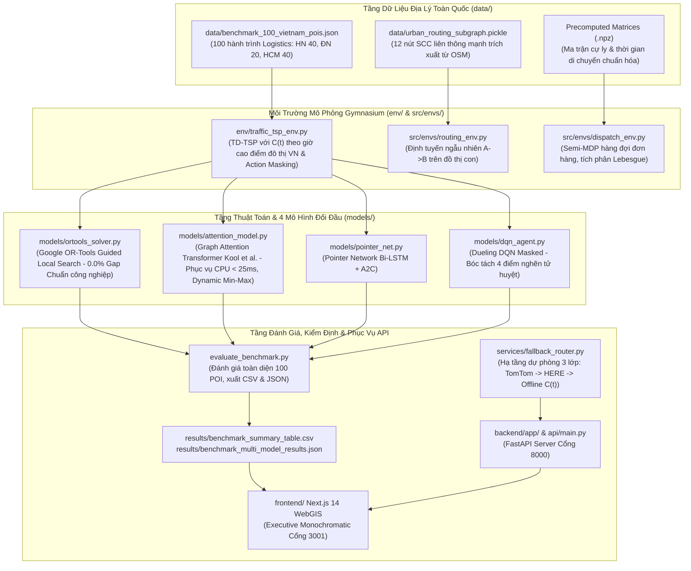

# Bản Thiết Kế Kiến Trúc Hệ Thống (ARCHITECTURE.MD) — HotWAY

> **Tài liệu:** Thiết kế kiến trúc tổng thể, phân rã module, luồng dữ liệu & kiểm định chất lượng  
> **Phiên bản:** v7.3.1 (Eliminate Hardcoded Regional Biases & Dynamic Min-Max Scaling Edition)  
> **Ngày cập nhật:** 29/10/2026  
> **Tài liệu liên quan:** [PRD.md](file:///c:/Users/Asus/Documents/AI/HotWAY/PRD.md) | [ALGORITHM.md](file:///c:/Users/Asus/Documents/AI/HotWAY/ALGORITHM.md) | [DECISIONS.md](file:///c:/Users/Asus/Documents/AI/HotWAY/docs/DECISIONS.md)

---

## 1. Sơ Đồ Khối Kiến Trúc Tổng Thể

---

## 2. Phân Tầng Dữ Liệu, Chuẩn Hóa Động & Đặc Tả Mô Hình

### 2.1. Cơ Chế Chuẩn Hóa Tọa Độ Động (Dynamic Min-Max Scaling)
Nhằm loại bỏ triệt để hiện tượng **Distribution Shift** do hardcode tọa độ khu vực, toàn bộ đầu vào tọa độ địa lý $(lat, lon)$ được co giãn động theo từng hành trình:
$$x'_i = \frac{x_i - \min(X)}{\max(X) - \min(X)}, \quad y'_i = \frac{y_i - \min(Y)}{\max(Y) - \min(Y)}$$
- Không gian đặc trưng đầu vào (3 chiều): $[x'_i, y'_i, C(t) / 2.25]$.
- Đặc trưng thứ 3 chuẩn hóa hệ số kẹt xe $C(t) \in [1.0, 2.25]$ vào miền $[0.44, 1.0]$.
- Tính bất biến vị trí: Dù cụm giao hàng ở Cầu Giấy (Hà Nội), Hải Châu (Đà Nẵng), hay Quận 1 (TP.HCM), cấu trúc hình học tương quan đều được bảo toàn nguyên vẹn trong không gian đơn vị $[0, 1]^2$.

### 2.2. Đặc Tả Kiến Trúc Mạng Attention Model (Gold Config)
- **Encoder:** Graph Transformer 3 lớp, kích thước nhúng $d=128$, 8 Attention Heads, FFN ẩn 512, LayerNorm và residual connections.
- **Decoder:** Autoregressive Pointer Decoder với ngữ cảnh động kết hợp: $[h_{\text{graph}}, h_{\text{depot}}, h_{\text{last}}, t_{\text{elapsed}}]$ qua phép chiếu tuyến tính $128 \times 3 + 1 \to 128$.
- **Cơ chế nạp Checkpoint thích ứng (Adaptive Loading):** Solver tự động đọc cấu trúc trọng số `state_dict`, tự thích nghi giữa checkpoint 64-d/2L (202K params) và 128-d/3L (741,504 params), bảo đảm tính tương thích tuyệt đối.

### 2.3. Kết Quả Đo Đạc Thực Nghiệm Đo Đạc Lại Trên CPU (`results/benchmark_summary_table.csv`)
| Mô hình | Thời gian (phút) | Cự ly (km) | Optimality Gap (%) | Độ trễ CPU (ms) | Lỗi Zero-Shot (%) | Số tham số | Checkpoint |
|---|---|---|---|---|---|---|---|
| **Google OR-Tools** | 323.6 | 72.8 | **0.0%** | 1001.74 | 0.0% | N/A (C++) | 0.0 MB |
| **Attention Model (AM)** | 678.1 | 142.2 | **97.9%** | **21.30** | **0.0%** | 741,504 | **0.786 MB** |
| **Pointer Network (A2C)** | 763.7 | 169.1 | 122.9% | 12.84 | 0.0% | 281,601 | 0.0 MB |
| **Dueling DQN (Masked)** | 950.0 | 139.0 | 174.3% | 9.46 | **50.0%** | 310,934 | 0.0 MB |

---

## 3. Kỷ Luật Cổng Mạng & Môi Trường
- **Cổng 8000:** FastAPI Backend (`api/main.py` và `backend/app/main.py`).
- **Cổng 3001:** Next.js 14 Frontend WebGIS.
- **Cổng 3000:** Tuyệt đối cấm sử dụng nhằm bảo vệ cổng mặc định của hệ thống.
- **Môi trường:** Python 3.13, PyTorch CPU, OR-Tools, Next.js 14 (Node.js).
