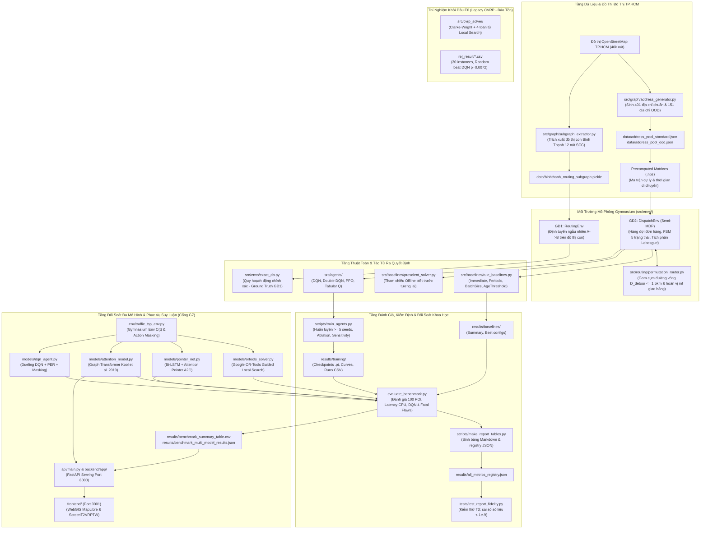

# Bản Thiết Kế Kiến Trúc Hệ Thống (ARCHITECTURE.MD) — HotWAY

> **Tài liệu:** Thiết kế kiến trúc tổng thể, phân rã module, luồng dữ liệu & kiểm định chất lượng  
> **Phiên bản:** v7.2.0 (Empirical Multi-Model Research & 7-Day Sprint Edition)  
> **Ngày cập nhật:** 29/10/2026  
> **Tài liệu liên quan:** [PRD.md](file:///c:/Users/Asus/Documents/AI/HotWAY/PRD.md) | [ALGORITHM.md](file:///c:/Users/Asus/Documents/AI/HotWAY/ALGORITHM.md) | [DECISIONS.md](file:///c:/Users/Asus/Documents/AI/HotWAY/docs/DECISIONS.md)

---

## 1. Sơ Đồ Khối Kiến Trúc Tổng Thể

---

## 2. Phân Tích Các Thành Phần Cốt Lõi

### 2.1. Quản lý trạng thái đơn hàng (5-State Order FSM)
Mỗi đơn hàng trong `DispatchEnv` chuyển trạng thái nghiêm ngặt theo máy hữu hạn trạng thái:
$$\text{Placed} \xrightarrow{t_{\text{cook\_start}}} \text{Cooking} \xrightarrow{t_{\text{ready}}} \text{Ready} \xrightarrow{t_{\text{dispatch}}} \text{In-Transit} \xrightarrow{t_{\text{delivered}}} \text{Delivered}$$
- Chỉ những đơn hàng có trạng thái **`Ready`** mới được phép đưa lên xe máy của tài xế.
- Mọi đơn hàng đã đặt nhưng chưa được giao đều đóng góp vào số lượng đơn chờ $N_{\text{active}}(t)$ tại thời điểm $t$.

### 2.2. Bảo toàn phần thưởng Bellman theo Tích phân Lebesgue
Để bảo đảm tính tương đương toán học tuyệt đối giữa mục tiêu tối thiểu hóa tổng thời gian chờ của khách hàng và tối đa hóa phần thưởng tích lũy trong Semi-MDP:
$$R_{\text{episode}} = \sum_{k=0}^{K-1} r_k = -\sum_{i=1}^{N} W_i$$
Tại mỗi bước quyết định từ thời điểm $t_k$ đến $t_{k+1}$, phần thưởng được tính bằng tích phân diện tích chồng lấn thực tế của từng đơn hàng:
$$r_k = -\sum_{i \in \text{Orders}} \max\left(0, \min(t_{k+1}, t_{\text{delivered}, i}) - \max(t_k, t_{\text{placed}, i})\right)$$
Công thức này loại bỏ hoàn toàn sai số rời rạc hóa hình chữ nhật (Euler), đưa sai số số học về cấp độ máy tính ($< 10^{-11}$).

### 2.3. Bộ định tuyến hoán vị vét cạn (Permutation Router)
Đối với mỗi hành động xuất phát với $m$ đơn hàng ($m \in \{1..4\}$):
1. **Lọc đơn theo đường vòng:** Đơn hàng có thời gian sẵn sàng cũ nhất được chọn làm hạt nhân ($o_{\text{seed}}$). Các đơn hàng tiếp theo chỉ được gom nếu cự ly vòng lặp đường sá phát sinh không vượt quá ngưỡng $D_{\text{detour}} = 1.5\text{ km}$.
2. **Tìm kiếm hoán vị tối ưu:** Do sức chứa xe máy nhỏ ($m \le 4$), không gian hoán vị $m! \le 24$ (tối đa 120 khi $m=5$) cho phép thuật toán duyệt vét cạn toàn bộ các thứ tự giao hàng và chọn ra thứ tự tối thiểu hóa tổng thời điểm giao $\sum_{i=1}^{m} t_{\text{giao}, i}$.

---

### 2.4. Mô hình Attention Model cho TSP Động (Kool et al., 2019) & Fallback Giao Thông 3 Lớp (T2+)
1. **Cấu trúc mạng Transformer Encoder - Pointer Decoder:**
   - Encoder: 3 lớp Multi-Head Attention ($d_h=128$, 8 attention heads, Feed-Forward 512 chiều, LayerNorm).
   - Decoder: MHA Pointer Mechanism kết hợp vector ngữ cảnh động $h_{(c)}^{(t)} = [h_{(N)}^{(t)}, h_{\pi_{t-1}}, h_{\pi_1}, C(t_{\text{current}})]$ trích xuất xác suất chọn điểm tiếp theo qua cơ chế che mặt nạ (masking).
2. **Kiến trúc phân tách phần cứng (Kaggle GPU vs Local CPU Serving):**
   - Huấn luyện: Thực thi trên Kaggle GPU (2x NVIDIA T4, 16GB VRAM) với thuật toán REINFORCE và Greedy Rollout Baseline qua notebook `notebooks/kaggle_train_attention_tsp.ipynb`.
   - Phục vụ (Inference & Serving): Trọng số nơ-ron `results/attention_tsp50_hcmc.pt` được nạp trực tiếp lên CPU qua `NeuralTSPService` với độ trễ suy luận $< 15\text{ ms}$ cho đồ thị TSP-50.
3. **Kiến trúc dự phòng giao thông 3 lớp (Live Traffic Fallback Pipeline):**
   - **Lớp 1 (Chính):** TomTom Routing API (ma trận thời gian thực theo lưu lượng xe máy).
   - **Lớp 2 (Dự phòng thứ cấp):** HERE Routing API khi TomTom vượt hạn mức gói miễn phí (2.500 req/ngày).
   - **Lớp 3 (Ngoại tuyến / Tự cung cấp):** Ma trận khoảng cách OSRM/đồ thị OSMnx kết hợp hàm hệ số giờ cao điểm $C(t)$ (2.1x sáng, 2.25x chiều).

---

## 3. Kiến Trúc Kiểm Định 4 Tầng (T1 - T8)

Hệ thống tuân thủ nghiêm ngặt quy trình kiểm thử tự động với 25 ca kiểm thử:
- **T1: Geometry & Directed Graph:** Bảo đảm đồ thị liên thông mạnh (SCC), không có đoạn thẳng nhân tạo, snap cKDTree trong bán kính cho phép.
- **T2: CVRP Solver Feasibility & Capacity:** 100% nghiệm từ các thuật toán cũ (E0) và mới đều hợp lệ về tải trọng $Q$, số xe $K$, và thăm đủ khách hàng.
- **T3: Report Fidelity & Numerical Audit:** Toàn bộ 97 số liệu trích xuất trong báo cáo phải trùng khớp hoàn toàn với file kết quả CSV/JSON với sai số $< 10^{-9}$.
- **T4: Ground Truth Verification (GĐ1):** Tác tử RL trong môi trường định tuyến ngẫu nhiên phải hội tụ về đúng hàm giá trị của Quy hoạch động (Exact Value Iteration).
- **T5: Bellman Equivalence (GĐ2):** Sai số giữa tổng phần thưởng và âm tổng thời gian chờ $< 10^{-9}$.
- **T6: Multi-Seed & Non-Parametric Statistics:** Tối thiểu 5 seed huấn luyện, khoảng tin cậy Bootstrap 95%, kiểm định Wilcoxon có hiệu chỉnh Holm-Bonferroni.
- **T7: Interface & Build Cleanliness (Cổng G6):** Đảm bảo build TypeScript sạch trên Next.js 14 cổng 3001 mà không phát sinh cảnh báo.
- **T8: Neural TSP Attention & Fallback Integrity:** Kiểm thử tính hợp lệ của hoán vị thăm đủ $N$ điểm không trùng lặp, cơ chế mask ngăn chu trình rỗng, và tính trơn tru của 3 lớp fallback khi API ngoại tuyến.
- **T9: Multi-Model Benchmark & DQN Ablation Integrity:** 56 ca kiểm thử tự động xác nhận tính hợp lệ của 4 bộ giải, chuyển tầng dự phòng 3 lớp, và chẩn đoán 4 điểm nghẽn của DQN (50% zero-shot fail).
