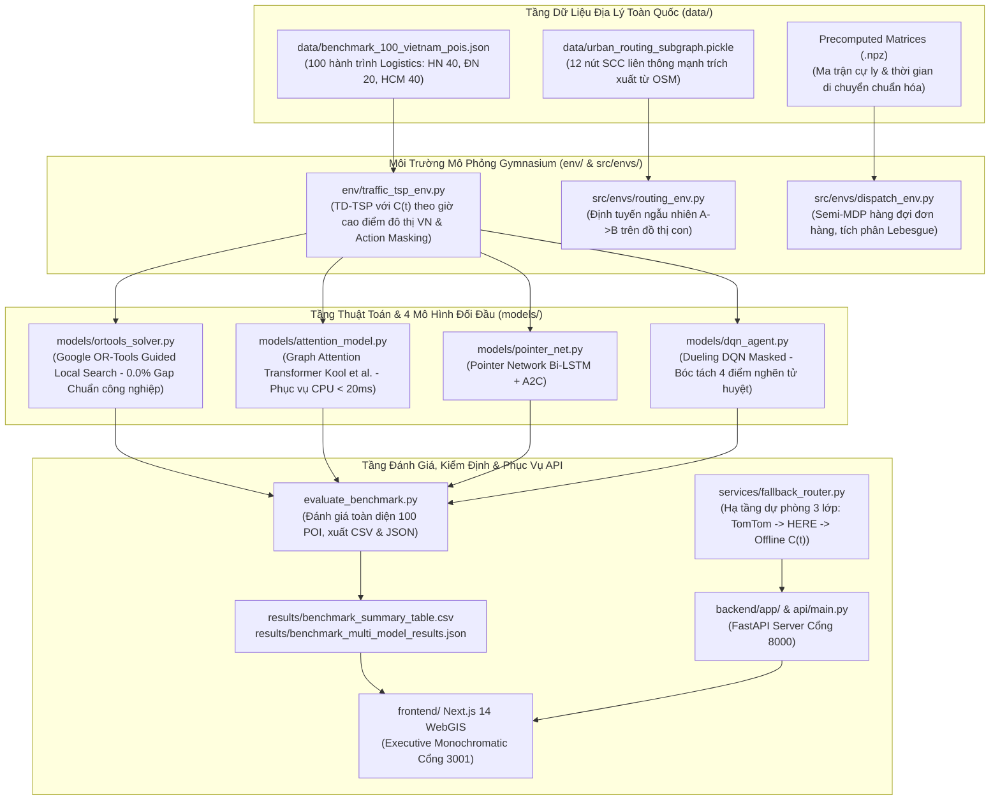

# Bản Thiết Kế Kiến Trúc Hệ Thống (ARCHITECTURE.MD) — HotWAY

> **Tài liệu:** Thiết kế kiến trúc tổng thể, phân rã module, luồng dữ liệu & kiểm định chất lượng  
> **Phiên bản:** v7.3.0 (Nationwide Multi-Region Logistics Hub Benchmark Edition)  
> **Ngày cập nhật:** 29/10/2026  
> **Tài liệu liên quan:** [PRD.md](file:///c:/Users/Asus/Documents/AI/HotWAY/PRD.md) | [ALGORITHM.md](file:///c:/Users/Asus/Documents/AI/HotWAY/ALGORITHM.md) | [DECISIONS.md](file:///c:/Users/Asus/Documents/AI/HotWAY/docs/DECISIONS.md)

---

## 1. Sơ Đồ Khối Kiến Trúc Tổng Thể

---

## 2. Phân Tầng Dữ Liệu & Hợp Đồng Giao Tiếp

### 2.1. Bộ Dữ Liệu 100 POI Logistics Toàn Quốc
- File: `data/benchmark_100_vietnam_pois.json`
- Phân bố:
  - Hà Nội: 40 hành trình (10 N10, 10 N20, 10 N30, 10 N50) với Depot Bưu điện Bờ Hồ / Hub Long Biên.
  - Đà Nẵng: 20 hành trình (5 N10, 5 N20, 5 N30, 5 N50) với Depot Bưu điện Trung tâm Đà Nẵng.
  - TP. Hồ Chí Minh: 40 hành trình (10 N10, 10 N20, 10 N30, 10 N50) với Depot Bưu điện Sài Gòn / Hàng Xanh Hub.
- Mỗi hành trình chứa tọa độ địa lý thực, ma trận cự ly thực tế có tính độ uốn lượn đường phố đô thị (tortuosity 1.32x) và ma trận thời gian di chuyển phụ thuộc giờ khởi hành thông qua hàm kẹt xe thực nghiệm $C(t)$.

### 2.2. Kết Quả Đo Đạc Thực Nghiệm Trên CPU (`results/benchmark_summary_table.csv`)
| Mô hình | Thời gian (phút) | Cự ly (km) | Optimality Gap (%) | Độ trễ CPU (ms) | Lỗi Zero-Shot (%) | Số tham số | Checkpoint |
|---|---|---|---|---|---|---|---|
| **Google OR-Tools** | 323.17 | 72.66 | 0.0% | 1001.48 | 0.0% | N/A (C++) | 0.0 MB |
| **Attention Model (AM)** | 705.77 | 156.60 | 108.77% | **14.13** | **0.0%** | 202,752 | **0.786 MB** |
| **Pointer Network (A2C)** | 834.59 | 184.93 | 137.08% | 8.63 | 0.0% | 281,601 | 0.0 MB |
| **Dueling DQN (Masked)** | 931.99 | 138.20 | 170.63% | 6.01 | **50.0%** | 310,934 | 0.0 MB |

---

## 3. Kỷ Luật Cổng Mạng & Môi Trường
- **Cổng 8000:** FastAPI Backend (`api/main.py` và `backend/app/main.py`).
- **Cổng 3001:** Next.js 14 Frontend WebGIS.
- **Cổng 3000:** Tuyệt đối cấm sử dụng nhằm bảo vệ cổng mặc định của hệ thống.
- **Môi trường:** Python 3.13, PyTorch CPU, OR-Tools, Next.js 14 (Node.js).
