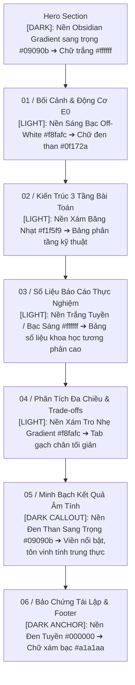

# Hệ Thống Thiết Kế (DESIGN_SYSTEM.MD) — HotWAY

> **Tài liệu:** Quy chuẩn thiết kế giao diện đơn sắc (Monochromatic), tương phản Gradient giữa các Section, Typography Manrope cấp quản lý & Thanh điều hướng tối giản  
> **Phiên bản:** v7.1.0 (Executive High-End Light with Dark Hero & Callout Edition)  
> **Ngày cập nhật:** 27/10/2026  
> **Tác tử phụ trách:** `designer_agent` (Designer & UI/UX Director)  
> **Tài liệu liên quan:** [AGENTS.md](file:///c:/Users/Asus/Documents/AI/HotWAY/AGENTS.md) | [PRD.md](file:///c:/Users/Asus/Documents/AI/HotWAY/PRD.md) | [ARCHITECTURE.md](file:///c:/Users/Asus/Documents/AI/HotWAY/ARCHITECTURE.md)

---

## 1. Triết Lý Thiết Kế: Nền Sáng Chủ Đạo Điểm Xuyết Nền Tối Sang Trọng

Phục vụ bài toán báo cáo cấp Quản lý (Trình Sếp & Hội đồng Giám khảo chuyên môn), HotWAY v7.1.0 định hình phong cách **Monochromatic High-End Editorial**:
1. **Typography Manrope:** Toàn bộ hệ thống sử dụng phông chữ **Manrope** (phông bán hình học cao cấp, hiển thị số liệu đo lường hoàn hảo, dấu tiếng Việt chuẩn xác 100%, tỷ lệ x-height thoáng).
2. **Nhịp điệu tương phản Nền Sáng chủ đạo điểm xuyết Tối (High-End Light with Dark Hero & Callout):**
   - **Hero Section:** Đen than Obsidian sang trọng (`#09090b` ➔ `#18181b`), chữ trắng tuyền, số đo thống kê kích thước lớn tương phản tuyệt đối.
   - **Mục 01 (Bối Cảnh), Mục 02 (Kiến Trúc), Mục 03 (Số Liệu), Mục 04 (Phân Tích):** Sử dụng các dải gradient đơn sắc sáng tinh tế (Trắng tuyền, Bạc sáng, Xám khói zinc `#f8fafc` ➔ `#ffffff` ➔ `#e2e8f0`). Dữ liệu bảng mở dễ đọc, nền sáng dịu mắt cho Giám khảo theo dõi liên tục.
   - **Mục 05 (Minh Bạch Kết Quả Âm Tính):** Điểm xuyết bằng khối Đen than sang trọng (`#09090b`), viền sắc nét, làm nổi bật thông điệp trung thực khoa học — điểm cộng lớn nhất trước Hội đồng Giám khảo.
   - **Mục 06 (Bảo Chứng Tái Lập) & Chân Trang (Footer):** Neo kết thúc trang bằng nền Đen tuyền (`#000000`).
3. **Thanh điều hướng đỉnh thu gọn tối giản (Minimal Top Bar with Dropdown):**
   - Toàn bộ 6 mục báo cáo (`01 Bối Cảnh` đến `06 Tái Lập`) được giấu gọn trong nút xổ xuống `[Mục Lục ▾]`.
   - Khi nhấp chuột, Dropdown phẳng xổ xuống ngay dưới thanh bar với 6 mục có số `01` đến `06`, click vào tự động cuộn mượt và đóng menu.
4. **Không Board Card & Không Icon:** Loại bỏ toàn bộ card bo cong lơ lửng AI và biểu tượng trang trí; sử dụng bảng số liệu mở (Open Tables) theo chuẩn IEEE/ACM với đường hairline thanh mảnh.

---

## 2. Thông Số Chi Tiết Lớp Nền & Bảng Màu Từng Section

| Thứ tự Section | Tên Section | Tone chủ đạo | Lớp nền CSS / Gradient | Màu chữ chính & phụ |
|---|---|---|---|---|
| **00** | **Hero & Executive Summary** | **DARK** | `bg-gradient-to-b from-[#09090b] via-[#121215] to-[#18181b]` | Chữ chính: `#ffffff` Chữ phụ: `#a1a1aa` |
| **01** | **01 / Bối Cảnh & Động Cơ E0** | **LIGHT** | `bg-gradient-to-b from-[#f8fafc] via-[#ffffff] to-[#f1f5f9]` | Chữ chính: `#0f172a` Chữ phụ: `#475569` |
| **02** | **02 / Kiến Trúc 3 Tầng Bài Toán**| **LIGHT** | `bg-gradient-to-b from-[#f1f5f9] via-[#ffffff] to-[#f8fafc]` | Chữ chính: `#0f172a` Chữ phụ: `#475569` |
| **03** | **03 / Số Liệu Thực Nghiệm (T1/T2/T3)**| **LIGHT** | `bg-gradient-to-b from-[#ffffff] via-[#fafafa] to-[#f4f4f5]` | Chữ chính: `#18181b` Chữ phụ: `#52525b` |
| **04** | **04 / Phân Tích Đa Chiều & Trade-offs**| **LIGHT** | `bg-gradient-to-b from-[#f8fafc] via-[#f1f5f9] to-[#e2e8f0]` | Chữ chính: `#0f172a` Chữ phụ: `#475569` |
| **05** | **05 / Minh Bạch Kết Quả Âm Tính**| **DARK CALLOUT**| `bg-[#09090b] border-y border-neutral-800` | Chữ chính: `#ffffff` Điểm nhấn: `#e4e4e7` |
| **06** | **06 / Tái Lập & Footer** | **DARK ANCHOR** | `bg-[#000000] border-t border-neutral-900` | Chữ chính: `#e4e4e7` Chữ phụ: `#71717a` |

---

## 3. Quy Chuẩn Typography Manrope

- **Font Family:** `Manrope, system-ui, -apple-system, sans-serif`
- **Tải phông:** Từ Google Fonts với đầy đủ weights `300, 400, 500, 600, 700, 800` và `subset=vietnamese,latin`.
- **Phân cấp typography:**
  - Tiêu đề Hero (H1): `text-3xl sm:text-4xl lg:text-5xl font-extrabold tracking-tight text-white`
  - Tiêu đề Section (H2): `text-2xl sm:text-3xl font-extrabold tracking-tight`
  - Nhãn số thứ tự: `text-xs font-mono font-bold tracking-widest uppercase`
  - Chỉ số số liệu (Metrics Counter): `text-4xl sm:text-5xl font-extrabold font-mono tracking-tight`
  - Văn bản nội dung (Body): `text-sm sm:text-base leading-relaxed`

---

## 4. Thanh Điều Hướng Đỉnh Thu Gọn (Minimal Top Nav with Dropdown)

- Vị trí: `fixed top-0 left-0 right-0 z-50 backdrop-blur-md bg-white/95 border-b border-neutral-200` (hoặc nền tối khi ở Hero, hoặc thanh nổi bán trong suốt trang nhã).
- Cấu trúc thanh bar:
  - Trái: Logo `HOTWAY` / `v7.1.0`
  - Giữa: Nút dropdown `[Mục Lục ▾]` (khi bấm xổ danh mục phẳng gồm 6 mục có số `01` đến `06`)
  - Phải: Nút `Tải PDF [↓]` và `Mở Demo →`
