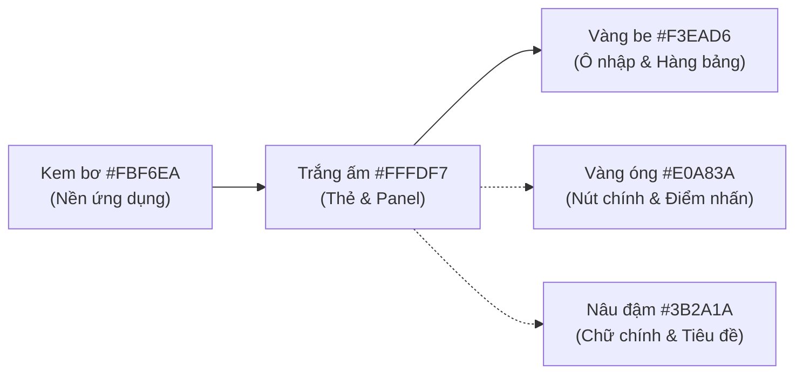

# Hệ Thống Thiết Kế (DESIGN_SYSTEM.MD) — HotWAY

> **Tài liệu:** Quy chuẩn thiết kế giao diện, bảng màu, typography, kiến trúc layout nổi & bản đồ thực địa  
> **Phiên bản:** v5.0.0 (Consumer & Dispatcher Production Edition)  
> **Ngày cập nhật:** 21/10/2026  
> **Tài liệu liên quan:** [PRD.md](file:///c:/Users/TanPhat/Documents/AI_E/HotWAY/PRD.md) | [ARCHITECTURE.md](file:///c:/Users/TanPhat/Documents/AI_E/HotWAY/ARCHITECTURE.md) | [ALGORITHM.md](file:///c:/Users/TanPhat/Documents/AI_E/HotWAY/ALGORITHM.md)

---

## 1. Triết Lý Thiết Kế: Map-First & Floating Panels

HotWAY v5.0.0 loại bỏ hoàn toàn giao diện nền tối 3 cột cứng nhắc mang tính dashboard kỹ thuật nội bộ, chuyển đổi sang kiến trúc **Map-First** hiện đại tương tự các ứng dụng giao vận hàng đầu (Grab, ShopeeFood, Be, Google Maps):

- **Bản đồ là canvas toàn cảnh (100% Viewport):** Bản đồ số thực địa Quận Bình Thạnh và TP.HCM chiếm toàn bộ khung nhìn, liên tục tương tác và phản ánh không gian địa lý trực quan.
- **Mọi phân hệ là lớp nổi (Floating Layers):**
  - **Thanh đỉnh nổi (Top Floating Bar):** Bo tròn góc lớn, chứa nút mở drawer, logo thương hiệu Hàng Gòn Quán, thanh tìm kiếm địa chỉ tự động hoàn thành (debounce 300ms), nút định vị GPS và nút thao tác nhanh "Lập tuyến".
  - **Menu ngăn kéo trượt (Navigation Drawer):** Trượt êm ái từ lề trái (animation 250ms, ease-out), hỗ trợ chế độ ghim cố định trên máy tính (desktop pinned mode) hoặc đóng mở linh hoạt bằng phím Esc / click overlay.
  - **Thanh chuyển phân hệ nổi (Floating Tab Bar):** Nằm gọn gàng phía trên (desktop) hoặc dưới đáy màn hình (mobile) giúp chuyển đổi êm qua 6 màn hình chức năng.
  - **Bảng nội dung trượt (Floating Sheet):** 
    - Desktop: Nằm bên trái, bề rộng 380–440px, hỗ trợ thu gọn thành thanh icon dọc hoặc mở rộng tuỳ ý.
    - Mobile: Bottom sheet với 3 mức kéo (thu nhỏ peek 140px, nửa màn hình 52vh, toàn màn hình 88vh).
- **Bộ nhớ trạng thái giao diện:** Trạng thái đóng/mở và ghim của Drawer / Sheet được lưu tự động trong `localStorage` (bọc kiểm tra ngoại lệ `try/catch`).

---

## 2. Bảng Màu Nhận Diện Ấm Áp (Warm Light Theme)

Loại bỏ toàn bộ nền đen thô cứng. Ứng dụng bảng màu sáng, ấm, thân thiện lấy cảm hứng từ nước dùng thanh ngọt và không gian ấm cúng của quán bánh canh Hàng Gòn:



### 2.1. Màu nền & Bề mặt
| Tên biến Tailwind | Mã màu HEX | Vai trò & Ứng dụng |
|---|---|---|
| `bg-app` | `#FBF6EA` | Nền canvas toàn ứng dụng (sắc kem bơ nhẹ nhàng, dịu mắt) |
| `bg-surface` | `#FFFDF7` | Nền thẻ nổi, thanh bar, panel nội dung và popup bản đồ |
| `bg-sunken` | `#F3EAD6` | Nền ô input, thanh trượt slider, hàng bảng xen kẽ |
| `border-warm` | `#E6D9BC` | Đường viền mảnh 1px mềm mại, không dùng viền đen thô |

### 2.2. Màu chữ & Thương hiệu
| Tên biến Tailwind | Mã màu HEX | Vai trò & Ứng dụng |
|---|---|---|
| `text-primary` | `#3B2A1A` | Chữ chính, tiêu đề, số đo (nâu đậm ấm áp, độ tương phản $\ge 4.5:1$) |
| `text-secondary` | `#8A7355` | Chữ phụ, nhãn đơn vị, chú thích kỹ thuật (nâu nhạt) |
| `brand-gold` | `#E0A83A` | Nút hành động chính (Hover: `#C98F22`, Pressed: `#B07A18`) |
| `brand-gold-soft`| `#FBE9B7` | Nền chip trạng thái, tab đang chọn, huy hiệu số lượng |
| `brand-brown` | `#8B5E34` | Biểu tượng icon, tiêu đề mục, ghim bếp trung tâm |

### 2.3. Màu trạng thái hệ thống
- **Thành công (Đạt nhiệt độ / Khả thi):** `#4E8F5A` (giảm độ bão hòa, hài hòa trên nền sáng).
- **Cảnh báo (Snap > 60m / Chuyển thuật toán):** `#D98A1F`.
- **Nguy hiểm (Nguội < 60°C / Quá tải):** `#C2493D`.

### 2.4. Palette 6 Màu Tuyến Xe (Colorblind-Safe)
Mỗi tuyến xe có đường viền casing trắng 2px bao quanh nét tuyến 3.8px để bảo đảm độ nổi bật tuyệt đối trên nền bản đồ đường phố:
1. **Xe 1:** `#2563eb` (Xanh dương đậm)
2. **Xe 2:** `#d97706` (Vàng hổ phách)
3. **Xe 3:** `#059669` (Xanh ngọc lục bảo)
4. **Xe 4:** `#7c3aed` (Tím hoa cà)
5. **Xe 5:** `#dc2626` (Đỏ gạch)
6. **Xe 6:** `#0891b2` (Xanh mòng két)

---

## 3. Bản Đồ Thực Địa TP.HCM & Kỷ Luật Hình Học D4

### 3.1. Nguồn Dữ Liệu & Giấy Phép Bản Đồ
- **Engine:** MapLibre GL JS v4.x (WebGL/Vector rendering mượt mà).
- **Vector Tile Source:** OpenFreeMap Liberty Style (`https://tiles.openfreemap.org/styles/liberty`), dữ liệu OpenStreetMap toàn cầu có nhãn tiếng Việt chuẩn xác cho đường phố TP.HCM (Quận Bình Thạnh, Quận 1, Quận 2, Phú Nhuận). Giấy phép mã nguồn mở tự do cho mục đích thương mại.
- **Raster Fallback:** Trong trường hợp mất kết nối vector, bản đồ tự động chuyển sang lớp ngói OpenStreetMap Raster (`https://tile.openstreetmap.org/{z}/{x}/{y}.png`).
- **Tâm mặc định:** Depot Hàng Gòn Quán tại `lat: 10.8012, lon: 106.7145`, mức zoom 14.5.

### 3.2. Quy Chuẩn Vẽ Tuyến Đường
- **Cấm đường thẳng nhân tạo:** Không tự ý nội suy đường thẳng giữa các điểm giao. Toàn bộ hình học chặng (`leg_geometries`) được trích xuất từ đường đi ngắn nhất trên đồ thị có hướng OSMnx từ Backend.
- **Đồng bộ hai chiều (Bidirectional Sync):**
  - Bấm chọn đơn hàng trong danh sách $\to$ bản đồ tự động bay tới (`flyTo`) vị trí đơn hàng và mở popup thông tin.
  - Bấm marker trên bản đồ $\to$ dòng đơn hàng trong sheet tương ứng được làm sáng (highlight).
- **Ghim đơn hàng:** Hiển thị số thứ tự chặng giao trong vòng tròn mang màu của tuyến xe tương ứng; popup hiển thị mã đơn, địa chỉ, số tô, ETA và nhiệt độ dự kiến $T(t)$.

### 3.3. Lớp Trừu Tượng Nguồn Vị Trí (Location Provider Abstraction)
Hệ thống thiết kế sẵn giao diện chuẩn cho dữ liệu vị trí:
```typescript
export type LocationSource = 'simulated' | 'device-gps';

export interface LiveLocationUpdate {
  source: LocationSource;
  lat: number;
  lon: number;
  heading?: number;
  speed_kmh?: number;
  accuracy_m?: number;
  vehicle_id?: number;
}
```
- **Vị trí thiết bị thật (`device-gps`):** Được cấp qua `navigator.geolocation` (chấm tròn xanh dương kèm vòng bán kính sai số), chỉ thị vị trí người điều phối hoặc tài xế thực địa.
- **Vị trí mô phỏng (`simulated`):** Mọi chuyển động xe nội suy từ `/api/v1/sim/{plan_id}` bắt buộc gắn nhãn **`MÔ PHỎNG`** để bảo đảm tính trung thực học thuật, không mạo nhận là GPS phần cứng.

---

## 4. Typography & Bo Góc Thân Thiện

- **Font giao diện chính:** `Be Vietnam Pro`, `sans-serif` (hỗ trợ tiếng Việt đầy đủ dấu, phân cấp độ đậm `font-medium`, `font-bold`).
- **Font số đo & mã định danh:** `JetBrains Mono`, `monospace` (dùng cho toạ độ, thời gian ETA, nhiệt độ °C, mã đơn hàng).
- **Bo góc (Border Radius):**
  - Nút bấm, ô nhập, marker: `rounded-xl` ($12\text{px}$).
  - Panel nổi, Sheet nội dung: `rounded-warm` ($16\text{px}$) hoặc `rounded-warm-lg` ($20\text{px}$).
- **Bóng đổ mềm (Soft Tinted Shadows):**
  - `shadow-soft`: `0 4px 20px -2px rgba(59, 42, 26, 0.08)`
  - `shadow-floating`: `0 16px 40px -6px rgba(59, 42, 26, 0.16)`

---

## 5. Quy Chuẩn Soạn Thảo Nội Dung (UI Copywriting)

1. **Độ dài nhãn nút:** $\le 3$ từ (vd: "Lập tuyến", "Nạp mẫu", "Thêm đơn", "Lập lại tuyến", "Về đầu", "Tạm dừng").
2. **Độ dài câu hướng dẫn:** $\le 15$ từ, ngắn gọn, đi thẳng vào trọng tâm kỹ thuật.
3. **Cấm từ ngữ quảng cáo:** Tuyệt đối không dùng các từ ngữ phóng đại: *"tối ưu nhất"*, *"thông minh"*, *"đỉnh cao"*, *"thượng lưu"*.
4. **Tagline chính thức:** *"Tuyến giao hàng ngắn nhất để món còn nóng."* (chỉ xuất hiện ở màn hình trống hoặc thông tin chân drawer, không lặp lại tuỳ tiện).
5. **Không dùng Emoji:** Thay thế toàn bộ bằng bộ icon nét mảnh đồng bộ từ thư viện `lucide-react`.
6. **Xóa bỏ trạng thái hạ tầng ở giao diện chính:** Dòng "Backend :8000 sẵn sàng" đã được dỡ bỏ hoàn toàn; chỉ hiện toast thông báo khi xảy ra sự cố mạng kèm nguyên nhân khách quan.
