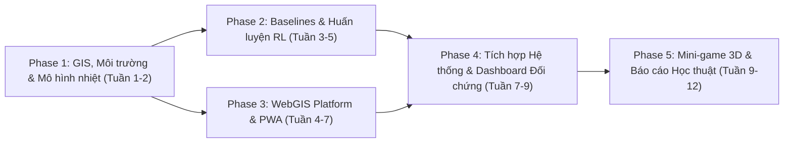

# Project Phases & Milestone Execution — HotWAY

**Tài liệu:** Đặc tả chi tiết các giai đoạn thực hiện dự án HotWAY  
**Chu kỳ triển khai:** 5 Giai đoạn chính (Phases 1–5)  
**Tài liệu tham chiếu:** [PRD.md](file:///c:/Users/TanPhat/Documents/AI_E/HotWAY/PRD.md) | [TECH_ARCHITECTURE.md](file:///c:/Users/TanPhat/Documents/AI_E/HotWAY/TECH_ARCHITECTURE.md) | [PLAN.md](file:///c:/Users/TanPhat/Documents/AI_E/HotWAY/PLAN.md) | [ROADMAP.md](file:///c:/Users/TanPhat/Documents/AI_E/HotWAY/ROADMAP.md)  

---

## Tổng quan các Giai đoạn (Phase Milestones Overview)

---

## Phase 1: Nền tảng Dữ liệu GIS, Mô hình Nhiệt & Môi trường Gymnasium (Tuần 1 – Tuần 2)

### Mục tiêu chính
Thiết lập toàn bộ nền tảng toán học, mạng lưới đồ thị giao thông thực tế của xã Hàng Gòn (Long Khánh, Đồng Nai) và xây dựng môi trường kiểm thử tiêu chuẩn Gymnasium.

### Nhiệm vụ chi tiết
1. **Trích xuất dữ liệu OpenStreetMap (OSMnx):**
   - Tải đồ thị đường bộ dạng `drive` hoặc `all_private=False` cho xã Hàng Gòn và vùng phụ cận.
   - Làm sạch đồ thị: Gộp các nút giao gần nhau (simplify graph), gán nhãn tốc độ tối đa theo quy chuẩn (QL56: 60km/h, đường liên ấp: 30-40km/h, ngõ hẹp: 20km/h).
   - Xác định tọa độ chính xác của Quán Bánh Canh Gà Hàng Gòn trên đồ thị (Depot Node).
2. **Cài đặt Mô hình nhiệt học Newton:**
   - Viết module `newton_cooling.py` với các hàm tính nhiệt độ tức thời, hệ số $k$ theo loại món và loại túi cách nhiệt.
3. **Xây dựng Môi trường Custom Gymnasium (`HangGonDeliveryEnv`):**
   - Định nghĩa `observation_space` (vị trí shipper, vector đơn hàng, thời gian, kẹt xe).
   - Định nghĩa `action_space` với cơ chế Action Masking.
   - Viết logic chuyển trạng thái `step()`, hàm phạt/thưởng đa mục tiêu (nhiệt độ món ăn, thời gian, phạt trễ hạn).
4. **Viết kịch bản sinh dữ liệu giả lập (Traffic & Orders Generator):**
   - Sinh đơn ngẫu nhiên theo phân phối Poisson tập trung tại khu dân cư Hàng Gòn.
   - Giả lập kẹt xe giờ cao điểm tại trục QL56 và ngã ba Suối Tre.

### Tiêu chí Đạt (Exit Criteria)
- [ ] Chạy thành công script `python -m tests.test_env` với 1.000 bước di chuyển ngẫu nhiên (random agent) không phát sinh lỗi hoặc ngoại lệ logic.
- [ ] Môi trường tương thích hoàn toàn với API Gymnasium (`reset()`, `step()`, `render()`).

---

## Phase 2: Cài đặt Baselines & Huấn luyện Mô hình Học Tăng Cường (Tuần 3 – Tuần 5)

### Mục tiêu chính
Cài đặt hoàn chỉnh bộ 3 thuật toán đối chứng (Baselines) và huấn luyện các mô hình RL từ đơn giản đến phức tạp (Q-learning $\to$ DQN $\to$ MaskablePPO), ghi nhận quá trình hội tụ học tập.

### Nhiệm vụ chi tiết
1. **Phát triển bộ giải thuật nền tảng (Baselines Engine):**
   - **Baseline 1:** Dijkstra / A* tìm đường ngắn nhất trên đồ thị OSMnx.
   - **Baseline 2:** Greedy Nearest-Neighbor (luôn chọn giao đơn cho khách gần nhất trước).
   - **Baseline 3:** Google OR-Tools VRP Solver (mô hình quy hoạch nguyên hỗn hợp MIP giải bài toán định tuyến chuẩn có cửa sổ thời gian).
2. **Huấn luyện Mô hình RL Khởi động:**
   - Tabular Q-learning trên lưới đồ thị rút gọn 10 nút quanh quán để chứng minh hội tụ lý thuyết MDP.
   - Xây dựng mạng Deep Q-Network (DQN / Double DQN) cho kịch bản 1 shipper phục vụ từng đơn lẻ.
3. **Huấn luyện Mô hình RL Nâng cao (Gom đơn đa mục tiêu):**
   - Áp dụng MaskablePPO (từ thư viện `sb3-contrib`) cho kịch bản 1 shipper gom 3–5 đơn hàng cùng lúc.
   - Tuning siêu tham số: Learning rate, entropy coefficient, clip range, gamma ($\gamma = 0.99$).
   - Huấn luyện 300.000 – 500.000 timesteps với TensorBoard logger ghi nhận giá trị phần thưởng và nhiệt độ.
4. **Thực hiện Thí nghiệm Bóc tách (Ablation Study):**
   - Run A: Full Reward ($R_{\text{thermal}} + R_{\text{time}} + R_{\text{penalty}}$).
   - Run B: Ablated Reward (loại bỏ hoàn toàn thành phần $R_{\text{thermal}}$, chỉ tối ưu thời gian).
   - So sánh nhiệt độ trung bình của món ăn tại điểm đích giữa hai phiên bản.

### Tiêu chí Đạt (Exit Criteria)
- [ ] Checkpoint mô hình RL (.zip) lưu trữ tại `models/rl_best_model.zip` cho kết quả phần thưởng trung bình vượt trội so với ngẫu nhiên và giải quyết được bài toán gom đơn.
- [ ] Xuất ra bảng dữ liệu CSV so sánh chỉ số của 4 phương pháp (Dijkstra, Greedy, OR-Tools, HotWAY RL).

---

## Phase 3: Nền tảng WebGIS, Backend Monolith & Shipper PWA (Tuần 4 – Tuần 7, song song Phase 2)

### Mục tiêu chính
Xây dựng nền tảng Web nghiệp vụ hoàn chỉnh gồm Backend FastAPI kết nối cơ sở dữ liệu địa không gian PostGIS, bản đồ số trực quan MapLibre GL JS và ứng dụng PWA cho tài xế.

### Nhiệm vụ chi tiết
1. **Thiết lập Backend Monolith & Database:**
   - Cài đặt cấu trúc FastAPI, SQLAlchemy models, Pydantic schemas.
   - Khởi tạo PostgreSQL với PostGIS extension và Redis thông qua `docker-compose.yml`.
   - Seed dữ liệu menu quán bánh canh gà Hàng Gòn (các món ăn, giá tiền, $T_0$, hệ số $k$).
2. **Hệ thống Quản lý Đơn hàng & WebSocket Hub:**
   - Xây dựng API đặt đơn: `POST /api/orders`, ghim tọa độ khách hàng.
   - Xây dựng WebSocket Hub `/ws/dispatcher` và `/ws/tracking/{order_id}` để đẩy dữ liệu thời gian thực.
3. **Giao diện Web Khách hàng & Điều phối Quán (Next.js):**
   - Màn hình đặt món trực quan, tích hợp bản đồ MapLibre GL JS ghim địa chỉ tại Hàng Gòn.
   - Trang quản lý của quán: Danh sách đơn hàng theo trạng thái, nút gán đơn cho shipper.
4. **Ứng dụng Tài xế (Shipper PWA):**
   - Thiết kế PWA tối ưu cho màn hình di động, sử dụng HTML5 Geolocation API để đọc tọa độ GPS thực tế.
   - Có nút chuyển đổi sang "Giả lập GPS" (Mock GPS) tự động chạy dọc tuyến đường để phục vụ thử nghiệm và demo.

### Tiêu chí Đạt (Exit Criteria)
- [ ] Luồng đặt hàng thành công từ giao diện web, lưu đơn vào CSDL và phát sự kiện sang WebSocket.
- [ ] Tài xế di chuyển trên PWA, bản đồ của khách hàng và quán lập tức cập nhật vị trí xe máy và thanh nhiệt độ món ăn.

---

## Phase 4: Tích hợp Động cơ RL, Dashboard So sánh & Chế độ Simulation (Tuần 7 – Tuần 9)

### Mục tiêu chính
Kết nối mô hình RL đã huấn luyện tại Phase 2 vào dịch vụ Dispatching của Backend FastAPI, xây dựng màn hình đối chứng trực quan RL vs Baselines và kích hoạt chế độ giả lập nhiều shipper ảo.

### Nhiệm vụ chi tiết
1. **Đóng gói Dịch vụ Suy luận RL (Inference Service):**
   - Viết wrapper tải trọng số mô hình `MaskablePPO` lên bộ nhớ FastAPI khi khởi động server.
   - Tạo endpoint `POST /api/dispatch/plan-route` nhận trạng thái đơn và trả về thứ tự giao tối ưu trong $< 20\,\text{ms}$.
2. **Xây dựng Academic Comparison Dashboard:**
   - Màn hình chuyên dụng cho hội đồng đánh giá: Hiển thị 2 bản đồ song song (Split Map):
     - Bên trái: Lộ trình và chỉ số của thuật toán Cổ điển (Dijkstra / OR-Tools).
     - Bên phải: Lộ trình và chỉ số của thuật toán HotWAY RL (tối ưu hóa nhiệt độ).
   - Biểu đồ thanh đối chiếu trực tiếp: Nhiệt độ món lúc đến, Tổng thời gian, Tỷ lệ trễ hẹn.
3. **Xây dựng Chế độ Mô phỏng Đám đông (Simulation Mode):**
   - Nút bấm kích hoạt: "Sinh 5 shipper ảo & 20 đơn ngẫu nhiên tại Hàng Gòn".
   - Hệ thống tự động phân bổ và mô phỏng xe chạy theo thời gian thực (real-time accelerated animation) bằng deck.gl.

### Tiêu chí Đạt (Exit Criteria)
- [ ] Dashboard chạy demo trực tiếp không gặp lỗi mạng, cho phép chuyển đổi thuật toán ngay trên giao diện chỉ bằng 1 cú nhấp chuột.
- [ ] Chứng minh rõ ràng trường hợp kẹt xe: RL linh hoạt chọn đường vòng thoáng hơn để đưa món đến sớm hơn và nhiệt độ cao hơn 5–8°C so với Dijkstra đi vào nút nghẽn.

---

## Phase 5: Mini-game 3D HotWAY Rider, Báo cáo Học thuật & Nghiệm thu (Tuần 9 – Tuần 12)

### Mục tiêu chính
Xây dựng mini-game đua xe máy 3D với AI Ghost trên nền Three.js, hoàn thiện báo cáo đồ án chuẩn khoa học, quay video minh họa và diễn tập bảo vệ đề tài.

### Nhiệm vụ chi tiết
1. **Phát triển Mini-game 3D "HotWAY Rider":**
   - Tạo mesh đường phố 3D và các khối nhà low-poly xung quanh khu vực Hàng Gòn từ dữ liệu OSM GeoJSON.
   - Điều khiển xe máy người chơi bằng phím WASD / phím mũi tên với cơ chế vật lý va chạm bằng `@react-three/rapier`.
   - Đọc dữ liệu trajectory của RL Agent để render xe máy "Bóng ma AI" (Ghost Rider) màu xanh neon chạy song song.
   - Giao diện HUD: Đồng hồ tốc độ, đồng hồ nhiệt độ tô bánh canh gà đang giảm dần theo thời gian thực.
   - Bảng xếp hạng điểm số (Leaderboard) và tặng mã voucher giảm giá thật của quán nếu người chơi thắng AI.
2. **Biên soạn Báo cáo Đồ án (Academic Thesis & Report):**
   - Soạn thảo báo cáo chi tiết theo chuẩn học thuật (LaTeX): Bối cảnh, Cơ sở lý thuyết MDP, Định luật Newton, Phân tích kiến trúc, Kết quả thực nghiệm và Thảo luận.
   - Đính kèm toàn bộ biểu đồ TensorBoard và bảng so sánh định lượng.
3. **Quay Video Demo & Hoàn thiện Slide Báo cáo:**
   - Quay video demo 3–5 phút chất lượng cao giới thiệu đầy đủ luồng đặt hàng, dashboard so sánh và mini-game 3D.
   - Diễn tập thuyết trình thử nghiệm và giải đáp các câu hỏi phản biện của hội đồng.

### Tiêu chí Đạt (Exit Criteria)
- [ ] Mini-game 3D chạy mượt trên trình duyệt với tốc độ $\ge 30\,\text{FPS}$.
- [ ] Hoàn thành toàn văn báo cáo đồ án, mã nguồn đẩy lên GitHub có README hướng dẫn chạy Docker 1 dòng lệnh.
