# Project Execution Plan — HotWAY

**Tên dự án:** HotWAY (Dynamic Thermal-Aware Food Delivery Optimization)  
**Phạm vi:** Đồ án Môn học Học Tăng Cường & Ứng dụng Thực nghiệm  
**Thời lượng thực hiện:** 12 Tuần (~3 tháng)  
**Tài liệu liên kết:** [PRD.md](file:///c:/Users/TanPhat/Documents/AI_E/HotWAY/PRD.md) | [TECH_ARCHITECTURE.md](file:///c:/Users/TanPhat/Documents/AI_E/HotWAY/TECH_ARCHITECTURE.md) | [PHASES.md](file:///c:/Users/TanPhat/Documents/AI_E/HotWAY/PHASES.md) | [ROADMAP.md](file:///c:/Users/TanPhat/Documents/AI_E/HotWAY/ROADMAP.md)  

---

## 1. Cơ cấu Phân chia Công việc (Work Breakdown Structure — WBS)

Dự án phân bổ trọng tâm theo tỷ lệ công số chiến lược: **60% Học Tăng Cường & Thuật toán**, **25% Nền tảng WebGIS & Real-time**, **15% Mini-game 3D & Báo cáo học thuật**.

```mermaid
graph TD
    WBS["Dự án HotWAY"]
    
    WBS --> W1["1. Module Học Tăng Cường (RL Core - 60%)"]
    W1 --> W11["1.1 Thu thập & Tiền xử lý GIS Hàng Gòn (OSMnx)"]
    W1 --> W12["1.2 Xây dựng Custom Gymnasium Env & Mô hình nhiệt Newton"]
    W1 --> W13["1.3 Cài đặt bộ 3 thuật toán Baseline (Dijkstra, Greedy, OR-Tools)"]
    W1 --> W14["1.4 Huấn luyện RL: Tabular Q-Learning & DQN (1 shipper, 1 đơn)"]
    W1 --> W15["1.5 Huấn luyện RL mở rộng: MaskablePPO (Gom nhiều đơn)"]
    W1 --> W16["1.6 Đánh giá khoa học: Ablation study & Learning Curves"]

    WBS --> W2["2. Nền tảng WebGIS & Real-time Platform (25%)"]
    W2 --> W21["2.1 Xây dựng Backend Monolith FastAPI & PostGIS"]
    W2 --> W22["2.2 Xây dựng WebSocket Hub & Quản lý vị trí Shipper (Redis)"]
    W2 --> W23["2.3 Giao diện Khách hàng & Ghim bản đồ (Next.js + MapLibre)"]
    W2 --> W24["2.4 Ứng dụng Shipper PWA thu thập GPS"]
    W2 --> W25["2.5 Dashboard đối chứng RL vs Baseline thời gian thực"]

    WBS --> W3["3. Mini-game 3D & Báo cáo Tổng kết (15%)"]
    W3 --> W31["3.1 Dựng mô hình 3D đường phố Hàng Gòn từ OSM (Three.js/R3F)"]
    W3 --> W32["3.2 Vật lý xe máy người chơi (Rapier Engine)"]
    W3 --> W33["3.3 Cơ chế AI Ghost Replay từ lộ trình RL Agent"]
    W3 --> W34["3.4 Biên soạn Báo cáo Đồ án LaTeX & Video Demo thực nghiệm"]
```

---

## 2. Kế hoạch Quản trị Rủi ro (Risk Management Matrix)

| Mã rủi ro | Mô tả rủi ro | Xác suất | Tác động | Chiến lược giảm thiểu (Mitigation Strategy) |
|---|---|---|---|---|
| **RSK-01** | **Mô hình RL không hội tụ hoặc dao động mạnh** khi huấn luyện trên đồ thị lớn nhiều ngã ba. | Trung bình | Rất cao | **Áp dụng Curriculum Learning:** Bắt đầu trên subgraph nhỏ 5–10 nút quanh quán bánh canh gà, sau đó mở rộng dần ra toàn xã Hàng Gòn. Áp dụng kỹ thuật Reward Normalization và Action Masking. |
| **RSK-02** | **RL thua thuật toán Baseline (Dijkstra / OR-Tools)** ở các kịch bản đơn giản không kẹt xe. | Cao | Thấp | Trong điều kiện tĩnh, Dijkstra là tối ưu tuyệt đối. Thiết kế các kịch bản **tắc đường ngẫu nhiên, mưa dông bất chợt** để làm nổi bật ưu thế thích nghi động của RL. Nếu RL vẫn xấp xỉ baseline, phân tích chi phí tính toán (inference time < 20ms so với OR-Tools giải MIP mất vài giây). |
| **RSK-03** | **Mini-game 3D bị giật lag trên trình duyệt hoặc quá tải thời gian làm.** | Trung bình | Trung bình | **Khóa chặt phạm vi (Strict Scope Freeze):** Chỉ dùng đồ họa Low-poly phẳng, không đổ bóng ray-tracing phức tạp; chỉ có 1 xe máy, 1 bản đồ bán kính 1km và 1 bóng ma AI. Giới hạn tối đa 2 tuần làm game. |
| **RSK-04** | **Thiếu dữ liệu giao thông thực tế tại Hàng Gòn.** | Cao | Thấp | Xây dựng bộ sinh sự kiện giả lập giao thông (Synthetic Traffic Generator) có căn cứ logic: tăng mật độ xe tại QL56 vào khung 11h–13h (giờ ăn trưa) và 17h–19h (giờ tan tầm). |
| **RSK-05** | **Khó khăn khi demo do không có shipper thật chạy ngoài đường.** | Rất cao | Trung bình | Xây dựng chế độ **Simulation Mode** cho phép sinh ngẫu nhiên 5–10 shipper ảo tự động gửi tọa độ GPS về WebSocket server để trình chiếu trên máy chiếu. |

---

## 3. Phân bổ Nguồn lực & Thiết bị

- **Tài nguyên tính toán:** 
  - Huấn luyện RL: Máy trạm cá nhân GPU NVIDIA RTX (hoặc Google Colab Free T4/A100) để train 100k - 500k timesteps cho mô hình MaskablePPO.
  - Runtime: Docker Compose chạy trên môi trường local (Windows WSL2 hoặc VPS Linux 2 CPU, 4GB RAM).
- **Bộ dữ liệu cơ sở:**
  - OpenStreetMap (OSM) trích xuất polygon xã Hàng Gòn (Bounding Box: `[10.90, 107.21, 10.96, 107.27]`).
  - Menu và bảng thông số nhiệt thực nghiệm từ quán bánh canh gà Hàng Gòn thật.

---

## 4. Kế hoạch Nghiệm thu & Tiêu chí Thành công (Definition of Done)

1. **Khía cạnh Học Tăng Cường (RL Core):**
   - Môi trường Gymnasium hoàn chỉnh, không rò rỉ bộ nhớ, pass 100% kiểm thử bước di chuyển (`env.step()`).
   - Có biểu đồ Tensorboard chứng minh hàm phần thưởng tăng đều và tổn thất (loss) hội tụ.
   - Bảng tổng hợp so sánh tối thiểu 4 thuật toán: Dijkstra, Greedy, OR-Tools, HotWAY RL.
   - Thử nghiệm bóc tách (Ablation study): Chứng minh khi có hàm thưởng nhiệt độ, độ nóng trung bình của tô bánh canh khi đến tay khách cao hơn ít nhất **$15\%$** so với tối ưu quãng đường thuần túy.
2. **Khía cạnh Nền tảng WebGIS:**
   - Đặt đơn, chọn món trên web, lưu dữ liệu vào PostgreSQL/PostGIS.
   - WebSocket truyền phát tọa độ shipper và cập nhật nhiệt độ món ăn mượt mà với độ trễ $< 200\,\text{ms}$.
   - PWA shipper ghi nhận vị trí GPS thật trên điện thoại hoặc nhận vị trí giả lập.
3. **Khía cạnh Mini-game 3D:**
   - Tải nhanh trong vòng 3 giây trên trình duyệt không cần cài đặt plugin.
   - Xe người chơi và xe bóng ma AI cùng xuất phát tại quán bánh canh gà Hàng Gòn và đua đến cùng một đích giao hàng.
