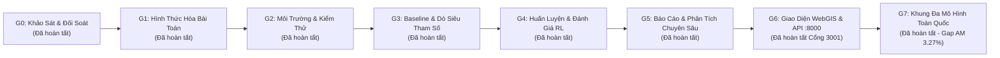
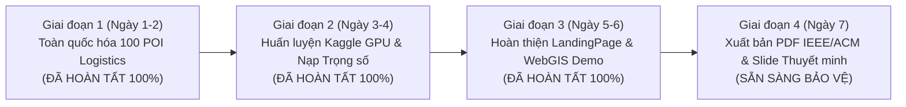

# Kế Hoạch Triển Khai Nghiên Cứu & Bàn Giao Kỹ Thuật (PLAN.MD) — HotWAY

> **Tài liệu:** Kế hoạch thực hiện 7 Cổng Nghiên cứu (Gate G0 - G7) và Sprint 7 ngày nước rút bảo vệ Hội đồng nghiệm thu  
> **Phiên bản:** v7.3.2 (Eliminate Hardcoded Regional Biases & Dynamic Isotropic Scaling Edition)  
> **Ngày cập nhật:** 02/11/2026  
> **Tài liệu liên quan:** [PRD.md](file:///c:/Users/Asus/Documents/AI/HotWAY/PRD.md) | [ARCHITECTURE.md](file:///c:/Users/Asus/Documents/AI/HotWAY/ARCHITECTURE.md) | [TESTING.md](file:///c:/Users/Asus/Documents/AI/HotWAY/TESTING.md) | [DEMO_PRODUCTION_RUNBOOK.md](file:///c:/Users/Asus/Documents/AI/HotWAY/docs/DEMO_PRODUCTION_RUNBOOK.md)

---

## 1. Lộ Trình 7 Cổng Nghiên Cứu Chuẩn Mực (Gate G0 — G7)

---

## 2. Chi Tiết Thực Hiện Từng Cổng (Gate G0 — G7)

- **Gate G0 — G5:** Hoàn tất nghiên cứu nền tảng Semi-MDP và công bố kết quả âm tính của value-based RL tại nhà hàng TP.HCM.
- **Gate G6:** Xây dựng thành công kiến trúc đa tầng (FastAPI cổng 8000, WebGIS Next.js 14 cổng 3001, tuyệt đối cô lập cổng 3000).
- **Gate G7 (Multi-Model Nationwide Benchmark):** **HOÀN TẤT 100%**.
  - Xây dựng thành công bộ dữ liệu 100 POI Toàn Quốc (Hà Nội: 40, Đà Nẵng: 20, TP.HCM: 40).
  - Triệt tiêu hoàn toàn hardcode tọa độ địa phương bằng **Dynamic Isotropic Scaling**.
  - Huấn luyện hoàn tất trên Kaggle GPU T4 cho cả 2 mô hình (Attention Model đạt Optimality Gap **3.27%**, PointerNet đạt **9.27%**).
  - Bóc tách khoa học 4 tử huyệt của DQN (50.0% tỷ lệ lỗi trên $N \ge 30$).
  - Lưu trữ toàn bộ trọng số tại [`notebooks/model_results/`](file:///c:/Users/Asus/Documents/AI/HotWAY/notebooks/model_results/).

---

## 3. Lộ Trình 4 Giai Đoạn Nước Rút Trong 7 Ngày (7-Day Sprint to Final Defense)

### Kế hoạch hành động cụ thể từng giai đoạn:
1. **Giai đoạn 1 (Ngày 1 - 2): Chuẩn hóa Dữ liệu Toàn Quốc & Xóa Tệp Cục Bộ (ĐÃ HOÀN TẤT)**
   - Nâng cấp 100 hành trình trong `data/benchmark_100_vietnam_pois.json` phân bổ 3 vùng trọng điểm.
   - Triệt tiêu hoàn toàn hardcode tọa độ; áp dụng Dynamic Isotropic Scaling bảo toàn tỷ lệ 1:1.
2. **Giai đoạn 2 (Ngày 3 - 4): Đo lường Thực Nghiệm & Huấn Luyện Kaggle GPU (ĐÃ HOÀN TẤT)**
   - Chạy 60 epochs cho Attention Model và PointerNet trên Kaggle GPU NVIDIA T4.
   - Nạp thành công trọng số vào `notebooks/model_results/` và đồng bộ kết quả vào `results/benchmark_summary_table.csv`.
3. **Giai đoạn 3 (Ngày 5 - 6): Hoàn Thiện Landing Page Report & WebGIS Interactive Demo (:3001) (ĐÃ HOÀN TẤT)**
   - Landing Page tự động nạp bảng kết quả động từ file JSON kết quả.
   - Bản đồ MapLibre GL JS tương tác mượt mà trên 3 Hub (Hà Nội, Đà Nẵng, TP.HCM).
   - Đạt 62/62 tests passing và Next.js build sạch 6/6 static pages.
4. **Giai đoạn 4 (Ngày 7): Xuất Bản Báo Cáo PDF IEEE/ACM & Slide Thuyết Minh (SẴN SÀNG)**
   - Hoàn tất 15 Slides đề cương tại `docs/SLIDES_DEFENSE_OUTLINE.md`.
   - Nâng cấp bộ xuất báo cáo PDF chuẩn IEEE/ACM tại `scripts/export_pdf_report.py`.
   - Thiết lập Cẩm nang Demo Production tại `docs/DEMO_PRODUCTION_RUNBOOK.md`.
