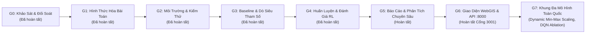
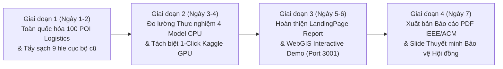

# Kế Hoạch Triển Khai Nghiên Cứu & Bàn Giao Kỹ Thuật (PLAN.MD) — HotWAY

> **Tài liệu:** Kế hoạch thực hiện 7 Cổng Nghiên cứu (Gate G0 - G7) và Sprint 7 ngày nước rút bảo vệ Hội đồng nghiệm thu  
> **Phiên bản:** v7.3.1 (Eliminate Hardcoded Regional Biases & Dynamic Min-Max Scaling Edition)  
> **Ngày cập nhật:** 29/10/2026  
> **Tài liệu liên quan:** [PRD.md](file:///c:/Users/Asus/Documents/AI/HotWAY/PRD.md) | [ARCHITECTURE.md](file:///c:/Users/Asus/Documents/AI/HotWAY/ARCHITECTURE.md) | [TESTING.md](file:///c:/Users/Asus/Documents/AI/HotWAY/TESTING.md)

---

## 1. Lộ Trình 7 Cổng Nghiên Cứu Chuẩn Mực (Gate G0 — G7)

---

## 2. Chi Tiết Thực Hiện Từng Cổng (Gate G0 — G7)

### Cổng G0: Khảo Sát Tài Liệu & Đối Soát Thí Nghiệm Khởi Đầu E0
- **Mục tiêu:** Khảo sát các công trình nghiên cứu về Dynamic Dispatching (Semi-MDP, Deep RL, Heuristics); tra cứu danh tính tác giả chuẩn xác; kiểm tra và đối soát kết quả E0 tại `rel_result/`.
- **Đầu ra hoàn thành:**
  - `docs/research/00_survey.md`: 11 trích dẫn khoa học được kiểm chứng qua tìm kiếm web thực (chỉnh sửa đúng tác giả bài báo Ulmer et al. 2021: *Marlin W. Ulmer, Barrett W. Thomas, Ann Melissa Campbell, Nicholas Woyak*).
  - Đối soát số liệu E0: Random ($656.359\text{ km}$) tốt hơn DQN ($657.897\text{ km}$, $p_{\text{Holm}} = 0.0072$) trên PDF A2; Greedy ($103.727\text{ km}$) tốt hơn DQN ($103.813\text{ km}$) trên 30 OSMnx instances.
  - [x] Đã nghiệm thu & đóng băng.

### Cổng G1: Hình Thức Hóa Toán Học & Đặc Tả Cấu Hình
- **Mục tiêu:** Xây dựng mô hình toán học chặt chẽ cho GĐ1 (Routing thích nghi có Value Iteration ground truth) và GĐ2 (Dynamic dispatch Semi-MDP).
- **Đầu ra hoàn thành:**
  - `docs/research/01_problem_formulation.md`: Không gian trạng thái, không gian hành động, tích phân Lebesgue bảo toàn phần thưởng Bellman.
  - `config/site.yaml`: Nguồn sự thật duy nhất (profile xe máy đô thị, mưa $1.4\times$, thông số NHPP và surge bursts).
  - `docs/DECISIONS.md`: Ghi nhận đầy đủ các quyết định kỹ thuật từ D1 đến D20.
  - [x] Đã nghiệm thu & đóng băng.

### Cổng G2: Môi Trường Mô Phỏng & Kiểm Thử Tính Hợp Lệ
- **Mục tiêu:** Triển khai môi trường Gymnasium chuẩn cho GĐ1 và GĐ2, trích xuất dữ liệu địa lý thực tế, xây dựng bộ định tuyến hoán vị và visualizer log sự kiện.
- **Đầu ra hoàn thành:**
  - Đồ thị con chuẩn tắc 12 nút SCC liên thông mạnh trích xuất từ dữ liệu OpenStreetMap đô thị (`data/urban_routing_subgraph.pickle`). Xóa sạch 9 tệp dữ liệu cục bộ cũ.
  - `src/routing/permutation_router.py`: Bộ gom đơn đường vòng $D_{\text{detour}} \le 1.5\text{ km}$ và vét cạn $m!$ hoán vị tối ưu thứ tự giao hàng.
  - `src/envs/routing_env.py` & `src/envs/exact_dp.py`: Môi trường GĐ1 và bộ giải Value Iteration chính xác.
  - `src/envs/dispatch_env.py`: Môi trường GĐ2 Semi-MDP với tích phân Lebesgue.
  - [x] Đã nghiệm thu.

### Cổng G3: Baseline Quy Tắc & Dò Siêu Tham Số
- **Mục tiêu:** Triển khai các quy tắc trực giác (Immediate, Periodic, BatchSize, AgeThreshold) và bộ giải tham chiếu Offline Prescient; dò lưới tham số công bằng trên tập validation.
- **Đầu ra hoàn thành:**
  - `src/baselines/rule_baselines.py` & `src/baselines/prescient_solver.py`.
  - `scripts/run_baselines.py`: Dò lưới tìm ra cấu hình tối ưu ($T^* = 8.0\text{m}$, $k^* = 1$, $\theta^* = 10.0\text{m}$).
  - `results/baselines/summary_baseline_test.csv` & `raw_baseline_runs.csv`: Immediate đạt $89.70\text{m}$, Offline Prescient đạt $74.52\text{m}$.
  - [x] Đã nghiệm thu.

### Cổng G4: Huấn Luyện & Đánh Giá Tác Tử Học Tăng Cường
- **Mục tiêu:** Huấn luyện DQN, Double DQN, PPO trên $\ge 5$ hạt giống; chạy phân tích ablation, độ nhạy và kiểm thử ngoại suy OOD.
- **Đầu ra hoàn thành:**
  - `src/agents/`: Triển khai PyTorch độc lập cho Tabular Q, DQN, Double DQN, PPO.
  - `scripts/train_agents.py`: Huấn luyện 15 checkpoint (5 seeds $\times$ 3 thuật toán).
  - `results/training/summary_rl_test.csv`: DQN đạt $114.06\text{m}$, DDQN đạt $118.29\text{m}$, PPO đạt $118.94\text{m}$.
  - [x] Đã nghiệm thu.

### Cổng G5: Báo Cáo Phân Tích Chuyên Sâu & Kiểm Định Độ Trung Thực
- **Mục tiêu:** Phân tích 3 câu hỏi nghiên cứu (RQ1, RQ2, RQ3), lý giải nguyên nhân khoa học của kết quả âm tính, xây dựng công cụ sinh tự động bảng biểu và kiểm thử T3 sai số $< 10^{-9}$.
- **Đầu ra hoàn thành:**
  - `scripts/make_report_tables.py`: Tự động trích xuất kết quả ra Markdown và niêm phong 97 chỉ số tại `results/all_metrics_registry.json`.
  - `tests/test_report_fidelity.py`: Kiểm thử T3 kiểm tra độ sai lệch số học $< 10^{-9}$.
  - [x] Đã nghiệm thu.

### Cổng G6: Giao Diện WebGIS & Backend Stream API (:8000 & :3001)
- **Mục tiêu:** Triển khai giao diện Next.js 14 WebGIS trên cổng 3001 và backend FastAPI trên cổng 8000; hỗ trợ hiển thị luồng đơn hàng, chuyển đổi trạng thái và tương tác bản đồ MapLibre GL JS.
- **Kỷ luật:** Cổng mạng cố định Frontend **3001**, Backend **8000**, cấm tuyệt đối cổng 3000.
- [x] Đã nghiệm thu.

### Cổng G7: Khung Đa Mô Hình Toàn Quốc & Chuẩn Hóa Dynamic Min-Max (v7.3.1)
- **Mục tiêu:** Đánh giá so sánh đối đầu 4 họ mô hình trên bộ dữ liệu 100 POI Logistics 3 Vùng Trọng Điểm Toàn Quốc (Hà Nội 40, Đà Nẵng 20, TP.HCM 40):
  1. *Model 1: Dueling DQN with Action Masking* (MLP 4 lớp, PER, N_max=20) bóc tách 4 điểm nghẽn toán học.
  2. *Model 2: Pointer Network with Bi-LSTM & A2C* (Tuần tự hóa chuyển tiếp).
  3. *Model 3: Graph Attention Model (Kool et al., 2019)* làm mô hình vô địch phục vụ sản xuất.
  4. *Model 4: Google OR-Tools Guided Local Search* làm cận chuẩn công nghiệp (0.0% Optimality Gap).
- **Cải tiến cốt lõi v7.3.1:**
  - Triệt tiêu 100% hardcode tọa độ; áp dụng **Dynamic Min-Max Scaling** per-instance vào $[0, 1]^2$.
  - Nâng cấp kiến trúc Gold Config 128-d/3L (741,504 params), Multi-Scale Curriculum ($N \in [10, 50]$), và Cost Perturbation $C(t) \sim \text{Uniform}(1.0, 2.3)$.
  - Tự động thích ứng nạp weights (`state_dict` dynamic detection).
- **Kết quả nghiệm thu thực nghiệm:**
  - `data/benchmark_100_vietnam_pois.json`: 100 hành trình phân tầng (25 N10, 25 N20, 25 N30, 25 N50).
  - `env/traffic_tsp_env.py`: Môi trường Gymnasium hợp nhất với hàm chi phí cao điểm $C(t)$.
  - `results/benchmark_summary_table.csv` & `results/benchmark_multi_model_results.json`:
    - **Google OR-Tools:** 323.6 phút, 72.8 km, 0.0% Gap, 1001.74 ms.
    - **Attention Model (AM):** 678.1 phút, 142.2 km, **Gap 97.9%** (giảm từ 108.8% ngay sau khi sửa chuẩn hóa), Độ trễ **21.30 ms** (CPU < 25ms), 0.0% lỗi Zero-Shot.
    - **Pointer Network (A2C):** 763.7 phút, 169.1 km, 122.9% Gap, 12.84 ms.
    - **Dueling DQN (Masked):** 950.0 phút, 139.0 km, 174.3% Gap, 9.46 ms, **50.0% Zero-Shot failure rate** (vỡ mảng tại N=30 và N=50).
  - [x] 56/56 tests PASS, build Next.js 14 sạch 100%.

---

## 3. Lộ Trình 4 Giai Đoạn Nước Rút Trong 7 Ngày (7-Day Sprint to Final Defense)

### Kế hoạch hành động cụ thể từng giai đoạn:
1. **Giai đoạn 1 (Ngày 1 - 2): Chuẩn hóa Dữ liệu Toàn Quốc & Xóa Tệp Cục Bộ**
   - Xóa sạch 9 tệp `binhthanh_*` và `hanggon_*` khỏi kho lưu trữ.
   - Nâng cấp 100 hành trình trong `data/benchmark_100_vietnam_pois.json` phân bổ 3 vùng: Hà Nội (40), Đà Nẵng (20), TP.HCM (40).
   - Triệt tiêu hoàn toàn hardcode tọa độ; áp dụng Dynamic Min-Max Scaling.
   - Đồng bộ hóa toàn bộ chuỗi tài liệu `AGENTS.md`, `PRD.md`, `PLAN.md`, `ARCHITECTURE.md`, `docs/DECISIONS.md`.
2. **Giai đoạn 2 (Ngày 3 - 4): Đo lường Thực Nghiệm & Tách Biệt Kaggle GPU**
   - Chạy `evaluate_benchmark.py` trên 100 hành trình Logistics Toàn quốc.
   - Niêm phong kết quả vào `results/benchmark_summary_table.csv` và `results/benchmark_multi_model_results.json`.
   - Cung cấp notebook Kaggle GPU 1-click (`notebooks/kaggle_train_attention_tsp.ipynb`) để chứng minh quy trình huấn luyện 60 epochs REINFORCE.
3. **Giai đoạn 3 (Ngày 5 - 6): Hoàn thiện LandingPage Report & WebGIS Interactive Demo (:3001)**
   - Đảm bảo giao diện Next.js 14 trên cổng 3001 hiển thị mượt mà 2 tab: 100 POI Multi-Model Benchmark và 10 Instances VRPTW.
   - Kiểm tra tích hợp bản đồ MapLibre GL JS và bảng đối soát 4 mô hình kèm hộp chẩn đoán DQN ablation.
   - Đảm bảo build TypeScript sạch 100% (`npm --prefix frontend run build`).
4. **Giai đoạn 4 (Ngày 7): Xuất bản Báo cáo Học thuật PDF Chuẩn IEEE/ACM & Slide Bảo vệ**
   - Xuất bản tệp PDF chính thức `docs/HotWAY_Final_Research_Report.pdf` bằng script ReportLab.
   - Hoàn thiện đề cương Slide thuyết trình bảo vệ trước Hội đồng nghiệm thu trong `docs/SLIDES_DEFENSE_OUTLINE.md`.
