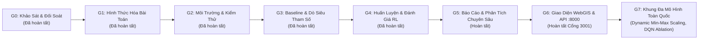
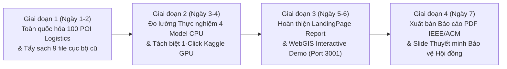

# Kế Hoạch Triển Khai Nghiên Cứu & Bàn Giao Kỹ Thuật (PLAN.MD) — HotWAY

> **Tài liệu:** Kế hoạch thực hiện 7 Cổng Nghiên cứu (Gate G0 - G7) và Sprint 7 ngày nước rút bảo vệ Hội đồng nghiệm thu  
> **Phiên bản:** v7.3.1 (Eliminate Hardcoded Regional Biases & Dynamic Min-Max Scaling Edition)  
> **Ngày cập nhật:** 29/10/2026  
> **Tài liệu liên quan:** [PRD.md](file:///c:/Users/Asus/Documents/AI/HotWAY/PRD.md) | [ARCHITECTURE.md](file:///c:/Users/Asus/Documents/AI/HotWAY/ARCHITECTURE.md) | [TESTING.md](file:///c:/Users/Asus/Documents/AI/HotWAY/TESTING.md)

---

## 1. Lộ Trình 7 Cổng Nghiên Cứu Chuẩn Mực (Gate G0 — G7)

---

## 2. Chi Tiết Thực Hiện Từng Cổng (Gate G0 — G7)

### Gate G7: Multi-model nationwide benchmark (status after v2 remediation)

- The 100-instance benchmark is synthetic and sampled from regional POI pools; it is not a set of observed delivery tours.
- Neural training uses isotropic coordinates, a physical synthetic time scale (15 km/unit, 25 km/h), elapsed-time C(t), and decoder current-hour context.
- Attention target is 128-d/3-layer/8-head. The historical 64-d/2-layer checkpoint is incompatible with the revised decoder and must be retrained.
- Pointer training and inference now share feature scaling, decoder time state, and pointer logit clipping. Old weights must be retrained because the decoder input schema changed.
- OR-Tools Guided Local Search is a reference heuristic over a static surrogate; relative gap is not an optimality certificate.
- Existing result files are historical pre-v2 outputs (Attention 81.62% relative gap with 64-d/2L checkpoint). Re-run evaluation after training before reporting post-remediation metrics.
- Kaggle runtime/VRAM are unmeasured; notebook code currently selects one CUDA device.

---
## 3. Lộ Trình 4 Giai Đoạn Nước Rút Trong 7 Ngày (7-Day Sprint to Final Defense)

### Kế hoạch hành động cụ thể từng giai đoạn:
1. **Giai đoạn 1 (Ngày 1 - 2): Chuẩn hóa Dữ liệu Toàn Quốc & Xóa Tệp Cục Bộ**
   - Xóa sạch 9 tệp `binhthanh_*` và `hanggon_*` khỏi kho lưu trữ.
   - Nâng cấp 100 hành trình trong `data/benchmark_100_vietnam_pois.json` phân bổ 3 vùng: Hà Nội (40), Đà Nẵng (20), TP.HCM (40).
   - Triệt tiêu hoàn toàn hardcode tọa độ; áp dụng Dynamic Min-Max Scaling.
   - Đồng bộ hóa toàn bộ chuỗi tài liệu `AGENTS.md`, `PRD.md`, `PLAN.md`, `ARCHITECTURE.md`, `docs/DECISIONS.md`.
2. **Giai đoạn 2 (Ngày 3 - 4): Đo lường Thực Nghiệm & Tách Biệt Kaggle GPU**
   - Chạy `evaluate_benchmark.py` trên 100 hành trình Logistics Toàn quốc.
   - Niêm phong kết quả vào `results/benchmark_summary_table.csv` và `results/benchmark_multi_model_results.json`.
   - Cung cấp notebook Kaggle GPU 1-click (`notebooks/kaggle_train_attention_tsp.ipynb`) để chứng minh quy trình huấn luyện 60 epochs REINFORCE.
3. **Giai đoạn 3 (Ngày 5 - 6): Hoàn thiện LandingPage Report & WebGIS Interactive Demo (:3001)**
   - Đảm bảo giao diện Next.js 14 trên cổng 3001 hiển thị mượt mà 2 tab: 100 POI Multi-Model Benchmark và 10 Instances VRPTW.
   - Kiểm tra tích hợp bản đồ MapLibre GL JS và bảng đối soát 4 mô hình kèm hộp chẩn đoán DQN ablation.
   - Đảm bảo build TypeScript sạch 100% (`npm --prefix frontend run build`).
4. **Giai đoạn 4 (Ngày 7): Xuất bản Báo cáo Học thuật PDF Chuẩn IEEE/ACM & Slide Bảo vệ**
   - Xuất bản tệp PDF chính thức `docs/HotWAY_Final_Research_Report.pdf` bằng script ReportLab.
   - Hoàn thiện đề cương Slide thuyết trình bảo vệ trước Hội đồng nghiệm thu trong `docs/SLIDES_DEFENSE_OUTLINE.md`.
