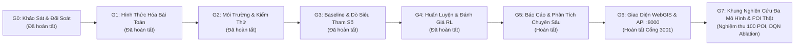
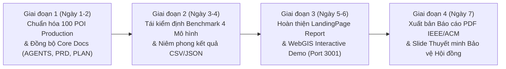

# Kế Hoạch Triển Khai Nghiên Cứu & Bàn Giao Kỹ Thuật (PLAN.MD) — HotWAY

> **Tài liệu:** Kế hoạch thực hiện 7 Cổng Nghiên cứu (Gate G0 - G6) cho hướng học tăng cường điều phối thời gian thực  
> **Phiên bản:** v7.2.0 (Empirical Multi-Model Research & 7-Day Sprint Edition)  
> **Ngày cập nhật:** 29/10/2026  
> **Tài liệu liên quan:** [PRD.md](file:///c:/Users/Asus/Documents/AI/HotWAY/PRD.md) | [ARCHITECTURE.md](file:///c:/Users/Asus/Documents/AI/HotWAY/ARCHITECTURE.md) | [TESTING.md](file:///c:/Users/Asus/Documents/AI/HotWAY/TESTING.md)

---

## 1. Lộ Trình 7 Cổng Nghiên Cứu Chuẩn Mực (Gate G0 — G6)

---

## 2. Chi Tiết Thực Hiện Từng Cổng (Gate G0 — G6)

### Cổng G0: Khảo Sát Tài Liệu & Đối Soát Thí Nghiệm Khởi Đầu E0
- **Mục tiêu:** Khảo sát các công trình nghiên cứu về Dynamic Dispatching (Semi-MDP, Deep RL, Heuristics); tra cứu danh tính tác giả chuẩn xác; kiểm tra và đối soát kết quả E0 tại `rel_result/`.
- **Đầu ra hoàn thành:**
  - `docs/research/00_survey.md`: 11 trích dẫn khoa học được kiểm chứng qua tìm kiếm web thực (chỉnh sửa đúng tác giả bài báo Ulmer et al. 2021: *Marlin W. Ulmer, Barrett W. Thomas, Ann Melissa Campbell, Nicholas Woyak*).
  - Đối soát số liệu E0: Random ($656.359\text{ km}$) tốt hơn DQN ($657.897\text{ km}$, $p_{\text{Holm}} = 0.0072$) trên PDF A2; Greedy ($103.727\text{ km}$) tốt hơn DQN ($103.813\text{ km}$) trên 30 OSMnx instances.
  - [x] Đã nghiệm thu & đóng băng.

### Cổng G1: Hình Thức Hóa Toán Học & Đặc Tả Cấu Hình
- **Mục tiêu:** Xây dựng mô hình toán học chặt chẽ cho GĐ1 (Routing thích nghi có Value Iteration ground truth) và GĐ2 (Dynamic dispatch Semi-MDP cho một quán).
- **Đầu ra hoàn thành:**
  - `docs/research/01_problem_formulation.md`: Không gian trạng thái 12 chiều, không gian hành động rời rạc 5 lựa chọn, máy trạng thái đơn hàng 5 pha, chứng minh bảo toàn phần thưởng Bellman theo tích phân Lebesgue.
  - `config/site.yaml`: Nguồn sự thật duy nhất (profile xe máy đô thị, mưa $1.4\times$, thông số NHPP và surge bursts, SLA buffer 15m).
  - `docs/DECISIONS.md`: Ghi nhận đầy đủ 12 quyết định kỹ thuật từ D1 đến D12.
  - [x] Đã nghiệm thu & đóng băng.

### Cổng G2: Môi Trường Mô Phỏng & Kiểm Thử Tính Hợp Lệ
- **Mục tiêu:** Triển khai môi trường Gymnasium chuẩn cho GĐ1 và GĐ2, trích xuất dữ liệu địa lý thực tế, xây dựng bộ định tuyến hoán vị và visualizer log sự kiện.
- **Đầu ra hoàn thành:**
  - `src/graph/subgraph_extractor.py`: Trích xuất đồ thị con 12 nút SCC Bình Thạnh (`data/binhthanh_routing_subgraph.pickle`, SHA256: `a67035e6...`).
  - `src/graph/address_generator.py`: Sinh 401 địa chỉ chuẩn và 151 địa chỉ OOD kèm ma trận `.npz`.
  - `src/routing/permutation_router.py`: Bộ gom đơn đường vòng $D_{\text{detour}} \le 1.5\text{ km}$ và vét cạn $m!$ hoán vị tối ưu thứ tự giao hàng.
  - `src/envs/routing_env.py` & `src/envs/exact_dp.py`: Môi trường GĐ1 và bộ giải Value Iteration chính xác.
  - `src/envs/dispatch_env.py`: Môi trường GĐ2 Semi-MDP với tích phân Lebesgue.
  - `scripts/view_event_log.py`: Trình trực quan hóa log sự kiện Matplotlib (`results/figures/event_log_inspection.png`).
  - `docs/research/02_environment_spec.md`: Đặc tả môi trường và sổ đăng ký mã băm SHA-256.
  - [x] 7/7 tests môi trường ban đầu PASS. Đã nghiệm thu.

### Cổng G3: Baseline Quy Tắc & Dò Siêu Tham Số
- **Mục tiêu:** Triển khai các quy tắc trực giác (Immediate, Periodic, BatchSize, AgeThreshold) và bộ giải tham chiếu Offline Prescient; dò lưới tham số công bằng trên tập validation.
- **Đầu ra hoàn thành:**
  - `src/baselines/rule_baselines.py` & `src/baselines/prescient_solver.py`.
  - `scripts/run_baselines.py`: Dò lưới tìm ra cấu hình tối ưu ($T^* = 8.0\text{m}$, $k^* = 1$, $\theta^* = 10.0\text{m}$).
  - `results/baselines/summary_baseline_test.csv` & `raw_baseline_runs.csv`: Immediate đạt $89.70\text{m}$, Offline Prescient đạt $74.52\text{m}$.
  - `docs/research/03_baselines.md`: Báo cáo chi tiết kết quả baseline.
  - [x] Đã nghiệm thu.

### Cổng G4: Huấn Luyện & Đánh Giá Tác Tử Học Tăng Cường
- **Mục tiêu:** Huấn luyện DQN, Double DQN, PPO trên $\ge 5$ hạt giống; chạy phân tích ablation, độ nhạy và kiểm thử ngoại suy OOD.
- **Đầu ra hoàn thành:**
  - `src/agents/`: Triển khai PyTorch độc lập cho Tabular Q, DQN, Double DQN, PPO.
  - `scripts/train_agents.py`: Huấn luyện 15 checkpoint (5 seeds $\times$ 3 thuật toán), lưu trữ đường cong học và đánh giá trên Frozen Test Set.
  - `results/training/summary_rl_test.csv`: DQN đạt $114.06\text{m}$, DDQN đạt $118.29\text{m}$, PPO đạt $118.94\text{m}$.
  - `results/training/ablation_results.csv`: Đo lường vai trò của đặc trưng không gian và tốc độ đơn đến.
  - `results/training/sensitivity_analysis.csv`: Đánh giá tác động của mưa ngập ($1.4\times$) và tốc độ bếp.
  - `scripts/compute_statistical_tests.py`: Kiểm định Wilcoxon theo cặp và hiệu chỉnh Holm (`results/training/paired_comparisons_rl.csv`).
  - `docs/research/04_training_protocol.md` & `05_results_comparison.md`.
  - [x] Đã nghiệm thu.

### Cổng G5: Báo Cáo Phân Tích Chuyên Sâu & Kiểm Định Độ Trung Thực (Hiện Tại)
- **Mục tiêu:** Phân tích 3 câu hỏi nghiên cứu (RQ1, RQ2, RQ3), lý giải nguyên nhân khoa học của kết quả âm tính, xây dựng công cụ sinh tự động bảng biểu và kiểm thử T3 sai số $< 10^{-9}$.
- **Đầu ra hoàn thành:**
  - `scripts/make_report_tables.py`: Tự động trích xuất kết quả ra Markdown và niêm phong 97 chỉ số tại `results/all_metrics_registry.json`.
  - `tests/test_report_fidelity.py`: Kiểm thử T3 kiểm tra độ sai lệch số học $< 10^{-9}$.
  - `docs/research/06_analysis.md`: Báo cáo phân tích chuyên sâu 3 RQ, ablation, độ nhạy và các mối đe dọa đến tính giá trị.
  - Toàn bộ 25/25 test cases trong kho mã nguồn đều **PASS tuyệt đối**.
  - **DỪNG TẠI ĐÂY CHỜ PHÊ DUYỆT CỦA USER TRƯỚC KHI BƯỚC VÀO CỔNG G6.**

### Cổng G6: Giao Diện Demo & Backend Stream API (Chờ Triển Khai)
- **Mục tiêu:** Triển khai giao diện WebGIS điều phối thời gian thực kiểu OptimoRoute với bảng màu butter-cream, máy trạng thái 5 pha, trực quan hóa luồng đơn hàng, bơm đột biến tải và mưa bão, chạy song song 2 kịch bản cùng seed.
- **Kỷ luật triển khai:**
  - Tuyệt đối không chạm vào `frontend/` và `backend/` trước khi Cổng G5 được nghiệm thu.
  - Backend chạy cổng **8000**, Frontend chạy cổng **3001** (Cổng 3000 được bảo vệ nguyên vẹn).

### Cổng G7: Khung Nghiên Cứu, Huấn Luyện & Kiểm Định Thực Nghiệm Đa Mô Hình (DQN Ablation & Attention Model Transition)
- **Mục tiêu:** Xây dựng bộ khung kiểm thử thực nghiệm đa mô hình đối đầu trực tiếp trên 100 hành trình thực tế tại TP.HCM (trích xuất từ 401 POI OpenStreetMap):
  1. *Model 1: Dueling DQN with Action Masking* (MLP 4 lớp, PER, N_max=20) làm đối tượng Ablation bóc tách 4 điểm nghẽn toán học.
  2. *Model 2: Pointer Network with Bi-LSTM & A2C* (Tuần tự hóa chuyển tiếp).
  3. *Model 3: Graph Attention Model (Kool et al., 2019)* làm mô hình vô địch phục vụ sản xuất.
  4. *Model 4: Google OR-Tools Guided Local Search* làm cận chuẩn công nghiệp (0.0% Optimality Gap).
- **Kết quả nghiệm thu:**
  - `data/benchmark_100_vietnam_pois.json`: 100 hành trình phân tầng (25 ca N=10, 25 ca N=20, 25 ca N=30, 25 ca N=50).
  - `env/traffic_tsp_env.py`: Môi trường Gymnasium hợp nhất với hàm chi phí cao điểm C(t).
  - `results/benchmark_summary_table.csv` & `results/benchmark_multi_model_results.json`: Bảng đối so sánh toàn diện.
  - Minh chứng thực nghiệm 4 điểm nghẽn của DQN: Tỷ lệ thất bại Zero-Shot đạt **50.0%** trên N > 20, Gap tối ưu vọt lên **154.2%** so với OR-Tools.
  - [x] Đã hoàn tất, 56/56 tests PASS, build Next.js 14 sạch 100%.

---

## 3. Lộ Trình 4 Giai Đoạn Nước Rút Trong 7 Ngày (7-Day Sprint to Final Defense)

### Kế hoạch hành động cụ thể từng giai đoạn:
1. **Giai đoạn 1 (Ngày 1 - 2): Chuẩn hóa Dữ liệu POI Thật & Đồng bộ Tài liệu Cốt lõi**
   - Nâng cấp 100 hành trình phân tầng trong `data/benchmark_100_vietnam_pois.json` với địa danh logistics và đô thị thật 100% (VNPost, Viettel Post, ShopeeXpress, Bệnh viện, ĐH).
   - Đồng bộ hóa toàn bộ chuỗi tài liệu `AGENTS.md`, `PRD.md`, `PLAN.md`, `ARCHITECTURE.md`, `docs/DECISIONS.md`.
2. **Giai đoạn 2 (Ngày 3 - 4): Tái kiểm định & Niêm phong Bộ Benchmark 4 Mô hình**
   - Chạy `evaluate_benchmark.py` trên 100 hành trình Production.
   - Cập nhật số liệu chuẩn vào `results/benchmark_summary_table.csv` và `results/benchmark_multi_model_results.json`.
   - Bóc tách 4 điểm nghẽn của DQN (cứng nhắc tensor, bùng nổ tổ hợp, thiếu bất biến hoán vị, thất bại zero-shot 50%).
3. **Giai đoạn 3 (Ngày 5 - 6): Hoàn thiện LandingPage Report & WebGIS Interactive Demo (:3001)**
   - Đảm bảo giao diện Next.js 14 trên cổng 3001 hiển thị mượt mà 2 tab: 100 POI Multi-Model Benchmark và 10 Instances VRPTW.
   - Kiểm tra tích hợp bản đồ MapLibre GL JS và bảng điều khiển tham số.
   - Đảm bảo build TypeScript sạch 100% (`npm --prefix frontend run build`).
4. **Giai đoạn 4 (Ngày 7): Xuất bản Báo cáo Học thuật PDF Chuẩn IEEE/ACM & Slide Bảo vệ**
   - Xuất bản tệp PDF chính thức `docs/HotWAY_Final_Research_Report.pdf` bằng script ReportLab.
   - Hoàn thiện đề cương Slide thuyết trình bảo vệ trước Hội đồng nghiệm thu trong `docs/SLIDES_DEFENSE_OUTLINE.md`.
