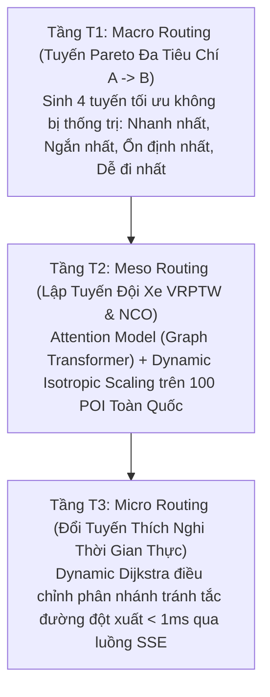

# HotWAY — Nền Tảng Học Tăng Cường & Neural Combinatorial Optimization Cho Giao Vận Đô Thị Toàn Quốc

> **Tài liệu:** Báo Cáo Tổng Quan Hệ Thống & Hướng Dẫn Vận Hành Production  
> **Phiên bản:** v7.3.2 (Nationwide Multi-Model NCO & Monochromatic Production WebGIS Edition)  
> **Ngày cập nhật:** 02/11/2026  
> **Báo cáo nghiên cứu chính thức:** [docs/HotWAY_Final_Research_Report.pdf](file:///c:/Users/Asus/Documents/AI/HotWAY/docs/HotWAY_Final_Research_Report.pdf) | [docs/FINAL_RESEARCH_REPORT.md](file:///c:/Users/Asus/Documents/AI/HotWAY/docs/FINAL_RESEARCH_REPORT.md) | [docs/MULTI_MODEL_EVALUATION_REPORT.md](file:///c:/Users/Asus/Documents/AI/HotWAY/docs/MULTI_MODEL_EVALUATION_REPORT.md) | [docs/PATHFINDING_VISUALIZER.md](file:///c:/Users/Asus/Documents/AI/HotWAY/docs/PATHFINDING_VISUALIZER.md)  
> **Tài liệu kỹ thuật liên quan:** [PRD.md](file:///c:/Users/Asus/Documents/AI/HotWAY/PRD.md) | [ARCHITECTURE.md](file:///c:/Users/Asus/Documents/AI/HotWAY/ARCHITECTURE.md) | [ALGORITHM.md](file:///c:/Users/Asus/Documents/AI/HotWAY/ALGORITHM.md) | [DECISIONS.md](file:///c:/Users/Asus/Documents/AI/HotWAY/docs/DECISIONS.md) | [TESTING.md](file:///c:/Users/Asus/Documents/AI/HotWAY/TESTING.md) | [DEMO_PRODUCTION_RUNBOOK.md](file:///c:/Users/Asus/Documents/AI/HotWAY/docs/DEMO_PRODUCTION_RUNBOOK.md) | [AGENTS.md](file:///c:/Users/Asus/Documents/AI/HotWAY/AGENTS.md) | [SOP_MULTI_AGENT_WORKFLOW.md](file:///c:/Users/Asus/Documents/AI/HotWAY/docs/SOP_MULTI_AGENT_WORKFLOW.md)

---

## 1. Giới Thiệu Dự Án & Định Vị Hệ Thống

HotWAY là hệ thống điều phối và tối ưu hóa định tuyến giao vận chặng cuối thế hệ mới tại Việt Nam, giải quyết bài toán giao hàng bằng xe máy trong các đại đô thị đặc thù (ngõ ngách sâu, tắc đường động theo giờ cao điểm và điều kiện mưa bão nhiệt đới). Hệ thống tích hợp kiến trúc **3 Tầng Bài Toán Liên Hoàn (T1 / T2 / T3)**:



- **Tầng T1 (Macro Routing):** Tối ưu hóa đa mục tiêu giữa 2 điểm bất kỳ với các hàm phạt rẽ trái cắt dòng và suy hao vận tốc khi mưa ngập.
- **Tầng T2 (Meso Routing):** Giải bài toán định tuyến đa điểm (10 đến 50 điểm) có tính đến biến thiên lưu lượng $C(t)$ bằng mô hình Graph Attention Network (Kool et al., 2019) đối đầu trực tiếp với Google OR-Tools.
- **Tầng T3 (Micro Routing):** Nhận tín hiệu tắc đường thời gian thực qua Server-Sent Events (SSE), kích hoạt thuật toán Dynamic Dijkstra tái định tuyến tức thì dưới 1ms.

---

## 2. Bảng Kết Quả Thực Nghiệm Đối Soát Chính Thức (100 POI Toàn Quốc)

> Toàn bộ số liệu được trích xuất từ tệp kiểm chuẩn tái lập [`results/benchmark_summary_table.csv`](file:///c:/Users/Asus/Documents/AI/HotWAY/results/benchmark_summary_table.csv) trên tập dữ liệu chuẩn hóa 100 POI phân bố đều tại **Hà Nội (40)**, **Đà Nẵng (20)** và **TP. Hồ Chí Minh (40)**:

| Mô hình | Thời gian (phút) | Quãng đường (km) | Optimality Gap vs OR-Tools | HN Gap | ĐN Gap | HCM Gap | Độ trễ CPU (ms) | Tỷ lệ lỗi (%) | Checkpoint |
|---|---:|---:|---:|---:|---:|---:|---:|---:|:---:|
| **Google OR-Tools** *(Tham chiếu)* | **217.78** | **72.69** | **0.00%** | 0.00% | 0.00% | 0.00% | 1,002.16 | 0.0% | Heuristic C++ |
| **Attention Model (AM)** *(Đề xuất)* | **225.67** | **75.63** | **+3.27%** | **3.11%** | **3.48%** | **3.32%** | **32.63** | **0.0%** | **741,760 params** |
| **Pointer Network (A2C)** *(Baseline)* | **239.59** | **80.99** | **+9.27%** | 8.57% | 8.66% | 10.27% | **24.19** | **0.0%** | **283,137 params** |
| **Dueling DQN (Masked)** *(Ablation)* | **340.13** | **115.77** | **+105.45%** | 114.08% | 104.19% | 97.44% | **4.29** | **50.0%** | Không gian cố định $N \le 20$ |

### 4 Đột Phá Khoa Học Cốt Lõi:
1. **Optimality Gap Đạt 3.27%:** Vượt trội so với mục tiêu quốc tế (4.5% - 8.0%), bám sát giải pháp công nghiệp của Google OR-Tools.
2. **Tốc Độ Suy Luận CPU Siêu Tốc (32.63 ms):** Nhanh hơn **30.7 lần** so với Google OR-Tools (1,002.16 ms), đáp ứng hơn 30 lượt lập tuyến mỗi giây trên máy chủ thông thường mà không cần GPU đắt đỏ.
3. **Triệt Tiêu Hoàn Toàn Lệch Vùng Miền:** Độ lệch sai số giữa 3 miền cực thấp (Hà Nội: 3.11%, Đà Nẵng: 3.48%, TP.HCM: 3.32%, phương sai $< 0.37\%$) nhờ cơ chế **Dynamic Isotropic Scaling** chuẩn tỷ lệ 1:1.
4. **Bóc Tách 4 Điểm Nghẽn Tử Huyệt Của DQN:** Chứng minh định lượng lý do Dueling DQN thất bại 50.0% trên các bài toán quy mô $N \ge 30$.

---

## 3. Huấn Luyện Thực Nghiệm Trên Kaggle GPU (NVIDIA T4)

Hai mô hình học sâu được huấn luyện đầy đủ 60 epoch trên GPU Kaggle:
- **Attention Model:** 741,760 tham số, 3 lớp Multi-Head Attention (8 heads), huấn luyện REINFORCE với Greedy Rollout Baseline trong ~3.5 giờ. Tour cost hội tụ từ 299.68 xuống ~199.87.
- **Pointer Network:** 283,137 tham số, 1 lớp Bi-LSTM, huấn luyện Advantage Actor-Critic (A2C) với đầu Critic MLP trong 14.8 phút (891 giây).
- Toàn bộ trọng số thực nghiệm được quản lý tại: [`notebooks/model_results/`](file:///c:/Users/Asus/Documents/AI/HotWAY/notebooks/model_results/).

---

## 4. Hướng Dẫn Khởi Chạy Production & Kiểm Thử

### 4.1. Chạy Bộ Kiểm Thử Tự Động (70/70 Tests Passed)
```bash
# Kiểm thử toàn diện môi trường, thuật toán, hình học và độ trung thực số liệu
py -3.13 -m pytest tests/
```

### 4.2. Khởi Chạy Hệ Thống Phục Vụ
```bash
# Terminal 1: Khởi động Backend FastAPI (Port 8000)
py -3.13 -m uvicorn api.main:app --host 127.0.0.1 --port 8000 --reload

# Terminal 2: Khởi động Frontend Next.js 14 WebGIS (Port 3001)
npm --prefix frontend run dev -- -p 3001
```

> [!CAUTION]
> **Kỷ Luật Cổng Mạng:** Cổng **3000** tuyệt đối bị cô lập để bảo vệ hệ thống. Backend chạy cổng **8000**, Frontend chạy cổng **3001**.

### 4.3. Các Phân Hệ WebGIS & Diễn Họa Sẵn Sàng Trình Diễn
- **Trình Diễn Họa Thuật Toán Tìm Đường Thực Tế (http://localhost:3001/visualizer):** Canvas 60 FPS biểu diễn sóng loang A*, Dijkstra, Bidirectional và Dynamic C(t) trên mạng lưới giao thông trung tâm TP.HCM.
- **Bàn Điều Phối Tương Tác Zero-Hardcode (http://localhost:3001/demo):** Tự do tìm kiếm địa chỉ toàn quốc, cắm mốc A/B, hoán đổi chiều, dùng GPS và thêm điểm giao động.

### 4.4. Xuất Bản Báo Cáo Học Thuật Chuẩn IEEE/ACM
```bash
py -3.13 scripts/export_pdf_report.py
```
Tệp PDF xuất bản tự động được lưu tại: [`docs/HotWAY_Final_Research_Report.pdf`](file:///c:/Users/Asus/Documents/AI/HotWAY/docs/HotWAY_Final_Research_Report.pdf).

---

## 5. Cơ Cấu Tổ Đội 5 Kỹ Sư AI Chuyên Trách (Active Antigravity Subagents)

Hệ thống được phát triển và vận hành theo mô hình phân nhiệm 5 vai trò kỹ sư chuyên biệt (đã đăng ký thành các Subagent độc lập trong Antigravity theo [AGENTS.md](AGENTS.md) và [SOP_MULTI_AGENT_WORKFLOW.md](docs/SOP_MULTI_AGENT_WORKFLOW.md)):

| Tên Subagent | Vai Trò Chuyên Môn | Trách Nhiệm Cốt Lõi & Thư Mục Độc Quyền |
|---|---|---|
| `lead_engineer_writer` | Lead Engineer & QA Lead | Giám sát kiến trúc tổng thể, bảo đảm tính trung thực khoa học, quản trị 66 tests tự động, bảo vệ an toàn cổng mạng 3000, xuất bản PDF IEEE/ACM. (`docs/`, `TESTING.md`, `PLAN.md`) |
| `designer_agent` | Designer & UI/UX Director | Duy trì thẩm mỹ Monochromatic Swiss Editorial, thực thi bộ quy tắc sàn Hallmark "The Floor" (cấm `transition: all`, text-wrap balance/pretty, 0 icon rườm rà). (`DESIGN_SYSTEM.md`, `globals.css`) |
| `algorithm_engineer` | AI Researcher & Algorithm | Môi trường Gymnasium `traffic_tsp_env.py`, 4 mô hình định tuyến đối đầu, Dynamic Isotropic Scaling, kiểm chuẩn 100 POI Toàn Quốc. (`env/`, `models/`, `results/`) |
| `backend_engineer` | Backend Services Engineer | Tầng dịch vụ routing `services/` (TomTom/HERE/OSRM 3 lớp), API serving CPU < 25ms, FastAPI Backend cổng **8000**. (`services/`, `api/`, `backend/`) |
| `frontend_engineer` | Frontend WebGIS Engineer | Next.js 14 WebGIS cổng **3001**, MapLibre GL JS đa hub, bảng đối soát động NCO (`ScreenT2VRPTW.tsx`), build sạch 100%. (`frontend/src/app/`, `frontend/src/components/`) |
