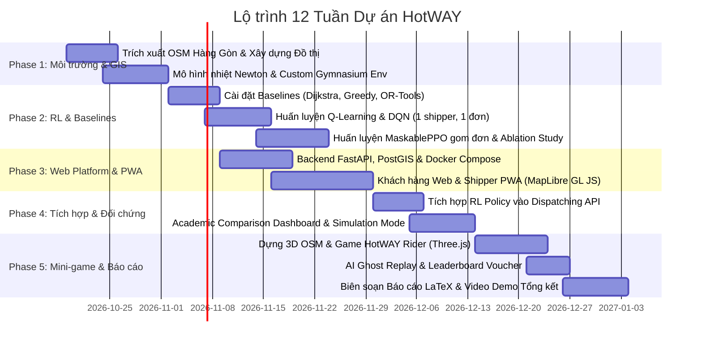

# 12-Week Strategic Roadmap — HotWAY

**Lộ trình phát triển:** Hệ thống Điều phối Giao hàng Bảo toàn Nhiệt độ Món ăn HotWAY  
**Chu kỳ:** 12 Tuần (Sprint 2 tuần / kỳ)  
**Tài liệu liên kết:** [PRD.md](file:///c:/Users/TanPhat/Documents/AI_E/HotWAY/PRD.md) | [TECH_ARCHITECTURE.md](file:///c:/Users/TanPhat/Documents/AI_E/HotWAY/TECH_ARCHITECTURE.md) | [PLAN.md](file:///c:/Users/TanPhat/Documents/AI_E/HotWAY/PLAN.md) | [PHASES.md](file:///c:/Users/TanPhat/Documents/AI_E/HotWAY/PHASES.md)  

---

## 1. Sơ đồ Tiến độ Tổng thể (Gantt Chart Roadmap)

---

## 2. Chi tiết Lộ trình theo Từng Tuần (Weekly Milestones & Deliverables)

### Tuần 1: Khảo sát Bản đồ Hàng Gòn & Thiết lập Môi trường Cơ sở
- **Mục tiêu:** Thu thập dữ liệu địa lý thực tế xã Hàng Gòn và khởi tạo dự án.
- **Công việc chính:**
  - Cài đặt cấu trúc repo, môi trường Python 3.10+, PyTorch, OSMnx.
  - Tải dữ liệu OpenStreetMap (OSM) xã Hàng Gòn và chuyển đổi sang đồ thị NetworkX.
  - Xác định vị trí tọa độ của Quán Bánh Canh Gà Hàng Gòn làm nút gốc (Depot).
- **Sản phẩm bàn giao (Deliverable):** File đồ thị `data/hanggon_road_graph.graphml` có thể hiển thị trực quan và đo đạc khoảng cách.

---

### Tuần 2: Cài đặt Mô hình Nhiệt Newton & Gymnasium Environment
- **Mục tiêu:** Hoàn thiện môi trường mô phỏng chuẩn OpenAI Gymnasium có tích hợp tính chất nhiệt.
- **Công việc chính:**
  - Viết module công thức nhiệt độ theo định luật Newton cho 3 nhóm món ăn và 3 loại thùng chứa.
  - Xây dựng lớp `HangGonDeliveryEnv` kế thừa từ `gymnasium.Env`.
  - Thiết kế hàm thưởng đa mục tiêu kết hợp thời gian, độ nóng của món và mức phạt trễ hạn.
  - Viết bộ kiểm thử đơn vị tự động kiểm tra `env.step()`.
- **Sản phẩm bàn giao:** File môi trường `src/rl/environment.py` vượt qua bài kiểm tra bước di chuyển với random actions.

---

### Tuần 3: Xây dựng Bộ Thuật toán Đối chứng (Baselines)
- **Mục tiêu:** Xây dựng thước đo đối chiếu chuẩn khoa học để so sánh với RL.
- **Công việc chính:**
  - Cài đặt thuật toán Dijkstra / A* tìm đường ngắn nhất trên đồ thị đường Hàng Gòn.
  - Cài đặt thuật toán Tham lam (Greedy Nearest Neighbor): Luôn chọn đơn hàng gần nhất.
  - Cài đặt bộ giải quy hoạch Google OR-Tools VRP Solver cho bài toán giao hàng có thời hạn.
- **Sản phẩm bàn giao:** Module `src/baselines/` xuất kết quả chuẩn hóa dạng JSON để so sánh.

---

### Tuần 4: Huấn luyện RL Bước đầu (Tabular Q-Learning & Deep Q-Network)
- **Mục tiêu:** Chứng minh tính hội tụ lý thuyết trên không gian nhỏ và triển khai DQN.
- **Công việc chính:**
  - Huấn luyện Tabular Q-learning trên đồ thị con (subgraph) 10 nút quanh quán để vẽ bảng Q-table minh họa lý thuyết.
  - Xây dựng mạng neural sâu Deep Q-Network (DQN / Double DQN) cho kịch bản 1 shipper phục vụ từng đơn lẻ.
  - Theo dõi loss và reward trên TensorBoard.
- **Sản phẩm bàn giao:** Checkpoint mô hình `models/dqn_hanggon.pt` và biểu đồ học tập sơ khởi.

---

### Tuần 5: Huấn luyện MaskablePPO Gom Đơn & Nghiên cứu Bóc tách (Ablation Study)
- **Mục tiêu:** Giải quyết bài toán thực tế phức tạp: 1 shipper gom và giao nhiều đơn cùng lúc.
- **Công việc chính:**
  - Triển khai thuật toán MaskablePPO từ `sb3-contrib` kết hợp cơ chế mặt nạ hành động (Action Masking).
  - Tinh chỉnh siêu tham số (Hyperparameter Tuning): `learning_rate=3e-4`, `gamma=0.99`, `ent_coef=0.01`.
  - Tiến hành thử nghiệm bóc tách: So sánh kết quả khi có và không có phần thưởng nhiệt độ $R_{\text{thermal}}$.
- **Sản phẩm bàn giao:** Checkpoint `models/ppo_multi_order.zip` và báo cáo phân tích thực nghiệm sơ bộ (CSV/Notebook).

---

### Tuần 6: Xây dựng Backend Monolith & Cơ sở Dữ liệu Địa không gian (PostGIS)
- **Mục tiêu:** Thiết lập khung backend FastAPI quản lý dữ liệu quán, menu, đơn hàng và shipper.
- **Công việc chính:**
  - Cấu hình PostgreSQL với tiện ích mở rộng PostGIS thông qua `docker-compose.yml`.
  - Viết models SQLAlchemy, Pydantic schemas cho Menu quán bánh canh gà, Đơn hàng và Lịch sử giao.
  - Viết RESTful APIs: Quản lý món ăn, tạo đơn hàng, cập nhật trạng thái đơn.
  - Cấu hình Redis lưu trữ trạng thái vị trí shipper.
- **Sản phẩm bàn giao:** Backend FastAPI chạy trong container Docker, Swagger docs tại `/docs`.

---

### Tuần 7: Xây dựng Giao diện Web Khách hàng & Shipper PWA (Bản đồ Thời gian thực)
- **Mục tiêu:** Khách hàng có thể đặt món trên bản đồ, shipper có ứng dụng nhận đơn và gửi GPS.
- **Công việc chính:**
  - Khởi tạo dự án Next.js 14, TailwindCSS và MapLibre GL JS.
  - Xây dựng trang đặt món cho khách hàng: Xem menu bánh canh gà, ghim vị trí nhận hàng trên bản đồ Hàng Gòn.
  - Xây dựng Shipper PWA hỗ trợ Geolocation API trên điện thoại và chế độ Mock GPS để thử nghiệm.
  - Kết nối WebSocket hai chiều giữa Backend, Khách hàng và Shipper.
- **Sản phẩm bàn giao:** Ứng dụng Web hoạt động mượt mà, hiển thị vị trí shipper di chuyển và thanh nhiệt độ cập nhật theo thời gian thực.

---

### Tuần 8: Tích hợp Động cơ RL vào Backend & Xây dựng API Điều phối
- **Mục tiêu:** Biến mô hình AI từ file checkpoint thành dịch vụ suy luận thực tế (Inference Service).
- **Công việc chính:**
  - Viết module `RLInferenceEngine` tải mô hình PPO vào RAM khi khởi động FastAPI.
  - Tạo API `POST /api/dispatch/recommend`: Nhận danh sách đơn chờ, trả về thứ tự gom đơn và thời gian đến dự kiến (ETA) kèm nhiệt độ lúc đến.
  - Hỗ trợ công tắc chuyển đổi: Người quản trị có thể chọn áp dụng gợi ý của RL hoặc của Dijkstra/OR-Tools.
- **Sản phẩm bàn giao:** Hệ thống điều phối thông minh tự động kích hoạt khi quán bấm "Giao hàng".

---

### Tuần 9: Xây dựng Academic Comparison Dashboard & Simulation Mode
- **Mục tiêu:** Tạo màn hình thuyết trình trực quan phục vụ hội đồng chấm đồ án.
- **Công việc chính:**
  - Thiết kế màn hình Split Map (Bản đồ phân đôi): Hiển thị đồng thời tuyến đường do Dijkstra tính và tuyến đường do HotWAY RL tính.
  - Trực quan hóa các biểu đồ so sánh: Nhiệt độ trung bình, thời gian giao hàng, tỷ lệ giao đúng hẹn.
  - Xây dựng chế độ Simulation Mode: Nút bấm sinh 5–10 shipper ảo và 20 đơn ngẫu nhiên tự động chạy xe mô phỏng trên nền deck.gl.
- **Sản phẩm bàn giao:** Trang `/admin/comparison-studio` và `/admin/simulation` phục vụ biểu diễn trực tiếp.

---

### Tuần 10: Xây dựng Khung 3D Bản đồ Hàng Gòn & Xe máy Người chơi (Three.js)
- **Mục tiêu:** Tạo nền tảng cho mini-game 3D HotWAY Rider.
- **Công việc chính:**
  - Trích xuất dữ liệu GeoJSON đường sá và khối nhà trung tâm xã Hàng Gòn thành mô hình 3D low-poly bằng Three.js / React Three Fiber.
  - Tạo mô hình xe máy người chơi với hiệu ứng vật lý chân thực bằng `@react-three/rapier` (lái bằng WASD/mũi tên).
  - Tích hợp hệ thống ánh sáng động (nắng ngày / mưa rào đặc trưng miền Đông Nam Bộ).
- **Sản phẩm bàn giao:** Trải nghiệm lái xe máy 3D trực tiếp trên trình duyệt Web tại đường dẫn `/game/rider`.

---

### Tuần 11: Hoàn thiện Cơ chế AI Ghost Replay & Bảng Xếp hạng Game
- **Mục tiêu:** Gắn kết mini-game với lõi Học Tăng Cường và tạo động lực cho người chơi.
- **Công việc chính:**
  - Đọc tệp log trajectory của RL Agent để render xe máy "Bóng ma AI" (Ghost Rider) màu neon chạy song song với người chơi.
  - Thiết kế HUD hiển thị đồng hồ nhiệt độ tô bánh canh gà giảm dần theo thời gian lái xe.
  - Tính điểm dựa trên nhiệt độ khi đến nơi; cấp mã voucher giảm giá cho người chơi đánh bại AI.
  - Xây dựng bảng xếp hạng trực tuyến lưu vào cơ sở dữ liệu.
- **Sản phẩm bàn giao:** Mini-game hoàn chỉnh 100%, có âm thanh, giao diện bắt mắt và kết nối dữ liệu thật.

---

### Tuần 12: Báo cáo Học thuật, Quay Video Demo & Tổng duyệt Bảo vệ
- **Mục tiêu:** Chuẩn bị toàn bộ hồ sơ nghiệm thu xuất sắc cho môn học.
- **Công việc chính:**
  - Soạn thảo Báo cáo Đồ án đầy đủ (LaTeX/PDF) gồm: Đặt vấn đề, Công thức toán học MDP, Định luật nhiệt Newton, So sánh thuật toán, Phân tích bóc tách (Ablation).
  - Biên tập Video Demo 3–5 phút chất lượng Full HD giới thiệu trọn vẹn dự án từ WebGIS, Dashboard đến 3D Mini-game.
  - Đóng gói toàn bộ source code với hướng dẫn chạy Docker 1 dòng lệnh trong `README.md`.
  - Diễn tập thuyết trình và phản biện giả định.
- **Sản phẩm bàn giao:** Toàn văn Báo cáo Đồ án, Slide thuyết trình, Video clip Demo và Kho mã nguồn hoàn chỉnh.
