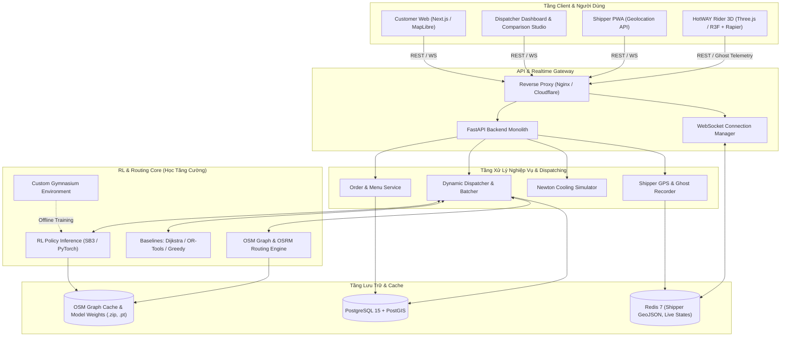
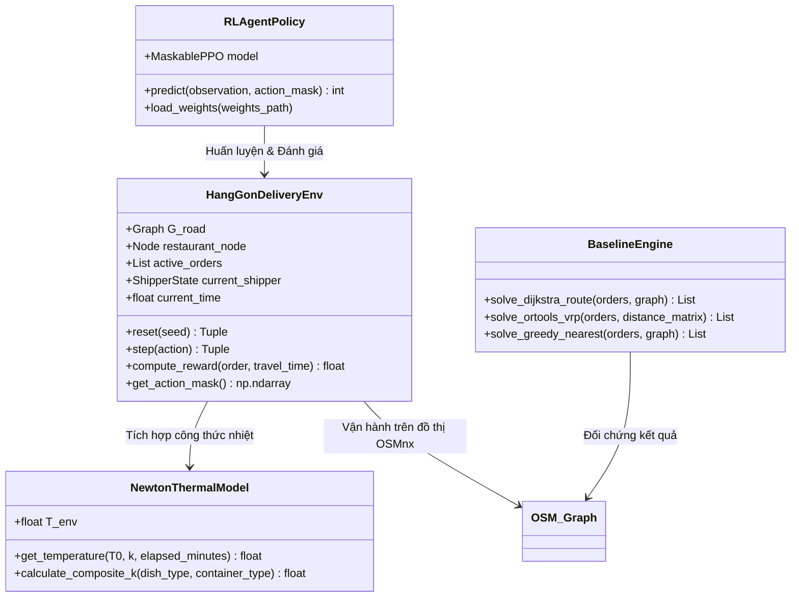
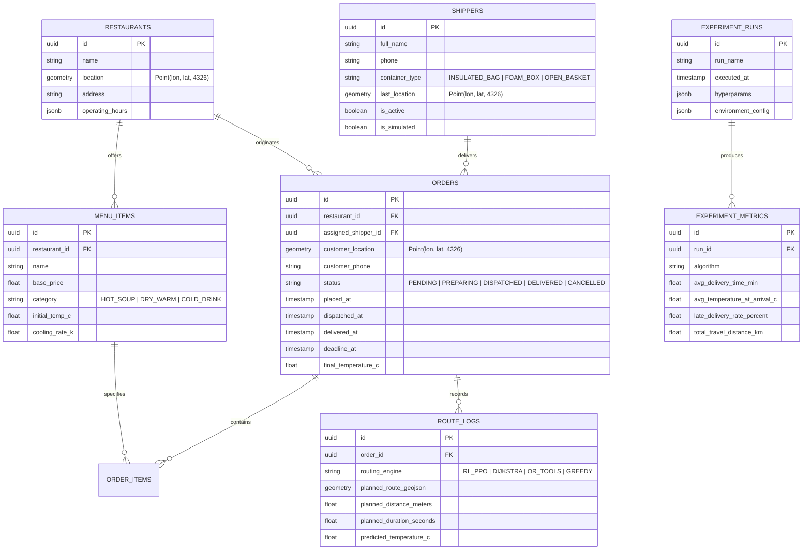
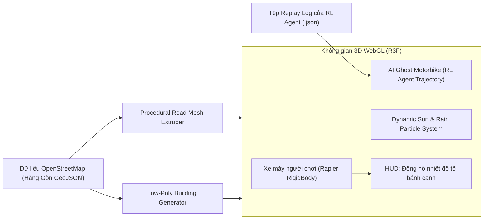

# Technical Architecture Document — HotWAY

**Hệ thống:** HotWAY Thermal-Aware Routing & Real-Time Dispatch Ecosystem  
**Phiên bản:** v1.0.0  
**Ngày cập nhật:** 2026-10-19  

---

## 1. Sơ đồ Kiến trúc Tổng thể (System Overview Diagram)

Hệ thống HotWAY được thiết kế theo mô hình **Modular Monolith** nhằm tối ưu hóa sự tương tác trực tiếp và độ trễ cực thấp giữa mô hình Học Tăng Cường (Python/PyTorch) và tầng dịch vụ Web (FastAPI).



---

## 2. Ngăn xếp Công nghệ (Technology Stack)

| Phân hệ | Công nghệ lựa chọn | Phiên bản khuyến nghị | Lý do lựa chọn |
|---|---|---|---|
| **RL Training** | Python, Gymnasium, Stable-Baselines3, PyTorch | Python 3.10+, SB3 v2.3+, PyTorch 2.3+ | Nền tảng tiêu chuẩn học máy, hỗ trợ Action Masking, PPO, DQN và logging TensorBoard/W&B. |
| **GIS & Bản đồ** | OSMnx, NetworkX, Shapely, GeoPandas | OSMnx 1.9+, GeoPandas 0.14+ | Tự động tải, phân tích và tiền xử lý đồ thị giao thông thực tế từ OpenStreetMap xã Hàng Gòn. |
| **Routing Engine** | OSRM backend (hoặc NetworkX Shortest Path fallback) | OSRM v5.27+ | Tính toán ma trận khoảng cách và lộ trình đường bộ cực nhanh (hàng nghìn phép tính/giây). |
| **Backend Core** | FastAPI, Uvicorn, Pydantic v2 | FastAPI 0.111+, Pydantic 2.7+ | Tận dụng chung môi trường Python với mô hình AI, tốc độ cao (Asynchronous), hỗ trợ WebSocket native. |
| **Database** | PostgreSQL + PostGIS extension | PostgreSQL 15+, PostGIS 3.4+ | Quản lý quan hệ đơn hàng và hỗ trợ truy vấn không gian địa lý (khoảng cách, ranh giới xã Hàng Gòn). |
| **Cache & Realtime** | Redis, Redis Pub/Sub | Redis 7.2+ | Caching tọa độ GPS của shipper dạng `GEOADD`, lưu trữ state tạm và broadcast thông điệp real-time. |
| **Frontend & WebGIS** | Next.js (App Router), TypeScript, TailwindCSS | Next.js 14.2+, TS 5.4+ | Tối ưu hóa SEO, rendering phía client/server linh hoạt, giao diện hiện đại và phản hồi nhanh. |
| **Map Rendering** | MapLibre GL JS, deck.gl | MapLibre 4.1+, deck.gl 9.0+ | Bản đồ vector miễn phí 100%, không cần thẻ tín dụng (khác Google Maps), deck.gl giúp vẽ animation shipper mượt 60 FPS. |
| **3D Mini-game** | React Three Fiber (Three.js), `@react-three/rapier` | Three.js r164+, R3F v8+ | Tích hợp thẳng vào Next.js, low-poly procedural rendering trực tiếp từ dữ liệu tọa độ OSM, vật lý nhẹ nhàng. |
| **Đóng gói & Chạy** | Docker, Docker Compose | Docker 26+, Compose v2 | Triển khai nhanh chóng toàn bộ stack (FastAPI, Postgres, Redis, OSRM) chỉ bằng 1 câu lệnh. |

---

## 3. Kiến trúc Chi tiết từng Phân hệ

### 3.1. Phân hệ Học Tăng Cường (Reinforcement Learning Core)



#### Thiết kế luồng suy luận phục vụ Web (Inference Pipeline):
1. **Tiếp nhận State:** Khi có đơn mới hoặc shipper hoàn thành 1 điểm dừng, `DispatchService` thu thập trạng thái hệ thống (tọa độ shipper, danh sách đơn chờ, thời gian hiện tại, thời tiết).
2. **Vector hóa quan sát:** Vector đặc trưng được chuẩn hóa (normalize tọa độ về $[-1, 1]$, nhiệt độ về $[0, 1]$, thời gian về $[0, 24]$ giờ).
3. **Action Masking:** Loại bỏ các đơn đã giao hoặc không khả thi về thời hạn (deadline).
4. **Suy luận Policy:** Mô hình MaskablePPO tải sẵn trong RAM thực thi `model.predict(obs, action_masks=mask, deterministic=True)` trong $< 15\,\text{ms}$.
5. **Sinh lộ trình chi tiết:** Lấy chỉ số đơn tiếp theo, gọi OSRM để tạo polyline chi tiết giữa điểm hiện tại của shipper và địa chỉ giao của đơn.

---

### 3.2. Cơ chế Đồng bộ Thời gian thực & WebSocket Protocol

Hệ sinh thái duy trì kết nối WebSocket hai chiều giữa Backend và các Client (`Customer`, `Dispatcher`, `Shipper`).

#### Các kênh WebSocket chính:
- `/ws/tracking/{order_id}`: Kênh dành cho khách hàng theo dõi trạng thái đơn và nhiệt độ món.
- `/ws/dispatcher`: Kênh dành cho chủ quán xem tổng thể vị trí các shipper và trạng thái hàng đợi đơn.
- `/ws/driver/{driver_id}`: Kênh nhận tọa độ GPS liên tục từ PWA tài xế và đẩy lệnh lộ trình mới.

#### Định dạng thông điệp WebSocket (Message Payload Sample):

```json
{
  "event": "SHIPPER_TELEMETRY_UPDATE",
  "timestamp": 1729302945,
  "data": {
    "driver_id": "drv_hg_01",
    "location": {
      "latitude": 10.923412,
      "longitude": 107.241589,
      "heading": 85.5,
      "speed_kmh": 32.4
    },
    "current_order_id": "ord_88219",
    "thermal_telemetry": {
      "dish_name": "Bánh canh gà tô đặc biệt",
      "initial_temperature_c": 88.0,
      "current_estimated_c": 71.4,
      "projected_arrival_c": 64.2,
      "status": "HOT_AND_FRESH"
    },
    "eta_seconds": 380,
    "remaining_distance_meters": 1850
  }
}
```

---

### 3.3. Cấu trúc Cơ sở Dữ liệu (Database Schema / PostGIS DDL)

Hệ thống sử dụng PostgreSQL với phần mở rộng PostGIS để xử lý dữ liệu địa không gian.



---

### 3.4. Kiến trúc Mini-game 3D "HotWAY Rider"

Mini-game tích hợp trực tiếp vào ứng dụng web thông qua React Three Fiber, tạo điểm nhấn trải nghiệm cho đồ án:



1. **Sinh địa hình từ bản đồ thật:** Trục đường Quốc lộ 56 và các tuyến nhánh tại Hàng Gòn được trích xuất tọa độ đỉnh và ép đùn (extrude) thành mặt đường nhựa và vạch sơn low-poly.
2. **Xe máy người chơi:** Điều khiển xe máy bằng phím mũi tên hoặc WASD, tương tác vật lý chân thực với mặt đường nhờ thư viện `@react-three/rapier`.
3. **Bóng ma AI (Ghost AI):** Khi bắt đầu cuộc đua, một xe máy ảo mờ ảo (hologram ghost) xuất hiện và chạy chính xác theo các mốc tọa độ và vận tốc mà Agent RL đã giải được.
4. **Cơ chế tính điểm:** Điểm số của người chơi = $T_{\text{delivered}} \times 100 - \text{Thời gian vi phạm}$. Người chơi phải học cách chọn tuyến đường ngắn và tránh kẹt xe để giữ bánh canh nóng hơn cả AI!
