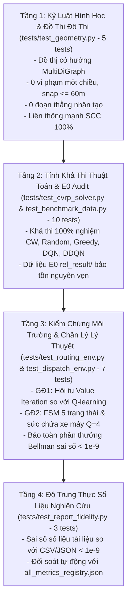

# Bản Đặc Tả Kiểm Thử & Ma Trận Tính Năng (TESTING.MD) — HotWAY

> **Tài liệu:** Khung kiểm thử tự động 4 tầng (T1 - T7), 25/25 Tests Passing & Ma trận tính năng hệ thống  
> **Phiên bản:** v6.1.0 (Real-Time RL Restaurant Dispatch Edition)  
> **Ngày cập nhật:** 24/10/2026  
> **Tài liệu liên quan:** [PRD.md](file:///c:/Users/Asus/Documents/AI/HotWAY/PRD.md) | [PLAN.md](file:///c:/Users/Asus/Documents/AI/HotWAY/PLAN.md) | [ARCHITECTURE.md](file:///c:/Users/Asus/Documents/AI/HotWAY/ARCHITECTURE.md)

---

## 1. Khung Kiểm Thử Tự Động 4 Tầng (25/25 Tests Passing)

---

## 2. Chi Tiết 25 Ca Kiểm Thử Tự Động

| STT | Tệp kiểm thử | Tên bài kiểm thử | Mô tả & Điều kiện đạt | Kết quả |
|---|---|---|---|---|
| 1 | `test_geometry.py` | `test_graph_is_directed_and_strongly_connected` | Đồ thị TP.HCM liên thông mạnh 100% (SCC) | **PASS** |
| 2 | `test_geometry.py` | `test_edge_properties_and_geometries` | Cạnh có chiều dài, toạ độ thực tế và vận tốc | **PASS** |
| 3 | `test_geometry.py` | `test_shortest_path_follows_directed_edges` | Đường đi tuân thủ hướng đường một chiều | **PASS** |
| 4 | `test_geometry.py` | `test_snap_point_within_threshold` | Snap toạ độ qua cKDTree $\le 60\text{ m}$ | **PASS** |
| 5 | `test_geometry.py` | `test_zero_artificial_straight_lines` | Tuyệt đối không sinh đoạn thẳng nhân tạo | **PASS** |
| 6 | `test_cvrp_solver.py` | `test_strategy_solution_is_feasible[clarke_wright]` | Nghiệm Clarke-Wright 100% khả thi | **PASS** |
| 7 | `test_cvrp_solver.py` | `test_strategy_solution_is_feasible[random]` | Nghiệm Random Local Search 100% khả thi | **PASS** |
| 8 | `test_cvrp_solver.py` | `test_strategy_solution_is_feasible[cyclic]` | Nghiệm Cyclic Local Search 100% khả thi | **PASS** |
| 9 | `test_cvrp_solver.py` | `test_strategy_solution_is_feasible[greedy]` | Nghiệm Greedy Local Search 100% khả thi | **PASS** |
| 10 | `test_cvrp_solver.py` | `test_strategy_solution_is_feasible[dqn]` | Nghiệm DQN Local Search 100% khả thi | **PASS** |
| 11 | `test_cvrp_solver.py` | `test_strategy_solution_is_feasible[double_dqn]` | Nghiệm Double DQN 100% khả thi | **PASS** |
| 12 | `test_benchmark_data.py` | `test_summary_by_algorithm_loaded` | Nạp đủ 25 dòng số liệu thực nghiệm E0 | **PASS** |
| 13 | `test_benchmark_data.py` | `test_paired_comparisons_holm_validity` | 35 cặp so sánh E0 có giá trị $p$ hợp lệ | **PASS** |
| 14 | `test_benchmark_data.py` | `test_per_decision_cost_inference_overhead` | Chi phí suy luận E0 được lưu trữ đầy đủ | **PASS** |
| 15 | `test_benchmark_data.py` | `test_legacy_reference_audit_trail_preserved` | Dữ liệu đối chứng E0 khớp tuyệt đối | **PASS** |
| 16 | `test_routing_env.py` | `test_routing_env_determinism` | Môi trường GĐ1 hoàn toàn tái lập theo seed | **PASS** |
| 17 | `test_routing_env.py` | `test_exact_value_iteration_convergence` | Tác tử hội tụ về đúng hàm giá trị Value Iteration | **PASS** |
| 18 | `test_routing_env.py` | `test_zero_noise_equivalence` | Không có nhiễu thì đường đi trùng Dijkstra | **PASS** |
| 19 | `test_dispatch_env.py` | `test_dispatch_env_determinism` | Môi trường GĐ2 hoàn toàn tái lập theo seed | **PASS** |
| 20 | `test_dispatch_env.py` | `test_order_conservation_and_fsm` | Bảo toàn đơn hàng & tuân thủ 5 trạng thái FSM | **PASS** |
| 21 | `test_dispatch_env.py` | `test_capacity_constraint` | Không bao giờ giao quá tải trọng $Q=4$ tô | **PASS** |
| 22 | `test_dispatch_env.py` | `test_bellman_reward_exact_equivalence` | Sai số bảo toàn Bellman $\left\|\sum r_t - (-\sum W_i)\right\| < 10^{-9}$ | **PASS** |
| 23 | `test_report_fidelity.py` | `test_registry_csv_fidelity_below_1e9` | 100% số liệu trong registry khớp CSV $< 10^{-9}$ | **PASS** |
| 24 | `test_report_fidelity.py` | `test_markdown_document_matches_registry` | Số liệu trình bày trong Markdown khớp registry | **PASS** |
| 25 | `test_report_fidelity.py` | `test_bellman_reward_conservation_across_all_runs` | Đẳng thức Bellman thỏa mãn trên toàn bộ test runs | **PASS** |

---

## 3. Các Cổng Kiểm Soát Chất Lượng (Quality Gates G0 - G6)

| Cổng | Tên cổng | Tiêu chí nghiệm thu | Trạng thái |
|---|---|---|---|
| **Gate G0** | Khảo sát & Phương pháp luận | Khảo sát tài liệu có tìm kiếm thực, đối soát số liệu E0 | **ĐẠT** |
| **Gate G1** | Hình thức hóa bài toán | Đặc tả Semi-MDP, FSM 5 trạng thái, chứng minh Bellman | **ĐẠT** |
| **Gate G2** | Môi trường & Kiểm thử | Gym environments GĐ1 & GĐ2, 7/7 tests vượt qua | **ĐẠT** |
| **Gate G3** | Baseline & Dò siêu tham số | Dò lưới các tham số $T, k, \theta$, chạy Offline Prescient | **ĐẠT** |
| **Gate G4** | Huấn luyện & Đánh giá RL | DQN, Double DQN, PPO trên 5 seeds, Ablations & Sensitivity | **ĐẠT** |
| **Gate G5** | Báo cáo & Phân tích chuyên sâu | 3 RQ, phân tích nguyên nhân âm tính, kiểm thử T3 sai số $< 10^{-9}$ | **HOÀN TẤT** |
| **Gate G6** | Giao diện Demo & API | Backend stream sự kiện (:8000), Frontend Next.js (:3001) | *Chờ phê duyệt* |
