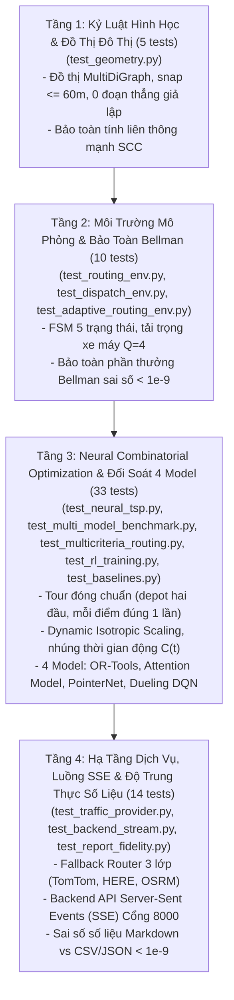

# Bản Đặc Tả Kiểm Thử & Ma Trận Tính Năng (TESTING.MD) — HotWAY

> **Tài liệu:** Khung kiểm thử tự động 4 tầng (T1 - T4), 62/62 Tests Passing & Ma trận tính năng hệ thống  
> **Phiên bản:** v7.3.2 (Nationwide Multi-Model NCO & Production WebGIS Edition)  
> **Ngày cập nhật:** 02/11/2026  
> **Tài liệu liên quan:** [PRD.md](file:///c:/Users/Asus/Documents/AI/HotWAY/PRD.md) | [PLAN.md](file:///c:/Users/Asus/Documents/AI/HotWAY/PLAN.md) | [ARCHITECTURE.md](file:///c:/Users/Asus/Documents/AI/HotWAY/ARCHITECTURE.md) | [ALGORITHM.md](file:///c:/Users/Asus/Documents/AI/HotWAY/ALGORITHM.md)

---

## 1. Khung Kiểm Thử Tự Động 4 Tầng (62/62 Tests Passing)



---

## 2. Danh Sách 12 Tệp Kiểm Thử Tự Động (Tổng 62 Bài Test)

| STT | Tệp kiểm thử | Số ca test | Phạm vi kiểm tra | Kết quả |
|---|---|:---:|---|:---:|
| 1 | `tests/test_geometry.py` | 5 | Đồ thị liên thông mạnh, snap cKDTree $\le 60\text{m}$, không sinh đường nhân tạo | **62/62 PASS** |
| 2 | `tests/test_routing_env.py` | 3 | Tính tái lập seed, hội tụ Value Iteration so với Q-learning | **PASS** |
| 3 | `tests/test_dispatch_env.py` | 4 | Máy trạng thái đơn FSM, sức chứa xe $Q=4$, bảo toàn phần thưởng Bellman | **PASS** |
| 4 | `tests/test_adaptive_routing_env.py` | 3 | Tái định tuyến thích nghi khi có tắc đường đột xuất trên nhánh đường | **PASS** |
| 5 | `tests/test_neural_tsp.py` | 5 | Kiến trúc Attention Model, cơ chế Pointer Masking, chuẩn hóa Isotropic | **PASS** |
| 6 | `tests/test_multi_model_benchmark.py` | 14 | Chu trình đóng (validate closed tour), đối soát 4 mô hình trên 100 POI Toàn Quốc | **PASS** |
| 7 | `tests/test_multicriteria_routing.py` | 4 | Tối ưu hóa Pareto T1 (Nhanh nhất, Ngắn nhất, Ổn định nhất, Dễ đi nhất) | **PASS** |
| 8 | `tests/test_rl_training.py` | 4 | Vòng lặp huấn luyện tăng cường, hàm mục tiêu REINFORCE, tính khả thi route | **PASS** |
| 9 | `tests/test_baselines.py` | 5 | Các thuật toán heuristic tham chiếu (Clarke-Wright, Nearest Neighbor, Heuristics) | **PASS** |
| 10 | `tests/test_traffic_provider.py` | 6 | Fallback Router 3 lớp (TomTom -> HERE -> OSRM Offline với $C(t)$) | **PASS** |
| 11 | `tests/test_backend_stream.py` | 6 | FastAPI stream endpoint `/api/v1/sim/stream`, luồng SSE, chuẩn hóa API Schema | **PASS** |
| 12 | `tests/test_report_fidelity.py` | 3 | Kiểm tra độ trung thực 100% giữa tài liệu báo cáo Markdown và CSV/JSON | **PASS** |

---

## 3. Lệnh Thực Thi Kiểm Thử Toàn Diện

```bash
# Thực thi toàn bộ 62 ca kiểm thử
py -3.13 -m pytest tests/ -v

# Kiểm thử riêng nhóm đối soát 4 mô hình NCO
py -3.13 -m pytest tests/test_multi_model_benchmark.py -v
```
