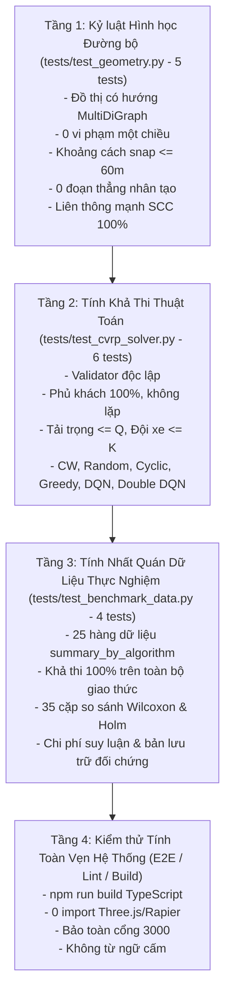

# Bản Đặc Tả Kiểm Thử & Ma Trận Tính Năng (TESTING.MD) — HotWAY

> **Tài liệu:** Khung kiểm thử tự động 4 tầng & Ma trận tính năng hệ thống (~35 mục)  
> **Phiên bản:** v5.0.0 (Production Multi-Region & Live Benchmark Edition)  
> **Ngày cập nhật:** 21/10/2026  
> **Tài liệu liên quan:** [PRD.md](file:///c:/Users/TanPhat/Documents/AI_E/HotWAY/PRD.md) | [PLAN.md](file:///c:/Users/TanPhat/Documents/AI_E/HotWAY/PLAN.md)

---

## 1. Khung Kiểm Thử Tự Động 4 Tầng (15/15 Tests Passing)

---

## 2. Ma Trận Tính Năng Hệ Thống Chuẩn Hóa (35 Mục)

### Nhóm 1: Dữ Liệu Không Gian & Đồ Thị Đường Bộ (Mục 1 - 7)
- **F01:** Nguồn sự thật duy nhất tại `config/site.yaml` (depot, bán kính, thông số đội xe, đa vùng `binhthanh` và `hcmc_compact`).
- **F02:** Tải và xây dựng đồ thị đường bộ có hướng OSMnx toàn TP.HCM (**46,055 nút, 107,224 cạnh, 8,551 km đường**).
- **F03:** Kiểm tra và trích xuất thành phần liên thông mạnh lớn nhất (SCC) đạt tỷ lệ liên thông 100%.
- **F04:** Snap toạ độ điểm giao hàng vào nút giao thông gần nhất bằng **cKDTree** trong thời gian $< 0.1\text{ ms}$.
- **F05:** Cảnh báo tự động khi khoảng cách snap vượt quá ngưỡng an toàn $\le 60\text{ m}$.
- **F06:** Tính toán độ dài cạnh theo công thức Haversine chính xác.
- **F07:** Xuất khẩu các định dạng lưu trữ: GraphML, cache pickle, và GeoJSON cho WebGIS (107k features).

### Nhóm 2: Ma Trận Chi Phí & Mô Hình CVRP (Mục 8 - 14)
- **F08:** Dịch vụ `road_matrix` tính toán ma trận khoảng cách bất đối xứng $C_{ij}$ bằng Dijkstra đơn nguồn.
- **F09:** Tính toán ma trận thời gian di chuyển bất đối xứng $t_{ij}$.
- **F10:** Lưu trữ và trích xuất hình học toạ độ chi tiết cho từng chặng (`leg_geometries: [[[lat, lon], ...], ...]`).
- **F11:** Cơ chế lưu đệm bộ nhớ (in-memory cache) theo mã băm SHA-256 của tập nút.
- **F12:** Khởi tạo nghiệm ban đầu bằng thuật toán Clarke-Wright Savings trên ma trận bất đối xứng.
- **F13:** Bộ sinh 30 benchmark instances ngẫu nhiên chuẩn hóa (`data/benchmark_instances/`).
- **F14:** Bộ validator độc lập kiểm tra tính khả thi và tính lại tổng khoảng cách.

### Nhóm 3: Thuật Toán Tìm Kiếm Cục Bộ & Học Tăng Cường (Mục 15 - 22)
- **F15:** Toán tử `two_opt` với công thức tính $\Delta C$ chính xác cho ma trận bất đối xứng.
- **F16:** Toán tử `intra_relocate` di chuyển khách hàng trong cùng tuyến.
- **F17:** Toán tử `inter_relocate` chuyển khách hàng giữa hai tuyến có kiểm tra tải $\le Q$.
- **F18:** Toán tử `inter_swap` hoán đổi hai khách hàng giữa hai tuyến có kiểm tra tải $\le Q$.
- **F19:** Lấy mẫu ngẫu nhiên tối đa 128/256 ứng viên mỗi bước theo luật chấp nhận giảm nghiêm ngặt.
- **F20:** Vector đặc trưng trạng thái F28 (28 chiều) với `feature_patience = 30` độc lập.
- **F21:** Huấn luyện mạng nơ-ron Q-Network (PyTorch MLP $28 \to 128 \to 128 \to 4$) cho DQN và Double DQN, lưu checkpoint tại `src/cvrp_solver/weights/`.
- **F22:** Pipeline chạy benchmark tự động 750 lượt qua 5 giao thức ($A2, A, A3, B, B2$).

### Nhóm 4: Ràng Buộc Nhiệt & Phân Tích Thống Kê (Mục 23 - 27)
- **F23:** Định luật làm nguội Newton quy đổi sang giới hạn thời gian di chuyển tối đa $t_{\max} \approx 30.3\text{ phút}$.
- **F24:** Tính toán nhiệt độ ước tính tại từng điểm dừng và gắn cờ cảnh báo quá hạn nhiệt.
- **F25:** Xuất khẩu bảng tổng hợp thực nghiệm tự sinh `rel_result/summary_by_algorithm.csv`.
- **F26:** Kiểm định thống kê theo cặp Wilcoxon Signed-Rank và hiệu chỉnh Holm-Bonferroni `rel_result/paired_comparisons.csv`.
- **F27:** Đo lường chi phí suy luận và số candidate đánh giá thực tế `rel_result/per_decision_cost.csv`.

### Nhóm 5: Backend API & Giao Diện Người Dùng (Mục 28 - 35)
- **F28:** API `POST /api/v1/scenarios` tiếp nhận đơn hàng và tạo kịch bản mẫu tự động.
- **F29:** API `POST /api/v1/plans` lập kế hoạch tuyến đường với cơ chế tự động fallback.
- **F30:** API `GET /api/v1/strategies/benchmark` cung cấp số liệu thực nghiệm tự sinh nguyên bản.
- **F31:** API `GET /api/v1/sim/{plan_id}` truyền phát toạ độ mô phỏng di chuyển tài xế.
- **F32:** Giao diện điều phối 3 cột OptimoRoute: Sidebar cố định, bảng danh sách, bản đồ MapLibre.
- **F33:** Màn hình Strategy Lab trình bày số liệu khoa học và phân tích cơ chế hoạt động của các phương pháp.
- **F34:** Màn hình Search Replay phát lại từng bước chọn toán tử với thanh tua tốc độ $1\times, 4\times, 16\times$.
- **F35:** Sổ tay Jupyter tương tác `notebooks/cvrp_benchmark.ipynb` phục vụ phân tích trực quan.

---

## 3. Cổng Chất Lượng & Tiêu Chí Nghiệm Thu (Quality Gates)

| Cổng chất lượng | Điều kiện vượt qua | Kết quả kiểm thử |
|---|---|---|
| **Gate 1: Hình học (T1)** | 100% cạnh liên tiếp nằm trong đồ thị có hướng, snap $\le 60\text{ m}$ | `pytest tests/test_geometry.py` (**5/5 PASS**) |
| **Gate 2: Khả thi (T2)** | Validator độc lập xác nhận 100% nghiệm hợp lệ trên cả 6 chiến lược | `pytest tests/test_cvrp_solver.py` (**6/6 PASS**) |
| **Gate 3: Nhất quán (T3)** | Dữ liệu benchmark 750 lượt chạy tự sinh đạt 100% khả thi | `pytest tests/test_benchmark_data.py` (**4/4 PASS**) |
| **Gate 4: Độ sạch mã nguồn (T7)** | `npm run build` thành công, 0 import Three.js/Rapier | `npm run build` (**PASS**) |
| **Gate 5: An toàn cổng mạng (T6)** | Cổng 3000 hoàn toàn tự do, Frontend chạy trên 3001, Backend trên 8000 | `Get-NetTCPConnection` (**PASS**) |
