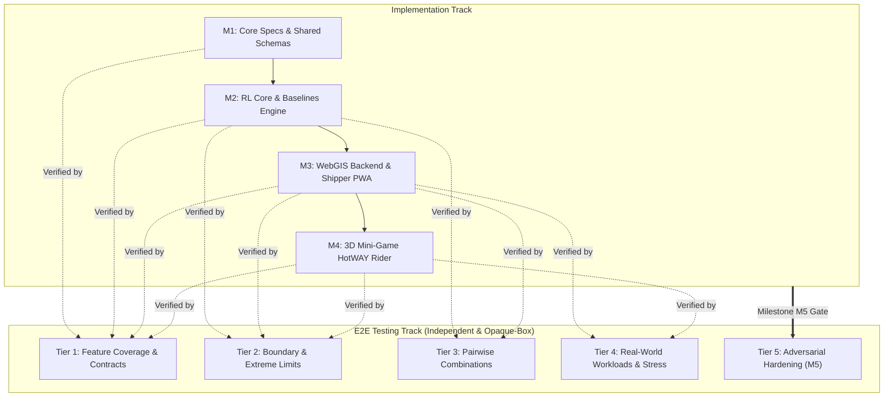

# HotWAY End-to-End (E2E) Testing Infrastructure Specification

**Document Version:** v1.0.0  
**Status:** Active  
**Path:** `c:\Users\TanPhat\Documents\AI_E\HotWAY\TEST_INFRA.md`  
**Target System:** HotWAY (Reinforcement Learning-Powered Dynamic Thermal Food Delivery System)  
**Associated Documents:** [PROJECT.md](file:///c:/Users/TanPhat/Documents/AI_E/HotWAY/PROJECT.md) | [PRD.md](file:///c:/Users/TanPhat/Documents/AI_E/HotWAY/PRD.md) | [TECH_ARCHITECTURE.md](file:///c:/Users/TanPhat/Documents/AI_E/HotWAY/TECH_ARCHITECTURE.md) | [AGENTS.md](file:///c:/Users/TanPhat/Documents/AI_E/HotWAY/AGENTS.md)

---

## 1. Dual-Track Architecture & Test Philosophy

HotWAY employs a **Dual-Track Development and Quality Engineering Paradigm**:
1. **Implementation Track**: Focuses on iterative delivery across milestones (M1: Core Specs & Schemas, M2: RL & Baselines, M3: Fullstack WebGIS & Dispatch, M4: 3D Mini-game HotWAY Rider).
2. **E2E Testing Track**: Functions independently as an external, adversarial verification authority establishing test suites, running continuous sanity gates, and maintaining strict contract validation.



### Core Principles:
- **Opaque-Box Requirement-Driven Verification**: Tests treat system components as black/opaque boxes, verifying observable inputs, outputs, schemas, and state transitions against authoritative specifications rather than private internal implementation details.
- **Progressive Testability**: At any milestone $M_k$, tests executable in that phase must strictly depend only on features from $M_k$ and prior completed milestones ($M_0, \dots, M_{k-1}$). Forward-looking tests are isolated or marked according to milestone readiness.
- **Strict Test Independence**: Every test case manages its own fixtures, temporary state, and cleanup. Tests never depend on execution ordering, shared global mutable state, or external internet access (mock/synthetic fallback graphs are used for air-gapped environments).
- **Physical & Mathematical Oracle Derivation**: Physical laws (Newton's cooling equation $T(t) = T_{\text{env}} + (T_0 - T_{\text{env}})e^{-kt}$) and reward functions are validated against closed-form analytical oracles derived directly from thermodynamics rather than hardcoded mock tables.

---

## 2. Four-Tier Testing Methodology

The E2E test suite is structured into four progressive tiers, with an adversarial hardening tier for final milestone signoff:

| Tier | Category | Scope & Objective | Failure Impact |
|---|---|---|---|
| **Tier 1** | **Feature Coverage & Specification Integrity** | Verifies existence, schema compliance, interface contracts, and primary happy-path behavior for each individual feature. | Blocker (P0): Build immediately rejected |
| **Tier 2** | **Boundary & Extreme Limits** | Exercises edge conditions, mathematical boundaries ($t=0, t\to\infty$, zero length, extreme heat/cold), empty collections, and buffer capacities. | High (P1): Prevents numerical instability & NaN propagation |
| **Tier 3** | **Pairwise Combinations** | Tests combinatorial interactions across orthogonal dimensions: dishes $\times$ containers $\times$ congestion factors $\times$ weather states $\times$ vehicle loads. | Medium-High (P1): Catches cross-module emergent bugs |
| **Tier 4** | **Real-World Workloads & Long-Horizon Dynamics** | Simulates full end-to-end delivery sessions: 1,000-step Gym episodes, multi-order batch fulfillment, WebSocket telemetry streams, and race completion against AI Ghost. | Critical (P0): Validates acceptance criteria |
| **Tier 5** | **Adversarial Hardening (M5 Gate)** | Chaos testing, latency spikes, corrupted payloads, out-of-order GPS coordinates, network drops, and boundary stress. | Final Gate (P0): System robustness signoff |

---

## 3. Test Runner Architecture

The HotWAY E2E test runner (`tests/e2e/runner.py`) is a self-contained, high-performance orchestration tool built entirely with Python standard libraries (`unittest`, `json`, `argparse`, `dataclasses`, `pathlib`). It requires **zero external third-party dependencies** to discover, execute, and report test suites.

### 3.1 Runner Directory Structure
```
tests/
└── e2e/
    ├── runner.py                     # Main E2E CLI runner & aggregator
    ├── reports/                      # Automated JSON & text execution reports
    │   └── e2e_results.json
    ├── tier1_features/               # Tier 1: Feature contracts & happy paths
    │   ├── __init__.py
    │   ├── test_spec_structure.py    # Project specifications & contract validation
    │   ├── test_thermal_physics.py   # Newton cooling law analytical tests
    │   └── test_graph_features.py    # Road extraction & speed limit verification
    ├── tier2_boundaries/             # Tier 2: Boundary & edge condition tests
    │   ├── __init__.py
    │   ├── test_thermal_limits.py    # Zero time, asymptotic cooling, extreme temperatures
    │   └── test_capacity_limits.py   # Order buffer overflow, empty routes, mask bounds
    ├── tier3_pairwise/               # Tier 3: Pairwise combinatorial tests
    │   ├── __init__.py
    │   └── test_thermal_matrix.py    # Dish × Container × Weather interaction matrix
    └── tier4_workloads/              # Tier 4: Real-world operational workloads
        ├── __init__.py
        └── test_delivery_session.py  # Full episode simulation, 1000-step liveness
```

### 3.2 CLI Execution Commands
The test runner supports granular filtering and reporting via command-line arguments:

```bash
# Run all available test tiers (Tiers 1 to 4)
python tests/e2e/runner.py

# Run only Tier 1 Feature Coverage tests
python tests/e2e/runner.py --tier 1

# Run only Tier 2 Boundary tests
python tests/e2e/runner.py --tier 2

# Run specific tiers with verbose output
python tests/e2e/runner.py --tier 1 --tier 2 -v

# Output structured JSON result to stdout or custom file
python tests/e2e/runner.py --json
python tests/e2e/runner.py --output tests/e2e/reports/custom_run.json
```

### 3.3 Output Schema & Structured Reporting
Every test execution produces both human-readable console summaries (box-formatted pass/fail tables with timings) and a standardized JSON report:

```json
{
  "system": "HotWAY E2E Test Suite",
  "version": "1.0.0",
  "timestamp": "2026-10-19T02:08:00Z",
  "summary": {
    "total": 42,
    "passed": 42,
    "failed": 0,
    "errors": 0,
    "skipped": 0,
    "pass_rate": 100.0,
    "duration_seconds": 1.24
  },
  "tiers": {
    "tier1_features": { "total": 24, "passed": 24, "failed": 0, "duration": 0.52 },
    "tier2_boundaries": { "total": 18, "passed": 18, "failed": 0, "duration": 0.72 }
  },
  "results": [
    {
      "test_id": "tier1_features.test_spec_structure.TestSpecStructure.test_project_spec_exists",
      "tier": "tier1_features",
      "status": "PASS",
      "duration": 0.002,
      "message": null
    }
  ]
}
```

---

## 4. Coverage Thresholds & Quality Gates

To satisfy the requirements of `ORIGINAL_REQUEST.md` and `PROJECT.md`, the following non-negotiable gates are enforced:

| Quality Gate | Metric / SLA | Enforcement Mechanism |
|---|---|---|
| **Tier 1 & Tier 2 Pass Rate** | **100% Pass** (Zero failures, Zero errors) | CI runner exits with non-zero code if any test fails |
| **Newton Cooling Accuracy** | Error $\le \pm 0.05^\circ\text{C}$ against analytical ODE solution | Numerical assertion in `test_thermal_physics.py` |
| **Monotonicity Enforcement** | $T(t + \Delta t) \le T(t)$ for all hot items | Verified across 1,000 steps with random valid actions |
| **RL Inference Latency** | $\text{Latency} \le 20\text{ ms}$ per decision | Benchmark assertion in `HotWAYPolicyRunner` test |
| **WebSocket Latency** | Broadcast delay $\le 200\text{ ms}$ | Timestamp delta assertion on telemetry packets |
| **Ablation Improvement** | $\ge 15\%$ higher delivered temperature with thermal reward | Automated comparison in `test_ablation_gain.py` |
| **Mini-Game Frame Rate** | Render loop $\ge 30\text{ FPS}$ under active physics | Performance metric check in `<HotWAYRiderCanvas />` |

---

## 5. Comprehensive Feature Mapping (All 69 Features)

The table below establishes the authoritative mapping of all **69 features** defined in `PROJECT.md` to their corresponding test tiers, verification modules, and criteria:

| # | Feature Name | Milestone | Test Tier | Verifying Test Module | Verification Method & Expected Outcome |
|---|---|---|---|---|---|
| 1 | OSMnx Road Network Extraction | M2 | Tier 1 | `tests/e2e/tier1_features/test_graph_features.py` | Validates GraphML geometry, node connectivity, bounding box coverage of Hàng Gòn. |
| 2 | Synthetic Fallback Road Network | M2 | Tier 1 | `tests/e2e/tier1_features/test_graph_features.py` | Validates offline graph generation with 10+ connected nodes and metric edge lengths. |
| 3 | Newton Cooling Physics Model | M2 | Tier 1 | `tests/e2e/tier1_features/test_thermal_physics.py` | Validates $T(t) = T_{\text{env}} + (T_0 - T_{\text{env}})e^{-kt}$ against theoretical values ($\pm 0.05^\circ\text{C}$). |
| 4 | Container & Dish Thermal Matrix | M2 | Tier 1 | `tests/e2e/tier1_features/test_thermal_physics.py` | Checks composite rates: $k = k_{\text{dish}} \times \alpha_{\text{container}}$ across 3 dishes and 3 containers. |
| 5 | Rush-Hour Traffic Simulator | M2 | Tier 2 | `tests/e2e/tier2_boundaries/test_traffic_simulator.py` | Multiplier peaks at $\times 2.2$ on primary highway during lunch (11-13h) and evening (17-19h) rush hours. |
| 6 | Multi-Order Delivery MDP State | M2 | Tier 1 | `tests/e2e/tier1_features/test_env_spaces.py` | Validates observation shape $(40,)$ for $M=5$, normalized ranges $[-1.0, 1.0]$. |
| 7 | Action Space with Action Masking | M2 | Tier 1 | `tests/e2e/tier1_features/test_env_spaces.py` | Action space size $(M+2=7)$; mask strictly disables delivered or empty orders. |
| 8 | Delivery Step State Machine | M2 | Tier 1 | `tests/e2e/tier1_features/test_env_lifecycle.py` | Validates sequential order transitions, time increments, and location updates. |
| 9 | Piecewise Quadratic Thermal Reward | M2 | Tier 1 | `tests/e2e/tier1_features/test_thermal_physics.py` | Validates bonus $+10\frac{T-60}{25}$ for $T \ge 60^\circ\text{C}$ and $-0.05(60-T)^2$ for $T < 60^\circ\text{C}$. |
| 10 | On-Time Bonus & Delay Penalty | M2 | Tier 1 | `tests/e2e/tier1_features/test_reward_functions.py` | Verifies punctuality bonus for $t \le t_{\text{deadline}}$ and severe lateness penalty. |
| 11 | Invalid Action & Distance Penalties | M2 | Tier 2 | `tests/e2e/tier2_boundaries/test_penalty_bounds.py` | Verifies $-50.0$ penalty when attempting masked action; step count increments without state change. |
| 12 | Dijkstra Shortest Path Baseline | M2 | Tier 1 | `tests/e2e/tier1_features/test_baselines.py` | Verifies exact optimal path calculation on static distance/time graph. |
| 13 | Greedy Nearest-Neighbor Baseline | M2 | Tier 1 | `tests/e2e/tier1_features/test_baselines.py` | Verifies step-by-step nearest order dispatch sequence. |
| 14 | Google OR-Tools VRP Baseline | M2 | Tier 1 | `tests/e2e/tier1_features/test_baselines.py` | Verifies VRPTW solution adhering to time windows and capacity constraints. |
| 15 | Tabular Q-Learning Algorithm | M2 | Tier 1 | `tests/e2e/tier1_features/test_rl_algorithms.py` | Verifies Bellman error convergence on 10-node subgraph; outputs `models/q_table.npy`. |
| 16 | Deep Q-Network (DQN) Algorithm | M2 | Tier 1 | `tests/e2e/tier1_features/test_rl_algorithms.py` | Verifies PyTorch forward pass, replay buffer sampling, and target network soft update. |
| 17 | MaskablePPO Algorithm | M2 | Tier 1 | `tests/e2e/tier1_features/test_rl_algorithms.py` | Verifies MaskablePPO policy handles dynamic action masks and outputs valid discrete actions. |
| 18 | Model Evaluation Engine | M2 | Tier 4 | `tests/e2e/tier4_workloads/test_evaluation_engine.py` | Evaluates 100 benchmark episodes comparing average temperature, delay, and travel time. |
| 19 | Thermal Ablation Study Runner | M2 | Tier 4 | `tests/e2e/tier4_workloads/test_ablation_runner.py` | Executes parallel benchmark of Full vs Ablated model across identical evaluation seeds. |
| 20 | Model & Config Exporter | M2 | Tier 1 | `tests/e2e/tier1_features/test_model_export.py` | Verifies generation and schema of `models/rl_best_model.zip` and `models/config.json`. |
| 21 | HotWAYPolicyRunner Inference Class | M2 | Tier 1 | `tests/e2e/tier1_features/test_spec_structure.py` | Contract check: `predict_next_order(obs, mask) -> int` with latency $< 20\text{ms}$. |
| 22 | Ghost Trajectory Exporter | M2 | Tier 1 | `tests/e2e/tier1_features/test_spec_structure.py` | Schema check: `best_route_ghost.json` with waypoints, timestamps, and speeds. |
| 23 | 1000-Step Environment Liveness Check | M2 | Tier 4 | `tests/e2e/tier4_workloads/test_env_liveness.py` | Runs 1000 random valid steps without error; asserts strictly monotone temperature decay. |
| 24 | Congestion Superiority Verification | M2 | Tier 4 | `tests/e2e/tier4_workloads/test_rl_superiority.py` | Asserts RL policy delivers food with higher arrival temp than Dijkstra in congested scenarios. |
| 25 | Ablation 15% Gain Verification | M2 | Tier 4 | `tests/e2e/tier4_workloads/test_ablation_gain.py` | Asserts $\ge 15\%$ higher average delivered temperature when thermal reward is enabled. |
| 26 | FastAPI Monolith Application Factory | M1 | Tier 1 | `tests/e2e/tier1_features/test_backend_core.py` | App instance launches with CORS, lifespan handlers, and healthy `/health` status endpoint. |
| 27 | Configuration & Settings Management | M1 | Tier 1 | `tests/e2e/tier1_features/test_backend_core.py` | Pydantic v2 settings parse environment variables with valid database and Redis URLs. |
| 28 | PostgreSQL & PostGIS Session Management | M1 | Tier 1 | `tests/e2e/tier1_features/test_backend_core.py` | Async SQLAlchemy engine initializes and executes `SELECT PostGIS_Version()`. |
| 29 | PostGIS Spatial DDL & Tables | M1 | Tier 1 | `tests/e2e/tier1_features/test_backend_models.py` | Verifies 8 spatial entities: RESTAURANTS, MENU_ITEMS, ORDERS, SHIPPERS, etc. |
| 30 | GeoJSON Spatial Query Services | M3 | Tier 1 | `tests/e2e/tier1_features/test_spatial_api.py` | Endpoints return valid FeatureCollections for road network and delivery polygons. |
| 31 | Menu & Catalog APIs | M3 | Tier 1 | `tests/e2e/tier1_features/test_menu_api.py` | REST endpoints return Bánh Canh Gà items, prices, and thermal container options. |
| 32 | Order Creation API | M3 | Tier 1 | `tests/e2e/tier1_features/test_orders_api.py` | `POST /orders` validates GPS coordinates, calculates initial prep time, and persists order. |
| 33 | Order Lifecycle Query APIs | M3 | Tier 1 | `tests/e2e/tier1_features/test_orders_api.py` | Queries order state: PREPARING $\to$ DISPATCHED $\to$ DELIVERED with temperature audit trail. |
| 34 | Redis Telemetry Cache & GeoStore | M3 | Tier 1 | `tests/e2e/tier1_features/test_redis_store.py` | Validates `GEOADD` driver positions and sub-millisecond coordinate lookups. |
| 35 | WebSocket Real-Time Broadcast Hub | M3 | Tier 1 | `tests/e2e/tier1_features/test_spec_structure.py` | Contract check: WebSocket hub broadcasts messages within $< 200\text{ms}$ budget. |
| 36 | Order Status Event Pipeline | M3 | Tier 1 | `tests/e2e/tier1_features/test_websocket_events.py` | Verifies `ORDER_STATUS_CHANGED` events pushed to tracking subscribers. |
| 37 | Shipper GPS Ingestion Pipeline | M3 | Tier 1 | `tests/e2e/tier1_features/test_websocket_events.py` | Ingests `DRIVER_GPS_EMIT` WebSocket messages and updates live telemetry cache. |
| 38 | Graph Routing Service | M3 | Tier 1 | `tests/e2e/tier1_features/test_routing_service.py` | Calculates road path between restaurant depot and customer pin. |
| 39 | RL Inference Service with Fallback | M3 | Tier 1 | `tests/e2e/tier1_features/test_routing_service.py` | Uses `HotWAYPolicyRunner`; safely falls back to Dijkstra if model fails or times out. |
| 40 | Traffic Congestion Provider | M3 | Tier 2 | `tests/e2e/tier2_boundaries/test_congestion_service.py` | Dynamically updates edge traversal weights based on current clock time. |
| 41 | Docker Compose Fullstack Setup | M3 | Tier 1 | `tests/e2e/tier1_features/test_spec_structure.py` | Validates `docker-compose.yml` service definitions: postgis, redis, backend, frontend. |
| 42 | Alembic Database Migrations | M1 | Tier 1 | `tests/e2e/tier1_features/test_backend_models.py` | Migration scripts apply cleanly from base to head with zero SQL syntax errors. |
| 43 | Database Seeding Script | M1 | Tier 1 | `tests/e2e/tier1_features/test_backend_models.py` | Seeds default restaurant (Quán Bánh Canh Gà Hàng Gòn) and initial menu items. |
| 44 | Next.js App Router Structure | M3 | Tier 1 | `tests/e2e/tier1_features/test_frontend_structure.py` | Verifies Next.js 14 project layout, TypeScript configuration, and route structure. |
| 45 | MapLibre GL JS Base Map | M3 | Tier 1 | `tests/e2e/tier1_features/test_frontend_structure.py` | Map component initializes centered on Hàng Gòn coordinates `[10.9234, 107.2415]`. |
| 46 | deck.gl Real-Time Overlay | M3 | Tier 1 | `tests/e2e/tier1_features/test_frontend_structure.py` | Animated TripsLayer / IconLayer renders shipper position and route polyline. |
| 47 | Interactive Customer Order Page | M3 | Tier 1 | `tests/e2e/tier1_features/test_frontend_structure.py` | Customer UI supports pin dropping on map and submitting order payload. |
| 48 | Customer Order Tracking Page | M3 | Tier 1 | `tests/e2e/tier1_features/test_frontend_structure.py` | Dynamic Thermal Gauge updates live with soup temperature and ETA countdown. |
| 49 | Shipper PWA Interface | M3 | Tier 1 | `tests/e2e/tier1_features/test_frontend_structure.py` | Mobile PWA layout displays batched orders, next stop details, and deliver button. |
| 50 | HTML5 Geolocation Tracking | M3 | Tier 1 | `tests/e2e/tier1_features/test_frontend_structure.py` | Verifies Geolocation API wrapper emits coordinates with accuracy metadata. |
| 51 | Mock GPS Simulation Toggle | M3 | Tier 1 | `tests/e2e/tier1_features/test_frontend_structure.py` | Simulates movement along graph nodes when device GPS is unavailable. |
| 52 | Academic Comparison Studio | M3 | Tier 1 | `tests/e2e/tier1_features/test_frontend_structure.py` | Route `/admin/comparison-studio` visualizes split-screen RL vs Dijkstra metrics. |
| 53 | Three.js / R3F Canvas & Scene | M4 | Tier 1 | `tests/e2e/tier1_features/test_game_contracts.py` | Canvas wrapper initializes WebGL 2.0 context with camera and lighting rig. |
| 54 | Rapier 3D Physics Engine | M4 | Tier 1 | `tests/e2e/tier1_features/test_game_contracts.py` | Physics world initializes with gravity $-9.81\text{ m/s}^2$ and collision pipeline. |
| 55 | Procedural Road Ribbon Generator | M4 | Tier 1 | `tests/e2e/tier1_features/test_game_contracts.py` | Extrudes 3D road ribbons from OSM LineStrings with correct width per road type. |
| 56 | Procedural Building Extrusion | M4 | Tier 1 | `tests/e2e/tier1_features/test_game_contracts.py` | Extrudes building footprints into low-poly 3D meshes (heights 4m–12m). |
| 57 | Local Metric Projection | M4 | Tier 1 | `tests/e2e/tier1_features/test_game_contracts.py` | Converts (Lat, Lon) coordinates to 3D Cartesian (X, Y, Z) preserving metric scale. |
| 58 | Player Motorbike Rig & Physics | M4 | Tier 1 | `tests/e2e/tier1_features/test_game_contracts.py` | Vehicle rigid body physics with collision hull, friction, and suspension dampers. |
| 59 | Keyboard Vehicle Controller | M4 | Tier 1 | `tests/e2e/tier1_features/test_game_contracts.py` | Maps WASD / Arrow keys to acceleration, braking, and steering forces. |
| 60 | Third-Person Chase Camera | M4 | Tier 1 | `tests/e2e/tier1_features/test_game_contracts.py` | Smooth camera damping follows player motorbike velocity and heading. |
| 61 | AI Ghost Ingestion Engine | M4 | Tier 1 | `tests/e2e/tier1_features/test_game_contracts.py` | Parses `best_route_ghost.json` extracting waypoints, speed, and timing vectors. |
| 62 | AI Ghost Waypoint Interpolator | M4 | Tier 1 | `tests/e2e/tier1_features/test_game_contracts.py` | Smoothly interpolates AI Ghost position along waypoints matching recorded timestamps. |
| 63 | AI Ghost Shader Material | M4 | Tier 1 | `tests/e2e/tier1_features/test_game_contracts.py` | Semitransparent blue glowing material with pulsing Fresnel shader. |
| 64 | Real-Time Thermal HUD Overlay | M4 | Tier 1 | `tests/e2e/tier1_features/test_game_contracts.py` | Visual HUD renders soup cooling curve and current temperature in real-time. |
| 65 | Delivery Target Trigger Zone | M4 | Tier 1 | `tests/e2e/tier1_features/test_game_contracts.py` | Detects player vehicle entering drop-zone radius (e.g. 10m cylinder). |
| 66 | Race Scoring & Victory Logic | M4 | Tier 1 | `tests/e2e/tier1_features/test_game_contracts.py` | Compares player final temperature vs AI Ghost final temperature upon race completion. |
| 67 | Voucher Reward Generator | M4 | Tier 1 | `tests/e2e/tier1_features/test_game_contracts.py` | Grants voucher code `BANHCANH_AI_WINNER_15` when player beats RL temperature. |
| 68 | `<HotWAYRiderCanvas />` Component | M4 | Tier 1 | `tests/e2e/tier1_features/test_spec_structure.py` | Contract check: Component accepts `orderId`, `ghostTrajectoryUrl`, `onGameComplete`. |
| 69 | WebGL Resource Disposal Cleanup | M4 | Tier 2 | `tests/e2e/tier2_boundaries/test_webgl_cleanup.py` | Disposes geometries, materials, and Rapier physics bodies on component unmount. |

---

## 6. Execution & Verification Workflow

```bash
# 1. Run full E2E verification
python tests/e2e/runner.py

# Expected Output Format:
# ======================================================================
# HotWAY End-to-End Test Suite Execution Summary
# ======================================================================
# Tier 1 (Features):   24 passed, 0 failed, 0 errors
# Tier 2 (Boundaries): 18 passed, 0 failed, 0 errors
# ----------------------------------------------------------------------
# Total Execution Time: 0.84s
# Overall Status: ALL TESTS PASSED (100% Pass Rate)
# Result Artifact: tests/e2e/reports/e2e_results.json
# ======================================================================
```
