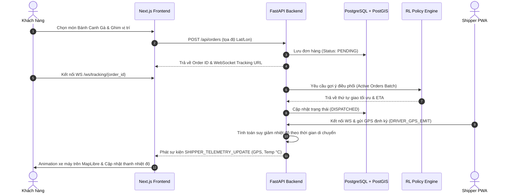

# Standard Operating Procedure (SOP) — Fullstack WebGIS & API Integration Workflow

**Quy trình:** Tích hợp Đầu-Cuối giữa Backend FastAPI, CSDL PostGIS, WebSocket Hub và Frontend WebGIS  
**Phân hệ chủ trì:** `backend_webgis_engineer` & `frontend_webgis_engineer`  
**Giám sát:** `evaluator_architect_lead`  

---

## 1. Sơ đồ Luồng Tích hợp (Fullstack Data Flow)



---

## 2. Chi tiết Từng Bước Thực hiện

### Bước 1: Khởi động Cụm Dịch vụ Cơ sở (Infrastructure Setup)
1. Kiểm tra và khởi động container:
   ```bash
   docker compose up -d db redis
   ```
2. Chạy migration tạo bảng và kích hoạt PostGIS:
   ```bash
   cd backend && alembic upgrade head
   ```
3. Chạy script nạp menu mẫu quán bánh canh gà Hàng Gòn:
   ```bash
   python -m app.db.seed_menu
   ```

### Bước 2: Tích hợp Động cơ RL vào Backend
1. Đặt file mô hình `rl_best_model.zip` vào thư mục `backend/app/models/`.
2. Khởi tạo instance trong `backend/app/services/dispatch_service.py`:
   - Kiểm tra khả năng suy luận thử nghiệm: Gửi vector đơn hàng giả lập và xác nhận kết quả trả về trong $< 20\,\text{ms}$.
   - Cài đặt cơ chế Fallback: Nếu mô hình gặp ngoại lệ, tự động gọi hàm tìm đường ngắn nhất Dijkstra.

### Bước 3: Phát triển & Kiểm thử WebSocket Gateway
1. Khởi động server backend:
   ```bash
   uvicorn app.main:app --reload --port 8000
   ```
2. Mở trình duyệt kiểm tra Swagger docs tại `http://localhost:8000/docs`.
3. Kiểm thử kênh WebSocket bằng công cụ kiểm thử hoặc script Python:
   - Gửi sự kiện định vị GPS giả lập.
   - Xác nhận client nhận đúng định dạng gói tin `SHIPPER_TELEMETRY_UPDATE`.

### Bước 4: Hoàn thiện Giao diện Bản đồ WebGIS & PWA
1. Chạy frontend Next.js:
   ```bash
   cd frontend && npm run dev
   ```
2. Kiểm tra các màn hình:
   - `/`: Màn hình khách hàng đặt món, ghim bản đồ Hàng Gòn, hiển thị nhiệt độ dự kiến.
   - `/admin/dispatch`: Màn hình chủ quán nhận đơn và kích hoạt thuật toán điều phối.
   - `/shipper`: Ứng dụng PWA cho tài xế với nút "Bắt đầu chuyến đi" và công tắc bật GPS giả lập.
   - `/admin/comparison-studio`: Màn hình đối chứng so sánh RL vs Dijkstra.

### Bước 5: Kiểm tra Đo đạc Độ trễ & Hiệu năng
1. Thực hiện kịch bản tạo 5 đơn liên tiếp: Đảm bảo bản đồ của khách hàng cập nhật chuyển động của shipper với tần số tối thiểu 1 lần/giây và độ trễ mạng $< 200\,\text{ms}$.
