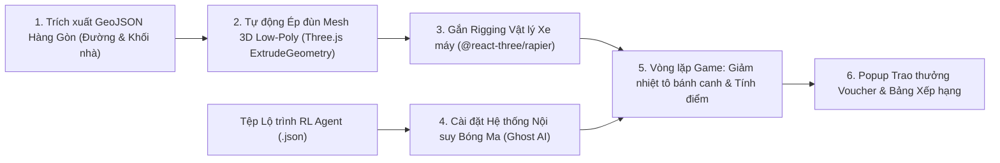

# Standard Operating Procedure (SOP) — 3D Mini-Game "HotWAY Rider" Pipeline

**Quy trình:** Dựng Bản đồ 3D từ Dữ liệu OSM, Tích hợp Vật lý Xe máy & Cơ chế Đua với AI Ghost  
**Phân hệ chủ trì:** `game_simulation_engineer`  
**Phối hợp:** `rl_researcher_engineer` & `frontend_webgis_engineer`  

---

## 1. Sơ đồ Pipeline Phát triển Mini-game (3D Pipeline Flow)



---

## 2. Chi tiết Từng Bước Thực hiện

### Bước 1: Chuẩn bị Dữ liệu Không gian Hàng Gòn
1. Lấy tệp `hanggon_center_roads.geojson` và `hanggon_buildings.geojson` từ thư mục `data/`.
2. Chuẩn hóa hệ tọa độ: Chuyển đổi tọa độ GPS (WGS84 Lat/Lon) sang hệ tọa độ phẳng mét (UTM Zone 48N hoặc phép chiếu Mercator cục bộ) lấy tâm quán bánh canh gà làm gốc tọa độ $(0, 0, 0)$.

### Bước 2: Tự động Sinh Khối 3D (Procedural Mesh Generation)
1. Trong component Three.js:
   - Duyệt qua từng đường LineString trong GeoJSON để tạo mặt phẳng đường (Road Ribbon) màu xám đậm.
   - Duyệt qua từng Polygon tòa nhà để tạo khối hộp low-poly (Building Block) với độ cao ngẫu nhiên từ $4\text{m} - 12\text{m}$ đặc trưng của nhà phố ngoại ô Hàng Gòn.
2. Thêm cây cối low-poly rải rác dọc theo hai bên Quốc lộ 56.

### Bước 3: Cài đặt Bộ điều khiển Xe máy Người chơi
1. Tạo mô hình xe máy low-poly gắn kèm Collider của Rapier:
   ```tsx
   <RigidBody ref={bikeBodyRef} colliders="hull" restitution={0.2} friction={0.7}>
     <MotorbikeMesh />
   </RigidBody>
   ```
2. Lắng nghe sự kiện bàn phím:
   - Phím W / Mũi tên lên: Tăng tốc tiến về phía trước.
   - Phím S / Mũi tên xuống: Phanh / lùi nhẹ.
   - Phím A / D: Đánh lái góc xe máy.
3. Camera góc nhìn thứ ba (Third-person Chase Camera) mượt mà bám theo xe máy.

### Bước 4: Tích hợp Lộ trình Bóng ma AI (Ghost AI Interpolation)
1. Nạp file `experiments/trajectories/best_route_ghost.json`.
2. Tạo mesh xe máy ảo phát sáng (Neon Hologram Shader):
   - Tại mỗi khung hình `useFrame((state, delta))`:
   - Tính thời gian trôi qua `elapsedTime = state.clock.getElapsedTime()`.
   - Tìm 2 mốc waypoints gần nhất và thực hiện nội suy tuyến tính (lerp) tọa độ $(x, y, z)$ và góc quay của xe bóng ma.

### Bước 5: Cơ chế Nhiệt độ & Luật chơi (Game Rules)
1. Ban đầu: Tô bánh canh gà của người chơi ở mức $85^\circ\text{C}$.
2. Mỗi giây trôi qua, nhiệt độ giảm theo công thức:
   $$T = 30 + (85 - 30) \times e^{-0.04 \times (t / 60)}$$
3. Khi người chơi chạm vào vạch đích (Bounding Box của nhà khách hàng):
   - Dừng đồng hồ.
   - So sánh nhiệt độ của Người chơi vs Bóng ma AI.
   - Nếu $T_{\text{player}} > T_{\text{AI}}$: Người chơi chiến thắng! Hiển thị mã giảm giá thật của quán: `BANHCANH_AI_WINNER_15`.
   - Nếu thua: *"AI đã giao nhanh hơn và giữ món nóng hơn! Hãy chọn đường tắt thông minh hơn!"*

### Bước 6: Kiểm tra Tối ưu Khung hình (FPS Optimization)
1. Kích hoạt Stats panel (`@react-three/drei/Stats`).
2. Đảm bảo game duy trì ổn định $\ge 30\,\text{FPS}$ trên trình duyệt và không rò rỉ bộ nhớ khi người chơi nhấn "Chơi lại" (Restart).
