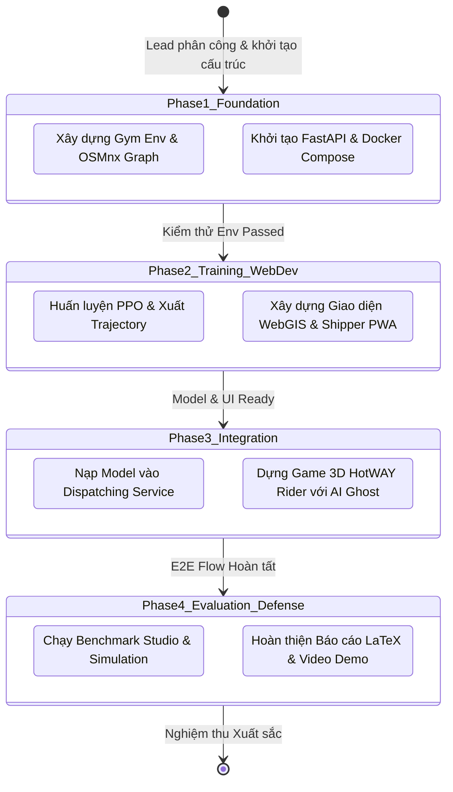

# Standard Operating Procedure (SOP) — Multi-Agent Collaboration & Handoff Workflow

**Quy trình:** Điều phối Liên tác tử, Bàn giao Sản phẩm Kỹ thuật & Kiểm soát Chất lượng  
**Phân hệ chủ trì:** `evaluator_architect_lead`  
**Các tác tử tham gia:** `rl_researcher_engineer`, `backend_webgis_engineer`, `frontend_webgis_engineer`, `game_simulation_engineer`  

---

## 1. Vòng đời Phối hợp giữa các Tác tử (Agent Collaboration Lifecycle)

---

## 2. Giao thức Bàn giao Sản phẩm (Handoff Protocols & Gates)

Mỗi giai đoạn chuyển giao giữa các Subagents phải vượt qua một **"Cổng Kiểm định" (Verification Gate)** trước khi chuyển tiếp sang nhiệm vụ kế tiếp:

### Cổng 1: Bàn giao Môi trường GIS & Cấu trúc Dữ liệu
- **Từ:** `rl_researcher_engineer` $\longrightarrow$ **Đến:** `backend_webgis_engineer` & `game_simulation_engineer`
- **Sản phẩm bàn giao:** File đồ thị Hàng Gòn `data/hanggon_graph.graphml` và các file ranh giới `data/*.geojson`.
- **Tiêu chí nghiệm thu của Gatekeeper:**
  - File đồ thị chứa đầy đủ tọa độ kinh độ/vĩ độ chuẩn WGS84, có thuộc tính độ dài đoạn đường (`length`) và tốc độ (`maxspeed`).
  - Điểm gốc quán Bánh Canh Gà Hàng Gòn tồn tại trên đồ thị với ID cụ thể.

### Cổng 2: Bàn giao Mô hình RL & Lộ trình Ghost
- **Từ:** `rl_researcher_engineer` $\longrightarrow$ **Đến:** `backend_webgis_engineer` & `game_simulation_engineer`
- **Sản phẩm bàn giao:** File trọng số `models/rl_best_model.zip`, file metadata `models/metadata.json`, và file replay `best_route_ghost.json`.
- **Tiêu chí nghiệm thu của Gatekeeper:**
  - `rl_researcher_engineer` cung cấp script kiểm thử đơn vị `test_inference.py` chứng minh hàm `predict()` chạy trong $< 20\,\text{ms}$ và không ném ngoại lệ.
  - Tệp `best_route_ghost.json` chứa danh sách waypoints liên tục không có bước nhảy tọa độ bất thường.

### Cổng 3: Bàn giao API Backend & WebSocket
- **Từ:** `backend_webgis_engineer` $\longrightarrow$ **Đến:** `frontend_webgis_engineer`
- **Sản phẩm bàn giao:** Tài liệu Swagger API tại `/docs` và tài liệu mô tả cấu trúc gói tin WebSocket.
- **Tiêu chí nghiệm thu của Gatekeeper:**
  - API endpoint `POST /api/dispatch/plan-route` phản hồi đúng schema Pydantic.
  - WebSocket phát tin `SHIPPER_TELEMETRY_UPDATE` chính xác và có cơ chế tự phục hồi kết nối (auto-reconnect).

### Cổng 4: Bàn giao Mini-game 3D
- **Từ:** `game_simulation_engineer` $\longrightarrow$ **Đến:** `frontend_webgis_engineer` & `evaluator_architect_lead`
- **Sản phẩm bàn giao:** Component `<HotWAYRiderCanvas />` nằm trong `frontend/src/game/`.
- **Tiêu chí nghiệm thu của Gatekeeper:**
  - Tốc độ khung hình duy trì $\ge 30\,\text{FPS}$.
  - Người chơi có thể hoàn thành vòng đua và nhận kết quả đối chiếu nhiệt độ với AI Ghost.

---

## 3. Quy trình Xử lý Xung đột và Lỗi Tích hợp (Conflict Resolution SOP)

1. **Xung đột phiên bản thư viện:**
   - Toàn bộ các phiên bản thư viện dùng chung giữa AI và Backend phải được ghim cứng tại `backend/requirements.txt` và xây dựng bên trong Docker image.
2. **Hiện tượng mô hình RL suy luận bất thường:**
   - Nếu mô hình RL đưa ra hành động không hợp lệ (ví dụ: gán đơn hàng đã giao hoặc đi lùi), `backend_webgis_engineer` phải kích hoạt cờ fallback `USE_DIJKSTRA_FALLBACK=True` và gửi cảnh báo đến `rl_researcher_engineer` để tinh chỉnh hàm phạt trong môi trường Gymnasium.
3. **Chốt phiên bản tài liệu trước ngày bảo vệ:**
   - Trước ngày bảo vệ đề tài 3 ngày, `evaluator_architect_lead` sẽ thực hiện **Code Freeze & Doc Freeze**. Mọi sửa đổi sau thời điểm này chỉ nhằm sửa lỗi chính tả hoặc lỗi hiển thị nhỏ.
