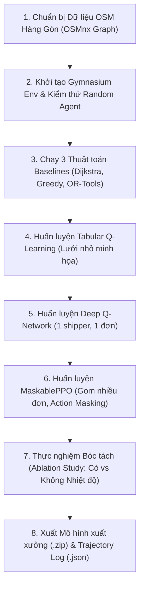

# Standard Operating Procedure (SOP) — RL Experimentation & Benchmark Workflow

**Quy trình:** Huấn luyện Mô hình Học Tăng Cường, Đánh giá Thực nghiệm & Bóc tách (Ablation Study)  
**Phân hệ chủ trì:** `rl_researcher_engineer`  
**Giám sát:** `evaluator_architect_lead`  

---

## 1. Sơ đồ Luồng Thực nghiệm (RL Experiment Flow)



---

## 2. Chi tiết Từng Bước Thực hiện

### Bước 1: Trích xuất và Tối ưu Đồ thị Giao thông Hàng Gòn
1. Chạy lệnh trích xuất:
   ```bash
   python -m src.rl.osm_graph_loader --place "Hang Gon, Long Khanh, Dong Nai, Vietnam" --output data/hanggon_graph.graphml
   ```
2. Đồ thị sau khi tải phải được đơn giản hóa: Gộp các nút giao thừa, bổ sung thông số tốc độ lưu thông mặc định trên từng cung đường.
3. Ghi nhận ID nút giao gần nhất với quán Bánh Canh Gà Hàng Gòn để làm `DEPOT_NODE_ID`.

### Bước 2: Kiểm thử Môi trường Gymnasium
1. Chạy kiểm thử tự động với 100 episodes random actions:
   ```bash
   pytest tests/test_rl_env.py -v
   ```
2. Kiểm tra xem nhiệt độ món ăn có giảm đơn điệu theo hàm mũ $e^{-kt}$ không. Nếu nhiệt độ tăng bất thường hoặc ra giá trị âm, hủy tiến trình và kiểm tra lại module `newton_cooling.py`.

### Bước 3: Chạy Thuật toán Baseline để Lấy Mốc Đánh giá
1. Chạy 100 kịch bản ngẫu nhiên cố định seed (`seed = 100` đến `seed = 199`) cho:
   - Dijkstra Shortest Path
   - Greedy Nearest Neighbor
   - Google OR-Tools VRP
2. Lưu kết quả ra file `experiments/results/baselines_benchmark.csv`.

### Bước 4 & 5: Huấn luyện Q-Learning & Deep Q-Network
1. Huấn luyện Tabular Q-learning trên đồ thị 10 nút: Lưu bảng Q-table ra file `.npy` để vẽ heatmap phục vụ báo cáo.
2. Huấn luyện mô hình DQN cho bài toán 1 đơn:
   ```bash
   python -m src.rl.train_dqn --timesteps 100000 --save-dir models/dqn/
   ```

### Bước 6: Huấn luyện MaskablePPO Đa mục tiêu
1. Kích hoạt huấn luyện gom nhiều đơn:
   ```bash
   python -m src.rl.train_ppo --timesteps 300000 --batch-size 64 --save-dir models/ppo/
   ```
2. Mở TensorBoard giám sát:
   ```bash
   tensorboard --logdir experiments/logs/
   ```
3. Đảm bảo:
   - `rollout/ep_rew_mean` có xu hướng tăng đều theo thời gian.
   - `train/entropy_loss` giảm dần nhưng không rơi về 0 quá sớm.

### Bước 7: Thực nghiệm Bóc tách (Ablation Study)
1. Chạy kịch bản đối chứng:
   - Run 1 (Standard): Đầy đủ thành phần thưởng nhiệt độ.
   - Run 2 (Ablated): Tắt hệ số $\beta_1, \beta_2$ của hàm thưởng nhiệt độ trong file cấu hình.
2. Trích xuất bảng so sánh độ nóng của món bánh canh khi đến đích giữa 2 mô hình.

### Bước 8: Bàn giao Sản phẩm
1. Đóng gói file `models/rl_best_model.zip`.
2. Trích xuất tệp lộ trình đẹp nhất cho mini-game 3D:
   ```bash
   python -m src.rl.export_ghost_trajectory --model-path models/rl_best_model.zip --output experiments/trajectories/best_route_ghost.json
   ```
3. Bàn giao cho `backend_webgis_engineer` và `game_simulation_engineer`.
