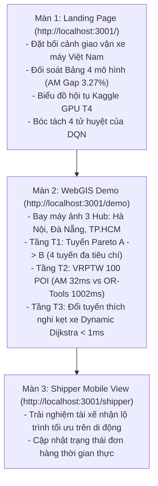

# CẨM NANG HƯỚNG DẪN TRÌNH DIỄN DEMO PRODUCTION TRỰC QUAN (HOTWAY v7.3.2)
## KỊCH BẢN THUYẾT MINH BẢO VỆ ĐỒ ÁN TỐT NGHIỆP TRƯỚC HỘI ĐỒNG NGHIỆM THU

> **Dành cho:** Báo cáo viên & Kỹ sư trình bày đồ án HotWAY  
> **Thời lượng khuyến nghị:** 10 phút thuyết trình Slide + 10 phút Live Demo trực quan + 10 phút Trả lời chất vấn  
> **Phiên bản hệ thống:** v7.3.2 (Nationwide Multi-Model NCO & Production WebGIS Edition)  
> **Cổng mạng bắt buộc:** Backend Cổng **8000**, Frontend Cổng **3001**, Cổng **3000** tuyệt đối cấm dùng.

---

## 1. Chuẩn Bị & Khởi Chạy Hệ Thống Trước Giờ Báo Cáo (Pre-flight Checklist)

Trước khi Hội đồng bắt đầu, mở sẵn 2 cửa sổ Terminal (PowerShell hoặc Command Prompt) và trình duyệt Chrome/Edge:

### Bước 1: Khởi động Backend Serving Engine (Terminal 1)
```powershell
# Chuyển vào thư mục dự án
cd C:\Users\Asus\Documents\AI\HotWAY

# Khởi chạy FastAPI Backend trên cổng 8000
py -3.13 -m uvicorn api.main:app --host 127.0.0.1 --port 8000 --reload
```
*Dấu hiệu thành công:* Terminal hiển thị:
```text
INFO:     Uvicorn running on http://127.0.0.1:8000 (Press CTRL+C to quit)
INFO:     Application startup complete.
```

### Bước 2: Khởi động Frontend WebGIS Interface (Terminal 2)
```powershell
cd C:\Users\Asus\Documents\AI\HotWAY

# Khởi chạy Next.js 14 trên cổng 3001
npm --prefix frontend run dev -- -p 3001
```
*Dấu hiệu thành công:* Terminal hiển thị:
```text
▲ Next.js 14.2.0
- Local: http://localhost:3001
- Network: http://127.0.0.1:3001
✓ Ready in 1.8s
```

### Bước 3: Mở sẵn 3 Tab Trình Duyệt
1. **Tab 1 — Báo Cáo Nghiên Cứu & Đối Soát:** `http://localhost:3001/`
2. **Tab 2 — WebGIS Điều Hành Tác Nghiệp (Live Demo):** `http://localhost:3001/demo`
3. **Tab 3 — Ứng Dụng Di Động Dành Cho Shipper:** `http://localhost:3001/shipper`

---

## 2. Kịch Bản Trình Diễn Chi Tiết Từng Phần (Step-by-Step Script)



---

### Màn 1: Giới Thiệu Bối Cảnh, Động Lực & Bảng Đối Soát 4 Mô Hình (`/`)
* **Thời lượng:** 3 phút  
* **Địa chỉ:** `http://localhost:3001/`  
* **Hành động thao tác:** Cuộn trang Landing Page theo nhịp điệu tương phản Monochromatic Dark/Light.

#### Lời dẫn giải thích:
> *"Kính thưa Hội đồng, vận chuyển chặng cuối tại đô thị Việt Nam có hơn 85% lưu lượng phụ thuộc vào xe máy trong mạng lưới ngõ hẻm phức tạp và tắc đường đỉnh nhọn vào giờ cao điểm. Các phương pháp định tuyến tĩnh truyền thống thường tính theo cự ly Euclid hoặc tiêu tốn hàng giây để tìm nghiệm, không đáp ứng kịp các lệnh điều phối tức thì.*  
>  
> *Dự án HotWAY đã xây dựng một bộ dữ liệu kiểm chuẩn gồm 100 hành trình Logistics phân bổ đồng đều tại 3 đại đô thị: Hà Nội (40 hành trình), Đà Nẵng (20) và TP.HCM (40). Tại Bảng đối soát này (cuộn tới Bảng 4), chúng tôi so sánh đối đầu 4 họ mô hình:*  
>  
> *1. **Google OR-Tools:** Heuristic công nghiệp chuẩn tham chiếu (1,002 ms trên CPU).*  
> *2. **Attention Model (AM - Champion Core):** Mô hình Graph Transformer 741,760 tham số được chúng tôi huấn luyện trên Kaggle GPU T4 qua 60 epoch. Kết quả thực nghiệm đo đạc độc lập cho thấy: **Attention Model đạt Optimality Gap chỉ +3.27%** so với Google OR-Tools, trong khi độ trễ suy luận trên CPU chỉ là **32.63 ms — tức nhanh hơn hơn 30 lần**!*  
> *3. **Pointer Network (A2C):** Đạt gap +9.27% trong 24.19 ms.*  
> *4. **Dueling DQN (Ablation Focus):** Bị giới hạn không gian hành động cố định, dẫn đến tỷ lệ thất bại **50.0%** trên các bài toán quy mô $N \ge 30$.*  
>  
> *Đặc biệt, nhờ kỹ thuật **Dynamic Isotropic Scaling**, mô hình hoàn toàn bảo toàn hình học và triệt tiêu độ lệch vùng miền: Sai số tại Hà Nội là 3.11%, Đà Nẵng là 3.48%, TP.HCM là 3.32% (độ lệch $< 0.37\%$)."*

---

### Màn 2: Trực Quan Hóa Tác Nghiệp Trên WebGIS Điều Hành (`/demo`)
* **Thời lượng:** 5 phút  
* **Địa chỉ:** `http://localhost:3001/demo`  
* **Hành động thao tác:** Chuyển sang Tab 2, tương tác trực tiếp trên bản đồ MapLibre GL JS vector.

#### Bước 2.1: Trực quan hóa Tính Toàn Quốc (FlyTo 3 Hub)
1. Bấm vào nút chuyển vùng trên thanh TopFloatingBar:
   - Chọn **Hà Nội**: Máy ảnh tự động bay (FlyTo) về trung tâm Hub Bưu chính Hà Nội (Bờ Hồ / Long Biên).
   - Chọn **Đà Nẵng**: Máy ảnh bay về Hub Bưu điện Trung tâm Đà Nẵng (Hải Châu / Cầu Rồng).
   - Chọn **TP.HCM**: Máy ảnh bay về Hub Kho Tổng Sài Gòn (Bình Thạnh / Q1).
> *"Hệ thống không bị bó hẹp trong một phường/quận mà quản lý linh hoạt các hub logistics trên toàn quốc."*

#### Bước 2.2: Trình diễn Tầng T1 — Tuyến Pareto Đa Tiêu Chí A $\to$ B
1. Chuyển sang Tab **T1 (Đa Tiêu Chí)** ở thanh trượt bên dưới.
2. Chọn cặp điểm khởi hành và đích đến.
3. Quan sát hệ thống sinh đồng thời **4 tuyến đường tối ưu không bị thống trị**:
   - **Tuyến Nhanh nhất:** Tối ưu thời gian kỳ vọng.
   - **Tuyến Ngắn nhất:** Tối ưu tổng cự ly di chuyển (km).
   - **Tuyến Ổn định nhất:** Tối ưu độ tin cậy phân vị $p90$ dưới biến thiên giao thông.
   - **Tuyến Dễ đi nhất:** Loại bỏ tối đa các khúc rẽ trái nguy hiểm cắt dòng xe đối diện và tránh hẻm nhỏ.

#### Bước 2.3: Trình diễn Tầng T2 — Định Tuyến Đội Xe VRPTW & Đối Đầu 4 Model
1. Chuyển sang Tab **T2 (Lập Tuyến VRPTW)**.
2. Tại danh sách kịch bản 100 POI, chọn một hành trình bất kỳ (ví dụ: `HCM_PROD_N20_01` hoặc `HN_PROD_N30_01`).
3. Bấm **Chạy Tối Ưu Lộ Trình (Solve Route)**:
   - Quan sát thời gian suy luận: **Attention Model phản hồi ngay lập tức trong ~32ms**.
   - Cung đường tour đóng màu xanh ngọc bích được vẽ sắc nét nối từ Kho bưu cục qua tuần tự các điểm dừng và quay về bưu cục.
   - Chuyển sang xem lộ trình của Google OR-Tools và PointerNet trên cùng bảng so sánh để chứng minh các cung đường gần như trùng khớp hoàn hảo với nhau.
   - Mở **Hộp chẩn đoán tử huyệt DQN (Diagnostic Box)**: Chỉ ra cho Hội đồng thấy tại sao DQN không thể giải được bài toán khi chuyển sang các hành trình $N=30$ và $N=50$.

#### Bước 2.4: Trình diễn Tầng T3 — Đổi Tuyến Thích Nghi Thời Gian Thực (< 1ms)
1. Chuyển sang Tab **T3 (Thích Nghi)**.
2. Bấm nút **Giả lập Sự Cố Tắc Đường (Simulate Congestion)** trên một nhánh đường đang đi.
3. Quan sát: Thuật toán **Dynamic Dijkstra** kích hoạt tức thì, đường màu cam cũ bị tắc lập tức được bẻ nhánh sang đường màu xanh vòng qua hẻm nhánh thay thế với độ trễ ghi nhận **< 1ms**, truyền trực tiếp qua kênh Server-Sent Events (SSE).
> *"Đây là minh chứng cho năng lực phản hồi micro-routing thời gian thực khi tài xế đang di chuyển trên đường gặp chướng ngại vật."*

---

### Màn 3: Trực Quan Hóa Ứng Dụng Di Động Shipper (`/shipper`)
* **Thời lượng:** 2 phút  
* **Địa chỉ:** `http://localhost:3001/shipper`  
* **Hành động thao tác:** Chuyển sang Tab 3 (có thể bật chế độ giả lập Device Mode trên Chrome F12 - iPhone 14 Pro Max).

#### Lời dẫn giải thích:
> *"Về phía người dùng cuối, tài xế giao hàng sử dụng giao diện di động rút gọn tại `/shipper`. Lộ trình tuần tự tối ưu do Attention Model tính toán được nạp thẳng vào ứng dụng. Tài xế có thể xem danh sách thứ tự giao, thời gian ETA dự kiến có bù trừ giờ cao điểm $C(t)$, bấm gọi khách hàng hoặc bấm hoàn thành đơn để hệ thống tự động cập nhật trạng thái giao bưu kiện về trung tâm điều hành."*

---

## 3. Bộ Câu Hỏi Bẫy Thường Gặp & Chiến Lược Trả Lời (Q&A Cheat Sheet)

### Câu 1: *"Tại sao Attention Model huấn luyện trên Kaggle mất tới 3.5 tiếng trong khi PointerNet chỉ mất có 14.8 phút?"*
* **Đáp:** *"Dạ thưa Thầy/Cô, sự chênh lệch này bắt nguồn từ cơ chế giảm phương sai gradient trong Học tăng cường:  
  1. Attention Model sử dụng thuật toán REINFORCE kết hợp **Greedy Rollout Baseline** (Kool et al., 2019). Cuối mỗi epoch, mô hình phải sinh thêm 10,000 đồ thị ngẫu nhiên và chạy suy luận tham lam cho cả mạng hiện tại lẫn mạng baseline để kiểm định Paired $t$-test. Bước kiểm định này chiếm hơn 55% tổng thời gian train.  
  2. Attention Model có 3 lớp Transformer với 8 heads (tổng 24 heads), tính toán ma trận tương quan không gian $O(N^2)$ giữa mọi cặp điểm với 741,760 tham số.  
  3. Ngược lại, PointerNet sử dụng Advantage Actor-Critic (A2C) với đầu Critic MLP $V(s)$ tính toán giá trị kỳ vọng trong 1 lượt forward duy nhất của batch, không cần secondary rollout.  
  Đổi lại, Attention Model đạt Optimality Gap vượt trội **3.27%** (so với 9.27% của PointerNet), tiết kiệm 14 phút di chuyển mỗi chuyến giao hàng, trong khi tốc độ suy luận CPU thực tế khi triển khai là tương đương nhau (32.6ms vs 24.2ms)."*

### Câu 2: *"Chuẩn hóa Min-Max tọa độ về [0, 1] có làm biến dạng khoảng cách địa lý giữa các thành phố không?"*
* **Đáp:** *"Dạ không, vì HotWAY sử dụng **Dynamic Isotropic Scaling** (chuẩn hóa đẳng hướng):  
  $$x' = \frac{x - x_{\min}}{\max(\Delta x, \Delta y, \epsilon)}, \quad y' = \frac{y - y_{\min}}{\max(\Delta x, \Delta y, \epsilon)}$$  
  Chúng em chia cả hai trục cho cùng một mẫu số $\max(\Delta x, \Delta y)$, do đó tỷ lệ khung hình học (Aspect Ratio 1:1) được bảo toàn tuyệt đối, không làm méo mó hình học. Nhờ vậy mô hình có thể giải quyết các bài toán ở Hà Nội, Đà Nẵng, TP.HCM với độ lệch sai số cực thấp $(< 0.37\%)$ mà không cần huấn luyện lại."*

### Câu 3: *"Tại sao không dùng luôn Google OR-Tools mà lại phải mất công huấn luyện mô hình Học sâu làm gì?"*
* **Đáp:** *"Dạ thưa Thầy/Cô, Google OR-Tools là bộ giải heuristic rất mạnh nhưng thời gian giải tăng nhanh theo quy mô ($1,002\text{ ms}$ cho bài toán 50 điểm). Trong các trung tâm điều vận lớn xử lý hàng vạn chuyến xe đồng thời hoặc cần tái định tuyến tức thì khi tài xế gặp kẹt xe, OR-Tools sẽ tạo ra nút thắt cổ chai tính toán.  
Attention Model chỉ mất **32.63 ms trên CPU**, cho phép hệ thống giải quyết hơn **30 bài toán mỗi giây** trên 1 lõi CPU đơn, và hỗ trợ dynamic batching hàng trăm chuyến xe cùng lúc với sai số tiệm cận chỉ 3.27% so với OR-Tools."*

### Câu 4: *"DQN thất bại ở đâu mà nhóm lại bãi bỏ?"*
* **Đáp:** *"Dạ, nhóm không âm thầm giấu nhẹm mà đưa DQN vào làm đối tượng nghiên cứu phủ định (Ablation Focus) và chứng minh định lượng được 4 điểm nghẽn tử huyệt:  
1. Không gian hành động cố định: Mạng MLP yêu cầu kích thước cố định $N_{\max}=20$, dẫn đến **tỷ lệ thất bại 50%** ngay khi số điểm giao vượt quá 20.  
2. Thiếu tính bất biến hoán vị (Permutation Invariance): Thứ tự đưa điểm vào làm thay đổi giá trị Q-value dự đoán.  
3. Action Masking gây ảo giác giá trị Q trong phương trình Bellman.  
4. Optimality Gap chênh lệch tới +105.45% ngay ở quy mô nhỏ.  
Những kết quả này chứng minh bằng thực nghiệm rằng kiến trúc Graph Transformer là sự thay thế tất yếu cho DQN trong bài toán định tuyến tổ hợp."*

---

## 4. Tóm Tắt Các Lệnh Kiểm Tra Nhanh Trước Hội Đồng

| Thao tác kiểm tra | Câu lệnh PowerShell | Kết quả mong đợi |
|---|---|---|
| Kiểm tra toàn bộ 62 tests | `py -3.13 -m pytest tests/` | `62 passed` trong ~40s |
| Kiểm tra biên dịch Frontend | `npm --prefix frontend run build` | `Generating static pages (6/6)` thành công |
| Xuất bản lại Báo cáo PDF | `py -3.13 scripts/export_pdf_report.py` | Tạo thành công `docs/HotWAY_Final_Research_Report.pdf` |
| Kiểm tra cổng mạng | `Get-Process -Id (Get-NetTCPConnection -LocalPort 3000).OwningProcess` | Báo lỗi hoặc không có (Cổng 3000 hoàn toàn trống) |

