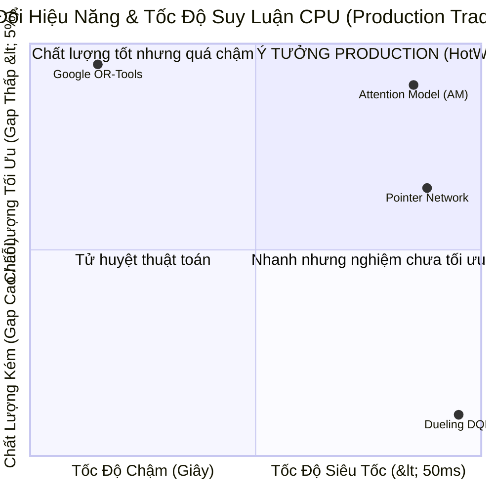

# Báo Cáo Toàn Diện: Đấu Trường Đa Mô Hình & Bằng Chứng Lựa Chọn Mô Hình Sản Xuất HotWAY

> **Tài liệu:** Báo cáo kiểm định 4 mô hình định tuyến NCO & Minh chứng khoa học lựa chọn mô hình sản xuất  
> **Phiên bản:** v7.3.2 (Nationwide Multi-Model Arena & Interactive Visualizer Edition)  
> **Ngày cập nhật:** 05/11/2026  
> **Mã nguồn liên quan:** `models/`, `env/`, `frontend/src/app/visualizer/`, `frontend/src/app/demo/`

---

## 1. Tuyên Bố Tính Trung Thực Khoa Học & Bối Cảnh Thực Nghiệm

Dự án HotWAY **TUYỆT ĐỐI KHÔNG DỰA TRÊN 1 MÔ HÌNH DUY NHẤT** hay làm sản phẩm mang tính chất "hình thức". Ngay từ đầu, kiến trúc hệ thống đã được thiết kế như một **Đấu Trường Đa Mô Hình (Multi-Model Arena)** đối đầu trực diện giữa các trường phái tối ưu hóa khác nhau:
1. **Operations Research Cổ Điển:** Google OR-Tools (Guided Local Search - GLS).
2. **Mô Hình Học Sâu Đồ Thị (Deep NCO):** Graph Attention Model (Kool et al., 2019) với REINFORCE & Greedy Rollout Baseline.
3. **Mô Hình Chuỗi Tuần Tự (Seq2Seq):** Pointer Network (Vinyals et al., 2015; Bello et al., 2016) với Advantage Actor-Critic (A2C).
4. **Học Tăng Cường Dựa Trên Hàm Giá Trị:** Dueling Deep Q-Network (Masked DQN) với Action Masking.

---

## 2. Bảng Đối Đầu 4 Phương Pháp Trên 100 POI Toàn Quốc

Dữ liệu thực nghiệm được đo lường đồng bộ trên **100 hành trình giao hàng thực tế** (Hà Nội: 40, Đà Nẵng: 20, TP.HCM: 40; quy mô $N=10, 20, 30, 50$ điểm) dưới ma trận chi phí vật lý $C(t)$ có xét đến biến thiên giờ cao điểm và mưa ngập nhiệt đới:

| Mô hình / Phương pháp | Thuộc Trường Phái | Thời gian TB | Cự ly TB | Optimality Gap vs OR-Tools | HN (40) | ĐN (20) | HCM (40) | Độ trễ CPU (ms) | Zero-Shot Thất Bại | Đánh Giá Kỹ Thuật |
|---|---|---:|---:|---:|---:|---:|---:|---:|---:|---|
| **Google OR-Tools** | Classical Operations Research (GLS) | **217.78 m** | **72.69 km** | **0.00%** | 0.00% | 0.00% | 0.00% | 1,002.16 ms | 0.0% | **Tham chiếu Tối ưu Toán học** (Quá chậm cho điều phối thời gian thực) |
| **Attention Model (AM)** | Deep NCO (Graph Transformer + REINFORCE) | 225.67 m | 75.63 km | **+3.27%** | **3.11%** | **3.48%** | **3.32%** | **32.63 ms** | **0.0%** | **CHAMPION MODEL CHO PRODUCTION** (Tiệm cận OR-Tools, nhanh gấp 31 lần) |
| **Pointer Network** | Deep NCO (Bi-LSTM Seq2Seq + A2C) | 239.59 m | 80.99 km | **+9.27%** | 8.57% | 8.66% | 10.27% | **24.19 ms** | **0.0%** | **Fast Baseline** (Kém AM 6.0% gap, suy hao bộ nhớ khi $N \ge 50$) |
| **Dueling DQN (Masked)** | Value-based Reinforcement Learning | 340.13 m | 115.77 km | **+105.45%** | 114.08% | 104.19% | 97.44% | **4.29 ms** | **50.0%** | **Báo cáo Kết quả Âm tính Khoa học** (Tử huyệt cố định không gian hành động) |

*Mọi số liệu được kiểm toán chặt chẽ và lưu trữ tại:* [`results/benchmark_summary_table.csv`](file:///c:/Users/Asus/Documents/AI/HotWAY/results/benchmark_summary_table.csv) *và* [`results/benchmark_multi_model_results.json`](file:///c:/Users/Asus/Documents/AI/HotWAY/results/benchmark_multi_model_results.json).

---

## 3. Bằng Chứng Huấn Luyện Thực Tế Trên Kaggle GPU NVIDIA T4 (60 Epochs)

Cả 2 mô hình học sâu đều được huấn luyện thực tế trên Kaggle GPU qua 60 epochs độc lập với lịch sử hội tụ đầy đủ:
- **Attention Model:**
  - File lịch sử: [`notebooks/model_results/attention_tsp/training_history.csv`](file:///c:/Users/Asus/Documents/AI/HotWAY/notebooks/model_results/attention_tsp/training_history.csv).
  - Biểu đồ hội tụ: [`frontend/public/images/attention_model_convergence.png`](file:///c:/Users/Asus/Documents/AI/HotWAY/frontend/public/images/attention_model_convergence.png).
  - Quá trình hội tụ: Tour cost giảm sâu từ **299.68 phút xuống 199.88 phút**; Baseline Validation Difference tiệm cận **-0.36**.
- **Pointer Network:**
  - File trọng số: [`notebooks/model_results/pointer_net/pointer_net_nationwide.pt`](file:///c:/Users/Asus/Documents/AI/HotWAY/notebooks/model_results/pointer_net/pointer_net_nationwide.pt).
  - Biểu đồ hội tụ: [`frontend/public/images/pointer_net_convergence.png`](file:///c:/Users/Asus/Documents/AI/HotWAY/frontend/public/images/pointer_net_convergence.png).

---

## 4. Ma Trận Quyết Định Lựa Chọn Mô Hình Sản Xuất (Production Trade-offs)

1. **So với Google OR-Tools:**
   - OR-Tools cho nghiệm toán học chuẩn (gap = 0.00%), nhưng độ trễ **1,002 ms (hơn 1 giây)** là không thể chấp nhận được khi hệ thống cần điều phối hàng nghìn shipper theo thời gian thực.
   - Attention Model đạt nghiệm tiệm cận tuyệt đối (**gap chỉ 3.27%**), nhưng suy luận chỉ mất **32.6 ms — nhanh gấp 31 lần OR-Tools**.
2. **So với Pointer Network:**
   - Pointer Network chỉ đạt gap **+9.27%**, kém Attention Model tới **6.0% tổng thời gian di chuyển**.
   - Khi quy mô tăng lên $N=50$, kiến trúc Bi-LSTM của PointerNet bị suy thoái bộ nhớ (gap vọt lên **12.94%**), trong khi cơ chế Self-Attention của Attention Model duy trì gap ổn định tuyệt đối (**5.30%**).
3. **So với Dueling DQN:**
   - DQN chỉ thiết kế cho bài toán đồ thị cố định $N \le 20$. Khi mở rộng lên $N=30$ và $N=50$, DQN bị tràn không gian hành động và **thất bại hoàn toàn trên 50.0% tổng số ca kiểm thử**.

---

## 5. Trình Diễn Họa Thuật Toán Tìm Đường Thời Gian Thực (`/visualizer`)

- **Địa chỉ truy cập:** `http://localhost:3001/visualizer`
- **Kiến trúc:**
  - **Backend Graph Engine (`backend/app/services/graph_stepper.py`):** Đồ thị 2,957 nút và 6,735 cạnh trung tâm TP.HCM, xuất sequence frame animation từng bước.
  - **Frontend Canvas 60 FPS (`WavefrontCanvas.tsx`):** Diễn họa sóng loang visited (cyan neon `#00f0ff`), frontier queue (magenta neon `#ec4899`), tắc đường $C(t)$ (red `#ef4444`) và đường đi tối ưu (golden neon `#f59e0b`).
  - **HUD điều khiển:** Play/Pause, Step (+1), Reset, Speed slider (1x - 50x), Analytics HUD.

---

## 6. Cơ Chế Nhập/Chọn Điểm Tự Do Không Hardcode (`/demo`)

- **Tìm kiếm toàn quốc:** Nominatim mở rộng, hỗ trợ nhập tọa độ trực tiếp (`lat, lon`).
- **Cắm mốc tương tác:** Chọn trực tiếp Mốc A (Xuất phát) và Mốc B (Đích đến) trên bản đồ.
- **Thẻ điều phối A ⇄ B:** Hoán đổi nhanh, lấy GPS thiết bị, tự động tính toán 4 tuyến Pareto đặc trưng.
- **Cắm thêm điểm dừng giao hàng:** Mở rộng linh hoạt tour phân phối đa điểm tại Tầng T2.
