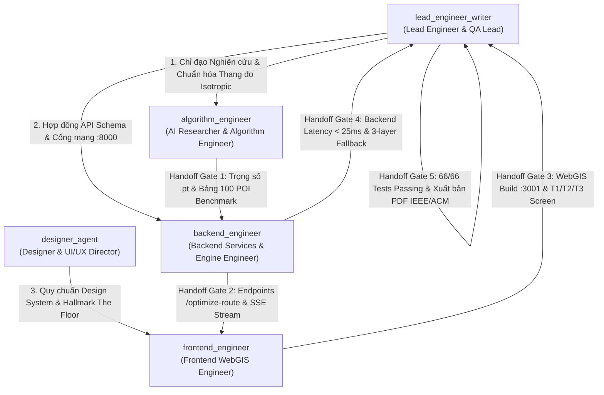
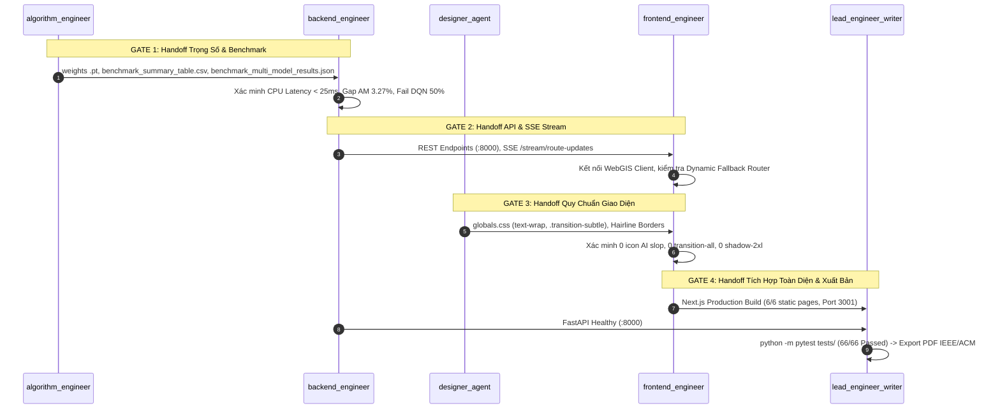

# Quy Trình Phối Hợp Đa Tác Tử (SOP MULTI-AGENT WORKFLOW) — HotWAY

> **Tài liệu:** Standard Operating Procedure (SOP) — Điều phối 5 Vai trò Kỹ sư AI, Giao thức Bàn giao & Cổng Kiểm định Chất lượng  
> **Phiên bản:** v7.3.2 (Executive Scientific & Hallmark The Floor Edition)  
> **Ngày cập nhật:** 04/11/2026  
> **Tác tử chủ trì:** `lead_engineer_writer` (Lead Engineer & QA)  
> **Tài liệu liên quan:** [AGENTS.md](file:///c:/Users/Asus/Documents/AI/HotWAY/AGENTS.md) | [DESIGN_SYSTEM.md](file:///c:/Users/Asus/Documents/AI/HotWAY/DESIGN_SYSTEM.md) | [PLAN.md](file:///c:/Users/Asus/Documents/AI/HotWAY/PLAN.md) | [TESTING.md](file:///c:/Users/Asus/Documents/AI/HotWAY/TESTING.md)

---

## 1. Cơ Cấu Tổ Đội 5 Kỹ Sư AI Trong Hệ Thống Antigravity

Dự án HotWAY vận hành theo cơ chế 5 vai trò chuyên biệt, được đăng ký chính thức thành các Subagent độc lập trong môi trường Antigravity:

### Bảng Phân Quyền Thư Mục Độc Quyền

| Tên Subagent | Mã định danh (`Name`) | Phạm vi Trách nhiệm Cốt lõi | Thư mục & Tệp Sở Hữu Độc Quyền |
|---|---|---|---|
| **Lead Engineer & QA** | `lead_engineer_writer` | Quản trị kiến trúc, bảo vệ tính trung thực khoa học, chạy 66 tests tự động, bảo vệ an toàn cổng mạng 3000, xuất bản báo cáo PDF IEEE/ACM. | `README.md`, `PRD.md`, `ARCHITECTURE.md`, `PLAN.md`, `AGENTS.md`, `TESTING.md`, `docs/`, `scripts/export_pdf_report.py` |
| **Designer & UI/UX Director** | `designer_agent` | Ngôn ngữ Monochromatic Swiss Editorial, tương phản Section Dark/Light, thực thi quy chuẩn sàn Hallmark "The Floor" (cấm `transition: all`, text-wrap balance/pretty, 0 icon rườm rà, 0 soft shadow card). | `DESIGN_SYSTEM.md`, `frontend/src/app/globals.css`, các visual tokens |
| **AI Researcher & Algorithm** | `algorithm_engineer` | Môi trường Gymnasium `traffic_tsp_env.py`, 4 mô hình định tuyến (AM, PointerNet, OR-Tools, DQN), chuẩn hóa Dynamic Isotropic Scaling, kiểm chuẩn 100 POI Toàn quốc. | `env/`, `models/`, `train.py`, `evaluate_benchmark.py`, `notebooks/`, `results/`, `tests/` |
| **Backend Engineer** | `backend_engineer` | Tầng dịch vụ `services/` (TomTom/HERE/OSRM Fallback Router 3 lớp), Serving CPU < 25ms tại `api/main.py`, FastAPI Backend cổng **8000**. | `services/`, `api/`, `backend/`, `docker-compose.yml`, `config/site.yaml` |
| **Frontend Engineer** | `frontend_engineer` | Next.js 14 WebGIS cổng **3001**, MapLibre GL JS đa hub (Hà Nội, Đà Nẵng, TP.HCM), màn hình đối soát 4 mô hình NCO (`ScreenT2VRPTW.tsx`), build sạch 100%. | `frontend/src/app/`, `frontend/src/components/`, `frontend/public/` |

---

## 2. 4 Cổng Bàn Giao Kỹ Thuật (Handoff Protocols & Quality Gates)

Mọi mã nguồn và dữ liệu khi chuyển giao giữa các Subagents bắt buộc phải vượt qua các Cổng Kiểm Định (Quality Gates):

### Chi Tiết Từng Cổng:

#### Cổng 1: Bàn Giao Trọng Số NCO & Dữ Liệu 100 POI
- **Bên giao:** `algorithm_engineer` $\longrightarrow$ **Bên nhận:** `backend_engineer`
- **Tiêu chuẩn kiểm tra:**
  1. File trọng số PyTorch tồn tại hợp lệ: `notebooks/model_results/attention_tsp/best_model.pt` và `notebooks/model_results/pointer_net/best_model.pt`.
  2. Bảng số liệu đối soát `results/benchmark_summary_table.csv` khớp 100% với `results/benchmark_multi_model_results.json`:
     - Attention Model: Duration 225.67m, Distance 75.63km, Relative Gap **+3.27%** (HN: 3.11%, DN: 3.48%, HCM: 3.32%), CPU Latency **32.63ms**, Failure 0.0%.
     - PointerNet: Duration 239.59m, Distance 80.99km, Relative Gap **+9.27%**, CPU Latency **24.19ms**, Failure 0.0%.
     - OR-Tools: Duration 217.78m, Distance 72.69km, Gap 0.00%, CPU Latency 1002.16ms.
     - Dueling DQN: Failure Rate **50.0%** trên $N \ge 30$.
  3. Áp dụng chuẩn **Dynamic Isotropic Scaling** $x'_i = (x_i - x_{\min}) / \max(\Delta x, \Delta y, \epsilon)$ bảo toàn tỷ lệ 1:1, không chứa hardcode bounding box địa phương.

#### Cổng 2: Bàn Giao Hợp Đồng API & Dữ Liệu Phục Vụ WebGIS
- **Bên giao:** `backend_engineer` $\longrightarrow$ **Bên nhận:** `frontend_engineer`
- **Tiêu chuẩn kiểm tra:**
  1. API Backend phục vụ ổn định trên cổng **8000**; endpoint `/api/benchmark/multi-model` trả về đúng định dạng JSON có schema v7.3.2.
  2. Router 3 lớp hoạt động trơn tru: L1 TomTom $\to$ L2 HERE $\to$ L3 OSRM.
  3. Kênh SSE Stream `/stream/route-updates` truyền nhận gói tin sự cố giao thông tầng T3 theo đúng cấu trúc GeoJSON.

#### Cổng 3: Bàn Giao Thẩm Mỹ & Kỷ Luật Sàn (Hallmark The Floor)
- **Bên giao:** `designer_agent` $\longrightarrow$ **Bên nhận:** `frontend_engineer`
- **Tiêu chuẩn kiểm tra:**
  1. Tuân thủ 100% bảng màu Monochromatic Swiss: Nền đen Obsidian (`#09090b`), nền trắng tuyền / bạc sáng, đường kẻ hairline `border-neutral-200/800`.
  2. Triệt tiêu toàn bộ `transition: all` trên mọi component; chuyển sang khai báo tường minh (`transition-[opacity,transform]`, `transition-[width]`).
  3. Kích hoạt ngắt dòng trình duyệt: `text-wrap: balance` cho thẻ tiêu đề, `text-wrap: pretty` cho đoạn văn tiếng Việt.
  4. Loại bỏ 100% icon trang trí lặp lại và thẻ card đổ bóng mờ nhạt (`shadow-2xl`).

#### Cổng 4: Bàn Giao Tích Hợp Toàn Hệ Thống & Bảo Chứng Khoa Học
- **Bên giao:** `frontend_engineer` & `backend_engineer` $\longrightarrow$ **Bên nhận:** `lead_engineer_writer`
- **Tiêu chuẩn kiểm tra:**
  1. Toàn bộ 66 ca kiểm thử tự động vượt qua 100%: `python -m pytest tests/` (bao gồm kiểm toán số liệu `< 1e-9` và kiểm toán UI anti-slop).
  2. Frontend Next.js 14 biên dịch sạch 100%: `npm --prefix frontend run build` (6/6 static pages compiled).
  3. Cổng mạng: Frontend chạy đúng cổng **3001**, Backend chạy cổng **8000**, Cổng **3000** được bảo vệ tuyệt đối.
  4. Xuất bản báo cáo PDF IEEE/ACM chuẩn xác: `python scripts/export_pdf_report.py`.

---

## 3. Quy Trình Khắc Phục Sự Cố & Rollback (Incident & Rollback SOP)

Khi một ca kiểm thử hoặc bước build thất bại:
1. **Phát hiện lỗi:** `lead_engineer_writer` thông báo mã lỗi và vị trí tệp đến Subagent sở hữu độc quyền tệp đó.
2. **Cô lập phạm vi:** Nghiêm cấm Subagent này sửa mã nguồn ngoài thư mục được phân quyền.
3. **Thực thi bản vá:**
   - Nếu lỗi liên quan đến thuật toán/số liệu $\to$ `algorithm_engineer` hiệu chỉnh trong `env/` hoặc `models/`.
   - Nếu lỗi liên quan đến CSS/The Floor $\to$ `designer_agent` và `frontend_engineer` hiệu chỉnh trong `frontend/`.
   - Nếu lỗi liên quan đến API/Mạng $\to$ `backend_engineer` hiệu chỉnh trong `services/` hoặc `backend/`.
4. **Kiểm tra hồi quy tức thì:** Chạy lại `pytest tests/` và `npm run build` trước khi tạo git commit.

---

## 4. Kỷ Luật Sprint & Danh Mục Kiểm Tra Trước Khi Trình Bày (Pre-Defense Checklist)

- [x] **Trọng số NCO:** Đã lưu trữ và kiểm chứng tại `notebooks/model_results/`.
- [x] **Dữ liệu 100 POI Toàn Quốc:** Đã phân bổ tại Hà Nội (40), Đà Nẵng (20), TP.HCM (40).
- [x] **Chuẩn hóa Đẳng Hướng:** Đã tích hợp Dynamic Isotropic Scaling per-instance.
- [x] **Bộ Kiểm Thử Tự Động:** 66/66 tests passed (`tests/test_ui_anti_slop.py` đã kích hoạt).
- [x] **Biên Dịch Sản Phẩm:** Next.js 14 build 6/6 static pages thành công.
- [x] **Báo Cáo Học Thuật:** File PDF IEEE/ACM 1.34 MB sẵn sàng tại `docs/HotWAY_Final_Research_Report.pdf`.
- [x] **Kịch Bản Trình Diễn:** Cẩm nang Demo Production sẵn sàng tại `docs/DEMO_PRODUCTION_RUNBOOK.md`.

