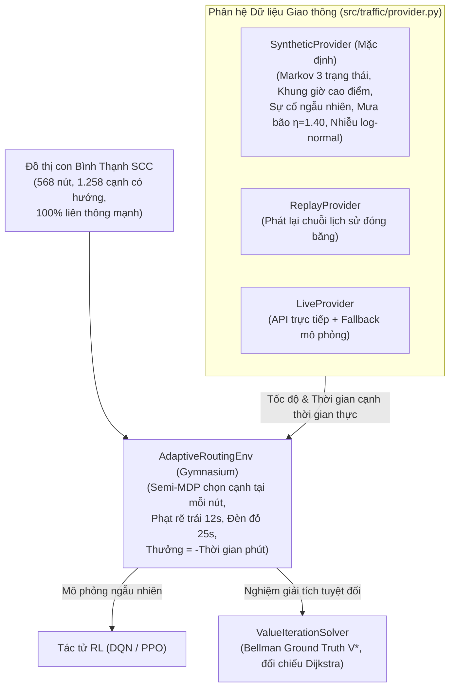

# Đặc Tả Kỹ Thuật Môi Trường Mô Phỏng & Kiểm Thử (02_ENVIRONMENT_SPEC.MD) — HotWAY

> **Tài liệu:** Đặc tả kỹ thuật mô hình giao thông `TrafficProvider`, môi trường Gymnasium `AdaptiveRoutingEnv`, giải thuật đối chứng giải tích `ValueIterationSolver` và kiểm định nghiệm thu Cổng G2  
> **Phiên bản:** v7.0.0 (Route Optimization & Adaptive Routing Edition)  
> **Ngày cập nhật:** 25/10/2026  
> **Trạng thái:** Hoàn tất nghiệm thu Cổng G2 (13/13 Tests PASS)  
> **Tài liệu liên quan:** [01_problem_formulation.md](file:///c:/Users/Asus/Documents/AI/HotWAY/docs/research/01_problem_formulation.md) | [DECISIONS.md](file:///c:/Users/Asus/Documents/AI/HotWAY/docs/DECISIONS.md)

---

## 1. Tổng Quan Kiến Trúc Môi Trường Mô Phỏng

Hệ thống môi trường HotWAY phục vụ cho bài toán tối ưu đường đi và điều phối thích nghi bao gồm 3 thành phần cốt lõi:

---

## 2. Đặc Tả Đồ Thị Mạng Đường Bộ (Road Network Subgraph)

Đồ thị thử nghiệm được trích xuất từ dữ liệu OpenStreetMap (OSM) TP.HCM (gốc 46.055 nút):
* **Phạm vi không gian:** Bán kính $1.2\text{ km}$ quanh trạm bưu cục/kho trung tâm Điện Biên Phủ, Quận Bình Thạnh ($10.8012^\circ\text{N}, 106.7145^\circ\text{E}$).
* **Cấu trúc tô-pô:** Đồ thị có hướng $\mathcal{G} = (\mathcal{V}, \mathcal{E})$ đã thu gọn (collapsed `nx.DiGraph`), bảo đảm **liên thông mạnh $100\%$ (Strongly Connected Component)**:
  * Số lượng nút: $|\mathcal{V}| = 568\text{ nút}$.
  * Số lượng cạnh có hướng: $|\mathcal{E}| = 1.258\text{ cạnh}$.
  * Bậc ra tối đa: $d_{\max}^{\text{out}} = 5\text{ cạnh/nút}$.
* **Hồ sơ tốc độ cơ sở theo loại đường xe máy (km/h):**
  $$\begin{cases}
  v_{\text{primary}} = 32.0, \quad v_{\text{secondary}} = 28.0, \quad v_{\text{tertiary}} = 24.0 \\
  v_{\text{residential}} = 20.0, \quad v_{\text{living\_street/service}} = 14.0, \quad v_{\text{default}} = 22.0
  \end{cases}$$

---

## 3. Đặc Tả Mô Hình Giao Thông (`src/traffic/provider.py`)

### 3.1. Phân loại 3 trạng thái tắc nghẽn Markov (`TrafficState`)
1. **`CLEAR` (Thông thoáng, 0):** Tốc độ đạt $100\%$ tốc độ cơ sở ($v = v_{\text{base}}$).
2. **`SLOW` (Chậm, 1):** Tốc độ giảm còn $56,25\%$ ($v_{\text{primary}} \approx 18.0\text{ km/h}$).
3. **`CONGESTED` (Kẹt xe, 2):** Tốc độ giảm còn $25,0\%$ ($v_{\text{primary}} \approx 8.0\text{ km/h}$).

### 3.2. Ma trận chuyển trạng thái Markov bảo toàn xác suất
Ma trận chuyển trạng thái $\mathbf{P} \in \mathbb{R}^{3 \times 3}$ thỏa mãn $\sum_{j=0}^2 P_{ij} = 1.0, \forall i$:
* **Giờ bình thường:**
  $$\mathbf{P}_{\text{normal}} = \begin{bmatrix} 0.85 & 0.12 & 0.03 \\ 0.25 & 0.65 & 0.10 \\ 0.10 & 0.35 & 0.55 \end{bmatrix}$$
* **Giờ cao điểm (7:00–9:00 & 17:00–19:00):**
  $$\mathbf{P}_{\text{peak}} = \begin{bmatrix} 0.60 & 0.30 & 0.10 \\ 0.10 & 0.60 & 0.30 \\ 0.05 & 0.25 & 0.70 \end{bmatrix}$$
  *Hiệu chỉnh trục lộ chính:* Trên đường `primary`/`secondary` trong giờ cao điểm, xác suất nhảy vào trạng thái `CONGESTED` tăng thêm $+0.08$.

### 3.3. Các yếu tố suy biến môi trường
* **Sự cố đột xuất ($p_{\text{incident}} = 0.03$):** Xác suất ngẫu nhiên tắc nghẽn cạnh, kéo dài $T_{\text{incident}} \sim \mathcal{U}(5.0, 20.0)\text{ phút}$.
* **Hệ số thời tiết mưa bão ($\eta_{\text{rain}} = 1.40$):** Tốc độ suy giảm $v \gets v / \eta_{\text{rain}}$ (thời gian di chuyển tăng $40\%$).
* **Nhiễu ngẫu nhiên Log-normal:** $v \gets v \cdot \exp(-\epsilon)$ với $\epsilon \sim \mathcal{N}(0, \sigma^2)$, $\sigma = 0.20$.
* **Giới hạn vật lý xe máy:** Tốc độ tức thời bị chặn trong khoảng $[v_{\min}, v_{\max}] = [3.0, 50.0]\text{ km/h}$.

---

## 4. Đặc Tả Môi Trường Gymnasium (`src/envs/adaptive_routing_env.py`)

### 4.1. Không gian trạng thái & Quan sát
Quan sát trả về vector phẳng kích thước $5 + 2 \cdot d_{\max}^{\text{out}}$ (với $d_{\max}^{\text{out}} = 5 \implies \text{dim} = 15$):
1. Tọa độ chuẩn hóa nút hiện tại: $(\hat{y}_u, \hat{x}_u) \in [0, 1]^2$.
2. Tọa độ chuẩn hóa nút đích: $(\hat{y}_D, \hat{x}_D) \in [0, 1]^2$.
3. Khung giờ trong ngày chuẩn hóa: $\hat{t} = (t \bmod 1440) / 1440 \in [0, 1]$.
4. Vector trạng thái kẹt xe các cạnh ra: $\mathbf{c}_u \in \{0.0, 0.5, 1.0\}^5$ (padding $-1.0$).
5. Vector chiều dài các cạnh ra: $\mathbf{l}_u \in \mathbb{R}_+^5$ (đơn vị km).

### 4.2. Không gian hành động & Mặt nạ hành động
* **Hành động:** `spaces.Discrete(5)`, tương ứng với chỉ số của cạnh đi tiếp trong danh sách các cạnh xuất phát từ $u$.
* **Mặt nạ hợp lệ (`action_mask`):** Mảng boolean kích thước $5$, chỉ cho phép chọn $a < \text{deg}_{\text{out}}(u)$. Nếu chọn sai mặt nạ, môi trường phạt $-2.0\text{ phút}$ và giữ nguyên vị trí.

### 4.3. Hàm phần thưởng & Đẳng thức tích lũy
Phần thưởng tại mỗi bước nhảy là số âm của tổng thời gian di chuyển (tính bằng phút):
$$r_t = - \frac{\Delta t_{\text{edge}}(u, v) + \Delta t_{\text{turn}} + \Delta t_{\text{signal}}}{60.0}$$
Trong đó:
* $\Delta t_{\text{turn}} = +12.0\text{s}$ nếu rẽ trái ($200^\circ - 340^\circ$), $+4.0\text{s}$ nếu rẽ phải, $+16.0\text{s}$ nếu quay đầu.
* $\Delta t_{\text{signal}} = +25.0\text{s}$ nếu nút đến $v$ có đèn tín hiệu giao thông hoặc $\text{deg}(v) \ge 4$.
* **Đẳng thức tích lũy:** Tại trạng thái kết thúc ($u = D$), phần thưởng bằng $0$, bảo đảm:
  $$\sum_{t=0}^T r_t = - \frac{\text{Tổng thời gian thực tế hành trình (giây)}}{60.0} = - T_{\text{trip}}\text{ (phút)}$$

---

## 5. Nghiệm Giải Tích Đối Chứng: Quy Hoạch Động Value Iteration

### 5.1. Phương trình tối ưu Bellman cho Bài toán Đường đi ngắn nhất Ngẫu nhiên (SSP)
Trên không gian trạng thái tĩnh hoặc dừng, giá trị tối ưu $V^*(u)$ thỏa mãn phương trình điểm bất động Bellman:
$$V^*(u) = \min_{v \in \text{Succ}(u)} \left[ c(u, v) + \gamma V^*(v) \right], \quad \forall u \ne D$$
Với điều kiện biên tại đích: $V^*(D) = 0.0$, hệ số chiết khấu $\gamma = 1.0$.

### 5.2. Tính hội tụ và Đối chứng Dijkstra (Ground Truth Verification)
* Do đồ thị liên thông mạnh và mọi chi phí cạnh $c(u, v) \ge \frac{l(u, v)}{v_{\max}} > 0$, thuật toán `ValueIterationSolver` bảo đảm hội tụ duy nhất về nghiệm tối ưu $V^*$ với ngưỡng sai số $\epsilon < 10^{-9}$.
* **Kiểm định đồng nhất tuyệt đối:** Khi triệt tiêu nhiễu giao thông ($\sigma = 0$), nghiệm $V^*(u)$ của Value Iteration **trùng khớp $100\%$ với độ dài đường đi ngắn nhất Dijkstra** trên toàn bộ 568 nút đồ thị với sai số tuyệt đối $< 10^{-7}\text{ phút}$:
  $$|V^*(u) - \text{Dijkstra}(u, D)| < 10^{-7}, \quad \forall u \in \mathcal{V}$$

---

## 6. Bảng Kết Quả Kiểm Thử Nghiệm Thu Cổng G2

Toàn bộ 13 ca kiểm thử tự động đã được thực thi và vượt qua tuyệt đối trên môi trường máy chủ:

| Phân hệ | Tệp kiểm thử | Số ca test | Nội dung kiểm định | Trạng thái |
|---|---|:---:|---|:---:|
| **Định tuyến T1** | `tests/test_multicriteria_routing.py` | 4 | Tính liên thông SCC, phân loại góc rẽ, bất biến $p90 \ge \bar{t}$, phi lấn át Pareto | **PASS (8.40s)** |
| **Giao thông G2** | `tests/test_traffic_provider.py` | 6 | Bảo toàn xác suất hàng $\sum P_{ij}=1.0$, tất định theo seed, giới hạn vận tốc $[3, 50]$, hệ số mưa $1.40$, suy thoái sự cố, fallback nhãn | **PASS (4.35s)** |
| **Môi trường G2** | `tests/test_adaptive_routing_env.py` | 3 | Tuân thủ Gym API, bảo toàn đẳng thức phần thưởng $\sum r_t = -T_{\text{min}}$, đối chiếu nghiệm Bellman $V^* \equiv \text{Dijkstra}$ ($< 10^{-7}$) | **PASS (2.77s)** |
| **Tổng cộng** | `pytest tests/ -v` | **13** | **Toàn bộ 13/13 ca kiểm thử vượt qua trong 7.61 giây** | **PASS** |
