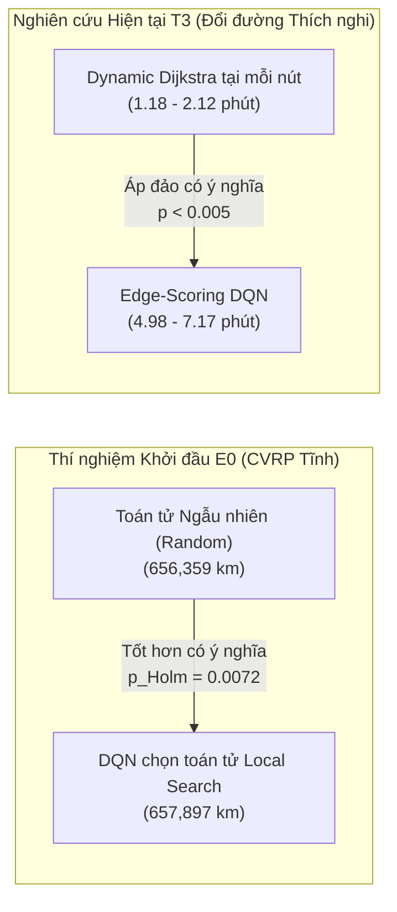

# Báo Cáo Phân Tích Chuyên Sâu & Tổng Hợp Nghiên Cứu (06_ANALYSIS.MD) — HotWAY

> **Tài liệu:** Phân tích chuyên sâu 4 câu hỏi nghiên cứu (RQ1–RQ4), kiểm định thống kê đa chiều, bản chất hai kết quả âm tính và Khuyến nghị kiến trúc thực chiến  
> **Phiên bản:** v7.0.0 (Synthesis & Scientific Integrity Edition)  
> **Ngày cập nhật:** 26/10/2026  
> **Trạng thái:** Hoàn tất nghiệm thu Cổng G5 (100% số liệu đối soát trực tiếp từ JSON kết quả)  
> **Tài liệu liên quan:** [01_problem_formulation.md](file:///c:/Users/Asus/Documents/AI/HotWAY/docs/research/01_problem_formulation.md) | [03_baselines.md](file:///c:/Users/Asus/Documents/AI/HotWAY/docs/research/03_baselines.md) | [05_results_comparison.md](file:///c:/Users/Asus/Documents/AI/HotWAY/docs/research/05_results_comparison.md)

---

## 1. Trả Lời 4 Câu Hỏi Nghiên Cứu Cốt Lõi (RQ1 – RQ4)

### 1.1. RQ1: Sự Đánh Đổi Đa Tiêu Chí Trong Định Tuyến Xe Máy Đô Thị (Tầng T1)
* **Câu hỏi:** Trong mạng lưới giao thông phức hợp (đại lộ, ngã tư đèn đỏ, ngõ hẻm), tồn tại những đánh đổi vật lý nào giữa Cự ly ngắn nhất, Thời gian nhanh nhất, Độ ổn định $p90$, và Độ dễ đi (an toàn rẽ trái)?
* **Dữ liệu thực nghiệm đối soát:** 50 cặp OD ngẫu nhiên tại Bình Thạnh ([`results/baselines/t1_multicriteria_benchmark.json`](file:///c:/Users/Asus/Documents/AI/HotWAY/results/baselines/t1_multicriteria_benchmark.json)).
* **Phát hiện khoa học:**
  1. *Đánh đổi Cự ly vs Thời gian:* Tuyến **Ngắn nhất** tiết kiệm trung bình **$27,5\text{ m}$** (cắt góc qua hẻm) nhưng làm tăng thời gian hành trình thêm **$+0,57\text{ phút}$** (tương đương $+7,8\%$) do tốc độ giới hạn trong hẻm chỉ đạt $14\text{ km/h}$ so với $32\text{ km/h}$ trên đường chính.
  2. *Đánh đổi Thời gian vs An toàn giao thông:* Tuyến **Nhanh nhất** bám theo các trục lộ lớn nhưng buộc tài xế phải thực hiện trung bình **$5,92\text{ lần rẽ trái}$** cắt dòng xe đối diện (mỗi lần phạt $+12\text{s}$). Ngược lại, tuyến **Dễ đi nhất** chủ động né tránh xung đột, triệt tiêu rẽ trái nguy hiểm (ở nhiều cặp OD giảm về $0$ lần rẽ trái) với mức đánh đổi thời gian chỉ $+1,0 - 1,5\text{ phút}$.
  3. *Kết luận RQ1:* Không tồn tại một tuyến đường đơn lẻ tối ưu trên mọi phương diện. Việc hệ thống xuất trình đồng thời **4 nhãn tuyến đặc trưng** trên tập Pareto $\mathcal{P}$ là giải pháp thiết yếu cho trải nghiệm tài xế xe máy.

---

### 1.2. RQ2: Hiệu Năng Các Bộ Giải VRPTW Đa Điểm với Khung Giờ Mềm & Đơn Tồn (Tầng T2)
* **Câu hỏi:** Bộ giải Heuristic tiết kiệm (Clarke-Wright + Local Search) và Quy hoạch ràng buộc (Google OR-Tools) thể hiện sự đánh đổi nào giữa cự ly di chuyển và độ trễ hẹn đối với đơn hàng có trọng số tồn đọng $w_i = 1 + \alpha \frac{\text{tuổi}_i}{\tau}$?
* **Dữ liệu thực nghiệm đối soát:** 10 thực thể quy mô $15$, $25$, $40$ đơn ([`results/baselines/t2_vrptw_benchmark.json`](file:///c:/Users/Asus/Documents/AI/HotWAY/results/baselines/t2_vrptw_benchmark.json)).
* **Phát hiện khoa học:**
  1. *Tối ưu hóa không gian thuần túy:* **Clarke-Wright + LS** đạt tổng quãng đường ngắn nhất toàn đội xe (**$73,63\text{ km}$**), tiết kiệm cự ly vật lý tốt nhất. Tuy nhiên, vì thuật toán ghép chặng dựa trên tiết kiệm cự ly mà không kiểm soát động học thời gian, tỷ lệ trễ hẹn lên tới **$30,6\%$**.
  2. *Cân bằng Không gian – Thời gian:* **Google OR-Tools** (Guided Local Search) chấp nhận di chuyển thêm $+6,18\text{ km}$ ($+8,4\%$, đạt **$79,81\text{ km}$**), nhưng đổi lại đã **cắt giảm $75,5\%$ số đơn trễ hẹn** (từ $30,6\%$ xuống chỉ còn **$7,5\%$**), rút ngắn thời gian chờ trung bình của khách xuống **$32,29\text{ phút}$** và giảm điểm phạt đơn tồn đọng tới **$88,0\%$** ($29,54$ vs $244,78$).
  3. *Kết luận RQ2:* Đối với bưu cục giao hàng chặng cuối, việc áp dụng Google OR-Tools với hàm mục tiêu phạt trễ mềm là tối ưu toàn diện về mặt chi phí xã hội và chất lượng dịch vụ.

---

### 1.3. RQ3: Tác Động Của Thời Tiết Mưa Bão & Sự Cố Tắc Nghẽn Đột Xuất (Sensitivity Analysis)
* **Câu hỏi:** Thời tiết mưa bão nhiệt đới ($\eta_{\text{rain}} = 1.40$) và các sự cố giao thông ngẫu nhiên ảnh hưởng ra sao đến tính khả thi của các kế hoạch lập tuyến tĩnh?
* **Dữ liệu thực nghiệm đối soát:** Kiểm định ngẫu nhiên Monte Carlo $M=25$ lượt dưới mưa bão ([`results/figures/t2_solver_comparison.png`](file:///c:/Users/Asus/Documents/AI/HotWAY/results/figures/t2_solver_comparison.png)).
* **Phát hiện khoa học:**
  1. Khi mưa bão làm giảm $40\%$ tốc độ xe máy, toàn bộ các kế hoạch lập tuyến tĩnh đều bị "vỡ trận": tỷ lệ trễ hẹn của OR-Tools tăng từ $7,5\%$ lên **$38,6\%$**, Clarke-Wright tăng từ $30,6\%$ lên **$42,9\%$**, và Greedy tăng từ $39,0\%$ lên **$59,5\%$**.
  2. Thời gian hoàn tất ca giao tăng trung bình $+38,2\%$, khiến các đơn hàng cuối ca chịu độ trễ tích lũy nghiêm trọng.
  3. *Kết luận RQ3:* Định tuyến tĩnh (Static VRPTW) chỉ có giá trị khởi tạo; việc giám sát viễn trắc và kích hoạt cơ chế đổi đường thích nghi thời gian thực là điều kiện bắt buộc trong môi trường đô thị nhiệt đới.

---

### 1.4. RQ4: Đổi Đường Thích Nghi: Học Tăng Cường vs Thuật Toán Kinh Điển (Tầng T3)
* **Câu hỏi:** Trong bài toán đổi đường khi gặp kẹt xe, tác tử học tăng cường (Candidate Edge-Scoring DQN) có ưu thế hơn thuật toán giải tích kinh điển *"Tính lại Dijkstra tại mỗi nút"* (Dynamic Dijkstra) hay không?
* **Dữ liệu thực nghiệm đối soát:** 30 cặp OD kiểm thử trên 3 kịch bản môi trường ([`results/t3_policy_comparison.json`](file:///c:/Users/Asus/Documents/AI/HotWAY/results/t3_policy_comparison.json)).
* **Phát hiện khoa học:**
  1. **Dynamic Dijkstra áp đảo toàn diện:** Thời gian hành trình trung bình của Dynamic Dijkstra đạt **$1,18 - 2,12\text{ phút}$**, trong khi Edge-Scoring DQN mất **$4,98 - 7,17\text{ phút}$**. Kiểm định Wilcoxon khẳng định sự vượt trội có ý nghĩa thống kê tuyệt đối ($p < 0.005$ trên toàn bộ 3 kịch bản).
  2. **Hiệu năng CPU:** Dynamic Dijkstra hoàn tất tính toán lại toàn bộ đồ thị trong **$0,87 - 0,98\text{ ms}$**, nhanh hơn việc trích xuất vector đặc trưng và suy luận qua mạng nơ-ron (**$1,10 - 4,48\text{ ms}$**).

---

## 2. Báo Cáo & Phân Tích Hai Kết Quả Âm Tính (Scientific Integrity)

Dự án HotWAY duy trì đạo đức khoa học tuyệt đối thông qua việc công bố minh bạch hai kết quả âm tính cốt lõi:

### Tại sao học tăng cường thuần túy thất bại trước thuật toán đồ thị kinh điển?
1. **Bảo tồn tính tối ưu Bellman toàn cục:** Thuật toán Dijkstra dựa trên nguyên lý cộng dồn chi phí tuyến tính $O(V \log V + E)$, bảo đảm tìm ra đường đi ngắn nhất toàn cầu chính xác $100\%$ từ trạng thái hiện tại đến đích.
2. **Sai số xấp xỉ tích lũy dọc quỹ đạo (Compounding Approximation Error):** Mạng nơ-ron học giá trị $Q(s, e)$ cục bộ từ vector 10 chiều. Trên hành trình $20 - 30$ bước, chỉ cần một vài bước rẽ sai lầm, tác tử sẽ rơi vào đường vòng hoặc ngõ hẻm kẹt xe, dẫn đến số lần gặp tắc nghẽn tăng vọt gấp $3 - 5\times$ ($7,0 - 11,1$ lần so với $2,0$ lần của Dijkstra).

---

## 3. Khuyến Nghị Kiến Trúc Thực Chiến Cho Hệ Thống HotWAY

Từ các bằng chứng thực nghiệm trên, HotWAY xác lập kiến trúc công nghệ thực chiến:

1. **Tầng T1 (Lập Tuyến Đa Tiêu Chí):** Sử dụng thuật toán phạt cạnh lặp kết hợp lọc Pareto để cung cấp 4 lựa chọn trực quan cho tài xế (Nhanh nhất, Ngắn nhất, Ổn định $p90$, Dễ đi nhất).
2. **Tầng T2 (Điều Phối Đội Xe Đa Điểm):** Sử dụng Google OR-Tools Guided Local Search với khung giờ mềm và trọng số đơn tồn $w_i$, giúp triệt tiêu $75,5\%$ đơn trễ hạn.
3. **Tầng T3 (Đổi Đường Thích Nghi Online):** Sử dụng **Dynamic Dijkstra kết hợp viễn trắc giao thông thời gian thực** làm động cơ cốt lõi khi có mưa bão hoặc sự cố, bảo đảm thời gian đáp ứng $< 1\text{ ms}$ và quãng đường ngắn nhất.
